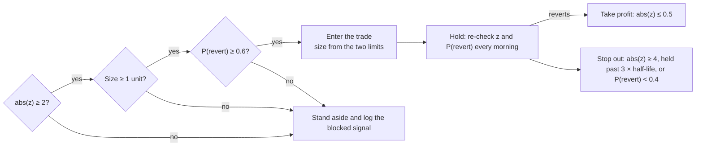

# Oil Complex Relative Value — Analysis Plan and Strategy

24 Oct 2026 · Ng Lei

> Equations use `$...$` (inline) and `$$...$$` (display) LaTeX, and the decision flow is a Mermaid diagram. Both render in GitHub, Obsidian, Typora, VS Code preview and Jupyter.

## Contents

- [The idea in one minute](#the-idea-in-one-minute)
- [Where the oil market stands (24 Oct 2026)](#where-the-oil-market-stands-24-oct-2026)
- [The three spreads and how to trade them](#the-three-spreads-and-how-to-trade-them)
- [Data: what to pull and from where](#data-what-to-pull-and-from-where)
- [The 10-step pipeline](#the-10-step-pipeline)
- [Trading rules, sizing and risk limits](#trading-rules-sizing-and-risk-limits)
- [Strategy for the sector now](#strategy-for-the-sector-now)
- [Extensions](#extensions)
- [Timeline, methods and caveats](#timeline-methods-and-caveats)
- [Sources](#sources)

---

## The idea in one minute

Trade the gaps inside the oil complex, not the price of oil. This is the same logic as the Project 2 2s10s trade, moved from the Treasury curve to the barrel.

In Project 2, the 2Y and 10Y yields both depend on the Fed path, so they are cointegrated: each wanders, but the gap between them is pulled back. In oil, three such ropes exist, and each is held by a physical arbitrage someone can actually do:

- **Crude vs products (the crack spread).** A refinery turns crude into gasoline and diesel. If the margin gets too wide, refiners run harder; if it goes negative, they cut runs.
- **Brent vs WTI.** Two crudes of similar quality in different places. The gap is held near the cost of shipping US crude abroad.
- **Front vs deferred futures (the curve).** Storage links today's barrel to next year's. The slope is tied to inventories.

Flat-price oil is close to a random walk, and in 2026 it moves on war headlines. Forecasting it means competing with every macro fund. The spreads are where a careful time-series model has a chance.

| Project 2 (2s10s) | Oil version |
| --- | --- |
| 2Y and 10Y yields | Crude and products · Brent and WTI · front and deferred contracts |
| Common driver: the Fed path | Common driver: the crude price, the seaborne arbitrage, inventories |
| Shocks to the gap: term premium, auctions, flows | Shocks to the gap: refinery outages, hurricanes, export capacity, Hormuz |
| DV01-neutral legs | Barrel-neutral legs (3:2:1 for the crack, 1:1 for Brent–WTI and calendars) |
| FRED DGS2, DGS10 | FRED and EIA spot prices, Bloomberg futures curves |
| Logit filter on FOMC and CPI dates | Logit filter on volatility, geopolitical risk, inventories and curve shape |

Two things are new compared with Project 2. Product cracks are strongly seasonal, so a SARIMA or STL step removes the seasonal pattern before any z-score is read. Oil also has larger and more frequent structural breaks, so the regime filter carries far more of the strategy's weight.

> **Read this first.** This is an educational research framework, not investment advice, and I'm not a financial advisor. The walk-forward backtest decides whether any of it would have made money.

---

## Where the oil market stands (24 Oct 2026)

The oil complex is in a war-driven stress regime: every spread this plan trades sits far from its history and moves violently. That is the setup where naive mean reversion loses money, so the regime filter (Step 07) matters more than the signal.

The shock began when [the US and Israel struck Iran in February 2026 and Tehran closed the Strait of Hormuz](https://24tv.ua/en/strait-of-hormuz_tag12152/). Flows have partly recovered: [more than 12 mb/d crossed in October, up from about 9 mb/d in September, despite 26 vessel attacks](https://www.newsbytesapp.com/news/world/strait-of-hormuz-shipments-top-12-million-bpd-despite-iranian-attacks/tldr), against a [pre-war 19–21 mb/d](https://1963macro.substack.com/p/escorted-backlogs-and-asian-flows).

| Indicator | Latest | Normal reference | Source |
| --- | --- | --- | --- |
| Brent futures | About $115/bbl on 23 Oct | Averaged $69 in 2025 | [Reuters via Discovery Alert](https://discoveryalert.com/news/us-rig-count-brent-114-drillers-october-2026/), [EIA STEO](https://www.eia.gov/pressroom/releases/press593.php) |
| WTI futures | About $101/bbl on 23 Oct | Usually $3–5 below Brent | [Reuters via Discovery Alert](https://discoveryalert.com/news/us-rig-count-brent-114-drillers-october-2026/) |
| Brent–WTI spot spread | Swung from $35 (12 Oct) to $7 (20 Oct) | Low single digits | [EIA spot via Crude Oil Now](https://crudeoilnow.com/news/weekly-recap.php) |
| 3-2-1 crack spread | $65/bbl average to 5 Oct, more than 2.5 times Oct 2025 | Median about $19 since 2006 | [RBN Energy](https://rbnenergy.com/daily-posts/analyst-insight/usgc-crack-spread-turns-down-volume-after-september-rally), [The Trading Tools](https://www.thetrading.tools/crack-spread) |
| Diesel minus gasoline crack | $49/bbl in September | Far smaller | [RBN Energy](https://rbnenergy.com/daily-posts/analyst-insight/usgc-crack-spread-turns-down-volume-after-september-rally) |
| Brent M1–M12 spread | Jumped from about $10 to $35 in the four weeks after the closure | A few dollars | [Parameta Solutions](https://www.parametasolutions.com/insights/extreme-brent-backwardation-managing-curve-dislocation-with-otc-oil-data/) |

Policy is leaning against the spike, mainly in diesel:

- **Stock releases.** [The G7 agreed on 2 October to release 100 million barrels over four months, with a front-loaded diesel release in the first 20 days.](https://www.euronews.com/2026/10/08/exclusive-g7s-100-million-barrel-pledge-tied-to-unfinished-march-emergency-oil-release) This completes the IEA's March action rather than adding to it. [IEA members still hold about 1.1 billion barrels, including over 200 million of diesel.](https://www.thenationalnews.com/business/energy/2026/10/07/iea-members-support-faster-release-of-reserve-oil-stocks/)
- **OPEC+.** [The seven core members kept September quotas for November on 4 October; the next meeting is 1 November.](https://newsonair.gov.in/opec-seven-countries-decide-to-maintain-september-2026-oil-production-quotas-for-november/)
- **Forecasts.** [EIA's October STEO has Brent at $105 in 4Q26, easing to $74 by 4Q27 as inventories rebuild.](https://www.eia.gov/outlooks/steo/pdf/steo_full.pdf) [Goldman puts the risk premium at slightly above $20/bbl.](https://discoveryalert.com/news/us-rig-count-brent-114-drillers-october-2026/) The next STEO is [10 November](https://www.eia.gov/outlooks/steo/data.php?ftag=YHF4eb9d17).

The key point for trading: steep backwardation means the futures curve already prices the fade. A forecast that prices will fall is not an edge on its own. The edge, if any, is in normalisation happening faster or slower than the curve implies, and in the relative spreads.

---

## The three spreads and how to trade them

The book trades the 3-2-1 crack and Brent–WTI as mean-reversion pairs, and uses the Brent curve slope mainly as a regime input. The crack is the flagship: it uses the most course methods (a three-variable Johansen VECM plus seasonality) and has the clearest physical anchor.

| Spread | Definition ($/bbl) | Legs per unit | P&L per $1/bbl move | What pulls it back | Core model |
| --- | --- | --- | --- | --- | --- |
| A. 3-2-1 crack (flagship) | (2 × RB × 42 + 1 × HO × 42 − 3 × CL) / 3 | 3 CL, 2 RB, 1 HO | $3,000 | Refiners raise or cut runs; product imports and exports | Johansen VECM, STL/SARIMA, GARCH |
| B. Brent–WTI | Brent − WTI, same delivery month | 1 Brent, 1 CL | $1,000 | US export arbitrage, capped by pipeline and dock capacity | Engle–Granger, ECM, GARCH |
| C. Brent curve slope | Brent M1 − M6 | 1 front, 1 deferred | $1,000 | Storage: inventories build when contango pays for them | OLS on inventories; used mainly as a filter input |

RB (RBOB gasoline) and HO (NY Harbor ULSD) are quoted in $/gallon; × 42 converts to $/bbl. Each NYMEX CL, RB and HO contract and each ICE Brent contract covers 1,000 barrels, so the legs above are barrel-neutral, which plays the role of DV01 neutrality in Project 2. A diesel-heavy 2-1-1 crack (2 CL, 1 RB, 1 HO) is a natural second version, given where the 2026 dislocation sits.

**Instruments you can reach from Singapore**

- **Futures (the real trade).** NYMEX CL, RB, HO and ICE Brent through a broker with CME and ICE access. Spreads trade as inter-commodity spreads with margin offsets. [CME's own trading-room note in July showed a short 3:2:1 built from 2 RB and 1 HO futures against 3 CL.](https://www.cmegroup.com/newsletters/fresh-from-the-trading-room/2026-07-14.html)
- **Micro WTI (100 barrels).** Useful for scaling the WTI leg down, but there is no matching micro RBOB or ULSD, so a small crack cannot be built exactly.
- **ETF proxies.** BNO (Brent) against USO (WTI) roughly tracks Brent–WTI, but the funds roll on different schedules and drift from the futures spread. Refiner ETFs such as [CRAK](https://www.etf.com/sections/features/vanecks-crak-tracks-oil-refiners-margins) hold equities, not the margin itself.

One full crack unit moves $3,000 per $1/bbl. With the crack's daily moves in dollars, a single unit is a large position for a personal account (see the sizing example). Paper-trading the futures version first is the sensible route. As a bank employee, also check your employer's personal-dealing policy before trading futures in your own account.

---

## Data: what to pull and from where

Free spot data is enough to build and test the signal; Bloomberg at SMU is needed for tradable futures curves. One trap: [EIA stopped publishing NYMEX futures prices after 5 April 2024](https://www.eia.gov/dnav/pet/pet_pri_fut_s1_d.htm), so older guides that point there for futures no longer work.

| Input | Source | Series or field | Frequency | Used in |
| --- | --- | --- | --- | --- |
| WTI and Brent spot | FRED (from EIA) | DCOILWTICO, DCOILBRENTEU | Daily | Spreads A, B |
| NY Harbor gasoline and ULSD spot | [EIA spot prices](https://www.eia.gov/dnav/pet/PET_PRI_SPT_S1_D.htm); FRED for gasoline | NYH conventional gasoline (FRED DGASNYH), NYH ULSD (EIA) | Daily, published weekly | Spread A |
| Futures curves (tradable prices) | Bloomberg at SMU | CL1–CL12, CO1–CO12, XB1–XB6, HO1–HO6 Comdty, with your own roll rule | Daily | All spreads, backtest |
| Front-month futures (rough check) | Yahoo Finance via yfinance | CL=F, BZ=F, RB=F, HO=F | Daily | Quick prototype only |
| US inventories and refinery runs | EIA Weekly Petroleum Status Report (API v2) | Crude ex-SPR, Cushing, gasoline and distillate stocks, refinery utilisation | Weekly (Wednesday) | Spread C fair value, filter |
| Crude oil implied volatility | FRED | OVXCLS (CBOE crude oil volatility index) | Daily | Filter |
| Geopolitical risk | Caldara–Iacoviello GPR index | Daily GPR | Daily | Filter |
| Speculative positioning | CFTC disaggregated Commitments of Traders | Managed money net in CL, RB, HO | Weekly (Friday) | Filter |
| Event dates | Built by hand | OPEC+ meetings, STEO and IEA report days, SPR releases, hurricane landfalls, Hormuz closure and reopening | Daily dummies | Filter, sub-period tests |
| Refiner equities and factors (optional sleeve) | WRDS: CRSP, Fama–French | VLO, MPC, PSX, PBF, DINO; market factor | Daily | Equity sleeve |
| Asian margins (optional) | Bloomberg | Singapore complex margins, Dubai cracks, Brent–Dubai EFS | Daily | Asia extension |

On 20 October the EIA spot sheet showed [NYH gasoline at $2.897/gal, NYH ULSD at $5.265/gal and WTI at $107.89](https://www.eia.gov/dnav/pet/PET_PRI_SPT_S1_D.htm). That puts the spot 3-2-1 crack near $47/bbl, with almost all of it from diesel: the diesel crack was about $113/bbl and the gasoline crack about $14/bbl. Spot and futures cracks differ, which is one reason to backtest on Bloomberg futures rather than spot.

WRDS is weak for commodity futures; use it only for the equity sleeve. Bloomberg's generic tickers roll mechanically on expiry, so build your own continuous series (roll about five business days before expiry) and keep the unadjusted prices for P&L.

---

## The 10-step pipeline

The pipeline keeps Project 2's ten steps and four phases, so the same code structure and group split carry over. Each step below says what changes for oil. Full runnable code is in `oil_rv_starter.py`.

| Phase | Steps | Question it answers |
| --- | --- | --- |
| Data | 01 Harvest · 02 Clean and align | Are the inputs clean and free of look-ahead? |
| Analysis | 03 Summary moments · 04 Diagnostics and seasonality · 05 Long-run link | Is there a stable relationship to trade? |
| Model | 06 VECM, half-life, z-score, GARCH · 07 Logit regime filter · 08 Rules | When to enter, exit, and how big? |
| Trade | 09 Walk-forward backtest · 10 Daily routine | Would it have made money, and how is it run? |

### Step 01 · Harvest

Pull the series in the data table from January 2007, when RBOB was the gasoline benchmark. Build an events file with `date` and `type` (OPEC, STEO, IEA, SPR, HURRICANE, HORMUZ). Use NY Harbor ULSD for the diesel leg throughout; the NYMEX heating oil contract has been ULSD since 2013.

### Step 02 · Clean and align

Oil data has more traps than Treasury yields:

- **Units.** RB and HO are $/gallon; multiply by 42 before any spread.
- **Contract months.** ICE Brent expires roughly a month before NYMEX WTI for the same delivery month. Compare the same delivery month, not front against front.
- **Rolls.** Roll about five business days before expiry. Keep unadjusted prices for P&L and back-adjusted ones for signals.
- **April 2020.** WTI settled negative on 20 April 2020. Work in price levels, not logs, and flag that week.
- **Weekly data timing.** Stamp EIA inventories on their Wednesday release, not the Friday week-end, or the backtest sees the future.

$$
\text{Crack}_{3\text{-}2\text{-}1} = \frac{2 \cdot 42 \cdot RB + 42 \cdot HO - 3 \cdot CL}{3}
$$

```python
def build_spreads(px):
    """px columns: cl, brent ($/bbl); rb, ho ($/gal)."""
    out = pd.DataFrame(index=px.index)
    out["rb_bbl"] = px["rb"] * 42
    out["ho_bbl"] = px["ho"] * 42
    out["crack321"] = (2 * out["rb_bbl"] + out["ho_bbl"] - 3 * px["cl"]) / 3
    out["brent_wti"] = px["brent"] - px["cl"]
    return out
```

### Step 03 · Summary moments

Tabulate mean, standard deviation, skew and excess kurtosis of daily spread changes, overall and by period: 2007–13, 2014–19, 2020, 2022, 2026. Expect very fat tails, which is why Step 06 uses a Student-t GARCH. The table also shows how far 2026 sits outside history.

### Step 04 · Diagnostics and seasonality

- **Unit roots.** ADF and KPSS on each price level (expect non-stationary) and on each spread (expect stationary, with breaks).
- **Rolling stationarity.** ADF p-value of each spread on a rolling three-year window. Plot it: it should show the 2011–13 Brent–WTI break, 2022 and 2026. This series becomes a filter input.
- **Seasonality.** STL decomposition of the monthly crack. Gasoline cracks tend to peak into the US driving season and diesel cracks in winter. Fit a SARIMA on the monthly crack as a forecasting baseline and check Ljung–Box on its residuals.

### Step 05 · Long-run link

- **Brent–WTI:** Engle–Granger. Regress Brent on WTI, test the residual with Engle–Granger critical values (`statsmodels.tsa.stattools.coint`), and test whether the slope equals 1.
- **Crack:** Johansen on (CL, RB, HO) levels. Expect rank 2, one cointegrating vector per product crack. Compare the estimated vector with the fixed 3:2:1 weights. Trade the fixed weights for execution, but only if the fixed-weight spread is also stationary.

```python
from statsmodels.tsa.vector_ar.vecm import coint_johansen, VECM

def johansen_rank(levels, k_ar_diff=1):
    j = coint_johansen(levels, det_order=0, k_ar_diff=k_ar_diff)
    rank = int((j.lr1 > j.cvt[:, 1]).sum())      # trace stats above 95% critical values
    return rank, j.evec[:, 0] / j.evec[0, 0]       # first vector, normalised on CL
```

### Step 06 · Model formation

- **VECM.** Fit with the Johansen rank. The adjustment coefficients (alpha) show which leg does the correcting. If products adjust and crude does not, the edge sits in the product legs.
- **Seasonal adjustment.** Remove month-of-year effects estimated inside the fitting window only, so summer gasoline strength is not read as a signal.
- **Half-life and z-score.** AR(1) on the deseasonalised spread over a 756-day window, re-estimated monthly, as in Project 2.
- **GARCH.** GARCH(1,1) with Student-t errors on daily spread changes gives tomorrow's dollar volatility for sizing.

$$
h = \frac{\ln 2}{-\ln b}, \qquad z_t = \frac{(S_t - \text{seas}_{m(t)}) - \mu}{\sigma}
$$

Here $b$ is the AR(1) coefficient of the deseasonalised spread, and $\mu$ and $\sigma$ are its window mean and standard deviation.

```python
def fit_window(spread):
    dev = spread - spread.mean()
    seas = dev.groupby(spread.index.month).mean()        # in-window seasonal effect
    resid = spread - spread.index.month.map(seas).values
    y, x = resid.iloc[1:].values, sm.add_constant(resid.iloc[:-1].values)
    b = sm.OLS(y, x).fit().params[1]
    half_life = np.log(2) / -np.log(b) if 0 < b < 1 else np.inf
    return {"mean": resid.mean(), "std": resid.std(), "seas": seas,
            "half_life": half_life, "adf_p": adfuller(resid, autolag="AIC")[1]}

def garch_sigma(spread, window=750):
    d = spread.diff().dropna().iloc[-window:]
    res = arch_model(d, mean="Zero", vol="GARCH", p=1, q=1, dist="t").fit(disp="off")
    return float(np.sqrt(res.forecast(horizon=1).variance.iloc[-1, 0]))
```

### Step 07 · Regime filter (logit)

The filter answers one question: given a 2σ signal today, will the spread revert? Label every past date with |z| ≥ 2 as 1 if |z| falls to 1 within 20 trading days without first touching 4, else 0. Fit a logit on these labels using only features known the evening before:

- OVX percentile and GARCH volatility percentile
- Daily geopolitical risk (GPR) index
- Rolling three-year ADF p-value of the spread (from Step 04)
- Brent M1−M6 slope as a share of price, and US inventories against their five-year seasonal average
- Managed-money net positioning z-score (CFTC)
- Hurricane-season dummy (June to November) and an event dummy for OPEC+, STEO or IEA days within three days

Train walk-forward only. Judge it by AUC, Brier score and a calibration plot, and run a probit as a robustness check. A trade needs P(revert) of at least 0.6.

### Step 08 · Final model and rules

See [Trading rules, sizing and risk limits](#trading-rules-sizing-and-risk-limits).

### Step 09 · Backtest honestly

Walk forward with monthly refits, signals from the previous close, and costs on every change in position. Use at least one tick per leg plus fees and roll costs; the test code charges $0.05/bbl per unit traded.

```python
def backtest(spread, window=756, refit=21, entry=2.0, exit_=0.5, stop=4.0,
             usd_per_bbl=3000, cost_bbl=0.05, filter_fn=None):
    pos, pnl, p, idx = 0, [], None, spread.index
    for t in range(window, len(spread)):
        if (t - window) % refit == 0:
            p = fit_window(spread.iloc[t - window:t])     # data up to t-1 only
        z = zscore(spread.iloc[t - 1], idx[t - 1], p)      # yesterday's close
        new = pos
        if pos == 0 and entry <= abs(z) < stop:
            if filter_fn is None or filter_fn(idx[t - 1]):
                new = -int(np.sign(z))
        elif pos != 0 and (abs(z) <= exit_ or abs(z) >= stop):
            new = 0
        cost = abs(new - pos) * cost_bbl * usd_per_bbl
        pnl.append(new * (spread.iloc[t] - spread.iloc[t - 1]) * usd_per_bbl - cost)
        pos = new
    return pd.Series(pnl, index=idx[window:])
```

Report the following, each with and without the filter:

- Sharpe, maximum drawdown, hit rate, average holding period against the half-life, worst trade, and the share of P&L from the five best trades
- Fixed 3:2:1 weights against Johansen weights
- Entry thresholds of 1.5, 2.0 and 2.5, and windows of 504, 756 and 1,008 days
- Each stress period on its own: 2011–13 Brent–WTI, 2020, 2022 and 2026

The test that matters most is whether the filter kept the strategy out of 2022 and 2026, not the full-sample Sharpe.

### Step 10 · Run it live from Singapore

NYMEX energy settles at 2:30 pm New York time. That is 2:30 am in Singapore until US clocks change on 1 November, then 3:30 am.

1. **Each morning (about 7 am SGT):** pull settles, update GARCH volatility, z-scores and P(revert), and check the events file for the next three days.
2. **Orders:** place spread orders around the US open (9:30 pm SGT now, 10:30 pm from 2 November), when the spread books are deepest.
3. **Wednesday:** the EIA inventory report lands at 10:30 pm SGT now, 11:30 pm after the change. Refresh the inventory features after it.
4. **Monthly:** refit the windows, the VECM and the logit, and log every parameter change.

---

## Trading rules, sizing and risk limits

A trade needs two green lights: the spread is at least 2σ from fair value, and the filter says reversion is likely. Size is the smaller of a volatility limit and a stop-loss limit. The thresholds match Project 2 so results are comparable.

| Rule | Setting |
| --- | --- |
| Entry | abs(z) ≥ 2.0 and P(revert) ≥ 0.6. Sell the spread when z > 0, buy it when z < 0 |
| Take profit | abs(z) ≤ 0.5 |
| Stop | abs(z) ≥ 4.0, or held longer than 3 × half-life, or P(revert) falls below 0.4 while in the trade |
| Event blackout | No new entries in the 24 hours before an OPEC+ meeting or a forecast hurricane landfall on the Gulf Coast |
| Estimation | 756-day window, refit monthly; seasonal effects estimated inside the window |
| Size | The smaller of the two limits below, capped at 3 units per spread |
| Book limits | Halve all sizes after a 10% drawdown; stop trading and review after 20% |



A failed check on any of the three gates leaves the book flat; in today's regime the size check alone usually stops the trade.

$$
N = \min\left( \left\lfloor \frac{R}{\hat\sigma_{t+1} \cdot M} \right\rfloor,\ \left\lfloor \frac{L}{(z_{\text{stop}} - z_{\text{entry}}) \cdot \sigma_w \cdot M} \right\rfloor \right)
$$

$R$ is the daily risk budget in dollars, $\hat\sigma_{t+1}$ the GARCH one-day volatility of the spread, $L$ the maximum loss per trade, $\sigma_w$ the window standard deviation, and $M$ the dollars per $1/bbl per unit ($3,000 for the crack, $1,000 for Brent–WTI).

**Worked example A: normal regime (illustrative inputs).** A $2m book with R = $6,000 a day and L = $40,000 a trade. The crack's z is +2.3, P(revert) is 0.68, GARCH σ̂ is $0.80/bbl and σ_w is $7/bbl.

- Volatility limit: 6,000 / (0.80 × 3,000) = 2.5, so 2 units.
- Stop limit: the stop is (4.0 − 2.3) × 7 = $11.90/bbl away; 40,000 / (11.90 × 3,000) = 1.12, so 1 unit.
- Trade 1 unit: sell 2 RB and 1 HO, buy 3 CL.
- Take profit is (2.3 − 0.5) × 7 = $12.60/bbl away, worth $37,800. The stop costs $35,700. Round-trip costs at $0.05/bbl are about $300.

**Worked example B: the 2026 regime (illustrative inputs).** Same book, but GARCH σ̂ is $2.50/bbl. The volatility limit is 6,000 / (2.50 × 3,000) = 0.8, so 0 units before the filter is even consulted. In a war regime the sizing rule alone keeps the book small; the filter is a second, independent brake.

Replace these inputs with your own estimates; they show the mechanics, not today's numbers.

---

## Strategy for the sector now

The strategy for the next few months is to build and paper-trade the engine while the regime is extreme, and to switch on normalisation trades only when the filter turns. The dislocations are the setup, not the signal. The best candidate is the diesel premium, because that is where the dislocation is largest and where policy is aimed.

**Why not fade now.** A 3-year z-score has said "extreme" all year, and fading it would have hurt. [CME's July note put early-June crack congestion near $45](https://www.cmegroup.com/newsletters/fresh-from-the-trading-room/2026-07-14.html); [by 18 August the 3-2-1 was $71.33](https://www.thetrading.tools/crack-spread). A June fade would have faced a move of about $26/bbl against it, roughly $79,000 per unit. The logit filter exists to block exactly that trade.

| Spread | Normal-regime trade | State now | Switch-on trigger | Candidate trade once on | Main risk |
| --- | --- | --- | --- | --- | --- |
| Diesel vs gasoline (HO − RB) | Fade the gap, seasonally adjusted | Diesel crack about $113/bbl, gasoline about $14 on 20 Oct spot | P(revert) ≥ 0.6, HO-crack GARCH volatility back under its 80th percentile, no Hormuz re-closure for 4 weeks | Sell HO, buy RB in Q1–Q2 2027 months; no crude leg, so less headline exposure | Cold winter; Russian refinery outages; diesel strength is normal in winter, so adjust seasonally |
| 3-2-1 crack | Fade at abs(z) ≥ 2 | About $65/bbl average early October, with a $19 long-run median | Same as above, on the 3-2-1 | Sell the crack in deferred months, 1 unit at most | The curve already prices part of the fall; you must beat the forward, not the spot |
| Brent–WTI | Fade wide spreads (sell Brent, buy WTI) | Spot spread swung from $35 to $7 within a week in October | Futures spread at z ≥ 2 with the filter on; ignore spot while Dated Brent is dislocated | Sell Brent, buy WTI, same delivery month | Gulf escalation; US export capacity lets the spread stay wide |
| Brent M1 − M6 | Monitor only | Steep backwardation across the curve | None; used as a filter input | No trade in this plan | The most headline-sensitive spread |

**Why diesel first.** The policy response is aimed at diesel. The G7 release front-loads diesel in its first 20 days and runs to about [February 2027](https://www.hellenicshippingnews.com/?p=1150554), and IEA members have said they will prioritise diesel. Selling diesel against gasoline keeps the bet on that dislocation and drops the crude price, the part most exposed to a headline.

**What not to do**

- Do not short outright crude because agencies forecast lower prices. The steeply backwardated curve already prices a large fall, so EIA's $74 for 4Q27 is not new information to the market.
- Do not trade spot spreads while Dated Brent and futures disagree. Signals come from futures in the same delivery month.
- Do not size from history's volatility. Use the GARCH forecast, which today shrinks positions to almost nothing.
- Do not add a filter feature after seeing the 2026 result. There are only a handful of stress episodes, so a filter tuned on them will look better than it is.

**Dates to watch**

- 1 November: OPEC+ seven-country meeting.
- Wednesdays: EIA inventory report.
- 10 November: next EIA STEO.
- 30 November: end of the Atlantic hurricane season.
- Through February 2027: the G7 stock release.

The strategy is a research plan, not a recommendation to trade any of these positions. It tells you which trades to test and the conditions under which the evidence would support them.

---

## Extensions

Three add-ons reuse the same pipeline. Each brings in a course method the core book does not use.

**Refiner equities against the crack (CAPM sleeve).** Refiners such as VLO, MPC, PSX, PBF and DINO earn the crack, but their share prices value the whole future margin path. [Consensus already expects a sharp jump in 2026 refining profit for this group.](https://www.spglobal.com/market-intelligence/en/news-insights/research/2026/09/us-refiners-set-for-sharp-2026-profit-growth-as-global-fuel-markets-tighten)

1. Regress each stock's excess return on the market (CAPM) and keep the residual return.
2. Relate the basket's cumulative residual to changes in the 12-month crack strip, not the prompt crack.
3. Trade large divergences, beta-hedged with an index future or ETF.

Data: CRSP and Fama–French factors on WRDS, strips from Bloomberg.

**Asia version.** Run the same pipeline on Singapore complex refining margins, Dubai cracks and the Brent–Dubai EFS from Bloomberg. Asian refiners depend most directly on Gulf crude, so these spreads carry the Hormuz shock most purely. It is also the version an Asia commodities or macro desk in Singapore would recognise.

**Hazard model for time to reversion.** Treat each trade as a spell that ends when the spread reverts. A discrete-time hazard (a logit on each day in the trade) estimates the chance of reversion on day k given no reversion so far. It gives a data-driven time stop in place of the fixed 3 × half-life.

---

## Timeline, methods and caveats

Eight weeks to a backtested, paper-traded book, with one gate before any real money. The Project 2 group split carries over: Group A owns Steps 01–04, Group B Steps 05, 06 and 08, Group C Steps 07 and 09.

1. **Week 1:** harvest FRED and EIA spot data, export Bloomberg curves, build the events file, agree the data format.
2. **Week 2:** summary moments, unit-root tests, rolling ADF, STL and SARIMA.
3. **Week 3:** Engle–Granger, Johansen, VECM, half-lives, GARCH.
4. **Week 4:** backtest engine without the filter, with costs and rolls.
5. **Weeks 5–6:** filter labels and features, walk-forward logit, robustness and stress-period tests.
6. **Week 7 (gate):** continue only for spreads whose filtered version is profitable out of sample and stays out of the 2022 and 2026 losses.
7. **Week 8 onward:** run the Step 10 routine on paper for at least three months.

| Course method | Where it is used | Step |
| --- | --- | --- |
| Summary moments, fat tails | Spread change distributions by period | 03 |
| ADF, KPSS, ACF/PACF, Ljung–Box | Unit roots, rolling stationarity, residual checks | 04 |
| STL decomposition, SARIMA | Crack seasonality and baseline forecast | 04, 06 |
| OLS and Engle–Granger | Brent–WTI long-run link, slope test | 05 |
| Johansen and VECM | Three-leg crack, adjustment speeds | 05, 06 |
| AR(1) half-life, z-score | Fair value and signal | 06 |
| GARCH(1,1), Student-t | Volatility forecast for sizing | 06, 08 |
| Logit, probit | Regime filter | 07 |
| Hazard model | Time to reversion (extension) | Extensions |
| CAPM | Refiner equity residuals (extension) | Extensions |

**Caveats**

- Spot and futures spreads differ, most of all during physical dislocations. Backtest on futures.
- Standard contracts are large: one crack unit moves $3,000 per $1/bbl, and margins in this regime are high.
- Few stress episodes means few filter labels, so the filter is easy to overfit.
- Fixed 3:2:1 weights are a convention; a refinery's real yields differ, and the relationship can drift.
- Personal-account trading in futures may be restricted by your employer's policy.

---

## Sources

- [EIA, Short-Term Energy Outlook, October 2026](https://www.eia.gov/outlooks/steo/pdf/steo_full.pdf) and [press release](https://www.eia.gov/pressroom/releases/press593.php)
- [EIA, daily spot prices](https://www.eia.gov/dnav/pet/PET_PRI_SPT_S1_D.htm) and [NYMEX futures page (discontinued after April 2024)](https://www.eia.gov/dnav/pet/pet_pri_fut_s1_d.htm)
- [IEA, Oil Market Report, October 2026](https://www.iea.org/reports/oil-market-report-october-2026)
- [Euronews on the G7 release](https://www.euronews.com/2026/10/08/exclusive-g7s-100-million-barrel-pledge-tied-to-unfinished-march-emergency-oil-release) and [The National on IEA stocks](https://www.thenationalnews.com/business/energy/2026/10/07/iea-members-support-faster-release-of-reserve-oil-stocks/)
- [Hellenic Shipping News on the G7 release timing](https://www.hellenicshippingnews.com/?p=1150554)
- [News on Air on the 4 October OPEC+ decision](https://newsonair.gov.in/opec-seven-countries-decide-to-maintain-september-2026-oil-production-quotas-for-november/)
- [RBN Energy on the Gulf Coast crack](https://rbnenergy.com/daily-posts/analyst-insight/usgc-crack-spread-turns-down-volume-after-september-rally) and [The Trading Tools crack history](https://www.thetrading.tools/crack-spread)
- [CME Group, Fresh from the Trading Room, 14 July 2026](https://www.cmegroup.com/newsletters/fresh-from-the-trading-room/2026-07-14.html)
- [Parameta Solutions on Brent backwardation](https://www.parametasolutions.com/insights/extreme-brent-backwardation-managing-curve-dislocation-with-otc-oil-data/)
- [Discovery Alert, Reuters prices on 23 October](https://discoveryalert.com/news/us-rig-count-brent-114-drillers-october-2026/) and [Crude Oil Now weekly recap](https://crudeoilnow.com/news/weekly-recap.php)
- [NewsBytes on October Hormuz flows](https://www.newsbytesapp.com/news/world/strait-of-hormuz-shipments-top-12-million-bpd-despite-iranian-attacks/tldr), [1963 Macro on pre-war flows](https://1963macro.substack.com/p/escorted-backlogs-and-asian-flows) and [24tv timeline](https://24tv.ua/en/strait-of-hormuz_tag12152/)
- [S&P Global on US refiners](https://www.spglobal.com/market-intelligence/en/news-insights/research/2026/09/us-refiners-set-for-sharp-2026-profit-growth-as-global-fuel-markets-tighten)
- [ETF.com on CRAK](https://www.etf.com/sections/features/vanecks-crak-tracks-oil-refiners-margins)
