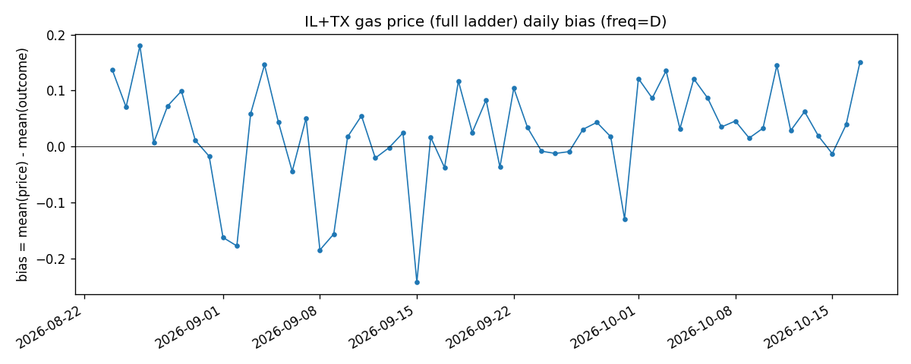
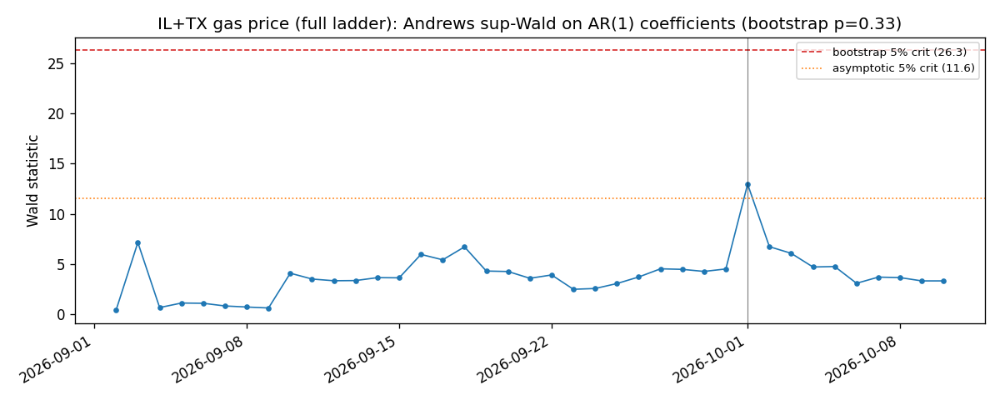

# Prediction Market Calibration — Draft Code

Companion code for `Project/Prediction_Markets_Proposal.docx`. Implements
Stage 1 (measurement: calibration curve), Stage 2 (significance: logit
fit), Stage 4 (persistence: does this period's bias predict next period's?),
and Stage 5 (out-of-sample test) end to end. Stages 3 and 6 are scoped but
not written yet — see `src/models/roadmap_stages_3to6.py`.

**Full reasoning trail**: this project went through several data sources
before landing on the current one — see `DECISIONS.md` for the complete,
append-only history (why the general Kalshi feed doesn't work, why
`KXTRUMPAPPROVE` was tried and then found to be the wrong population for
Stages 1/2/5, why Polymarket is currently blocked, and the two ladder-data
reconstruction attempts, one of which turned out to have a selection-bias
flaw). This README describes current best understanding only.

## Current status (read this first)

**Primary dataset: a "full ladder" reconstruction of Kalshi's continuous
threshold-strike markets (gas prices, commodities, FX, Treasuries), with
genuinely uncertain early-snapshot prices instead of near-certain
settlement-time prices** — see `DECISIONS.md` D005-D008 for the full
diagnosis and `src/data/ladder_atm.py` for the implementation. Validated
on **11 series across 4 asset classes** (5 gas-price states, 3 commodities
— gold/Brent oil/silver, 2 FX pairs — GBP/JPY, 2 Treasury-yield tenors —
5Y/30Y), 10,229 observations across 66 days (`data/raw_kalshi_ladder_
expanded.parquet`; see D008):

- **Stage 1 (calibration)**: the same sharp, classic, statistically
  significant favorite-longshot bias found on gas alone — longshots
  overpriced, favorites underpriced — holds up pooled across all 4 asset
  classes (details below).
- **Stage 2 (logit)**: converges cleanly, no quasi-separation. Pseudo
  R²=0.54. `price` itself is highly significant; unlike the 2-series gas
  result, `price²` is not significant here (p=0.36) — plausibly diluted by
  pooling asset classes with somewhat different calibration-curve shapes,
  not yet confirmed either way (see D008).
- **Stage 5 (OOS)**: the correction beats raw price under *both* a
  fraction split (+0.0043 Brier) and a genuine time split (+0.0043 Brier,
  cutoff 2026-09-30) — same sign, nearly identical magnitude on both
  splits, same qualitative pattern as the gas-only result (smaller in
  absolute Brier terms, consistent with a real but more modest pooled
  effect, not a contradiction).
- **Stage 4 (persistence)**: runs end to end on 64 daily periods. Level is
  non-stationary; differenced series is stationary with a substantial
  *negative* AR(1) coefficient (day-to-day bias swings partially reverse
  rather than persist), but residuals still fail Ljung-Box at some lags —
  not yet a fully clean diagnostic story, same unresolved gap as the
  gas-only result. Andrews sup-Wald break test: no significant break
  (bootstrap p=0.194) — a third dataset now agreeing that this project's
  break tests don't support a single sharp regime change anywhere tried.

**Caveat carried forward, not hidden**: Treasury series have much shorter
settled history (~9 days) than gas/commodities/FX (28-57 days), so they're
under-represented in Stage 4's 64-period series relative to the other
asset classes. More Treasury history (as it accumulates) and more
FX pairs/commodities are the natural next step — same spirit as before,
one level up. The original 2-series gas-only result (`DECISIONS.md` D007)
is kept below for reference since it's the cleaner, higher-R² fit on a
single asset class; the 11-series result above is the one to trust for
"does this generalize beyond gas prices."

**Everything else (the general Kalshi feed, `KXTRUMPAPPROVE`,
Polymarket, and a first ladder-reconstruction attempt that turned out to
have a selection-bias flaw) is still in the codebase and still tested, but
is no longer the basis for this project's headline findings** — see
`DECISIONS.md` for why each one was tried and retired.

## Reproducing the 11-series result

```bash
python scripts/pull_kalshi_ladder_atm.py --mode full \
    --series KXAAAGASDIL KXAAAGASDTX KXAAAGASDCA KXAAAGASDNY KXAAAGASDFL \
             KXGOLDD KXBRENTD KXSILVERD KXGBPUSDAD KXUSDJPYAD KXUST5A KXUST30A \
    --out data/raw_kalshi_ladder_expanded.parquet

python scripts/run_calibration.py --panel-path data/raw_kalshi_ladder_expanded.parquet
python scripts/run_oos.py --panel-path data/raw_kalshi_ladder_expanded.parquet --split fraction --train-frac 0.7
python scripts/run_oos.py --panel-path data/raw_kalshi_ladder_expanded.parquet --split time --cutoff 2026-09-30
python scripts/run_stage4.py --panel-path data/raw_kalshi_ladder_expanded.parquet --freq D --min-markets-per-period 1 --min-periods 24
python scripts/plot_stage4.py --panel-path data/raw_kalshi_ladder_expanded.parquet \
    --prefix stage4_expanded --label "11-series expanded (gas+commodities+FX+treasuries)" \
    --freq D --min-markets-per-period 1
```

## Setup

```bash
python -m venv .venv && source .venv/bin/activate
pip install -r requirements.txt
```

## Quickstart

```bash
# pull the primary dataset (every strike's early price, no selection on
# the outcome -- see DECISIONS.md D005-D007 for why this is the clean method)
python scripts/pull_kalshi_ladder_atm.py --mode full \
    --series KXAAAGASDIL KXAAAGASDTX --out data/raw_kalshi_ladder_full.parquet

# Stage 1 + 2: calibration curve + logit fit
python scripts/run_calibration.py --panel-path data/raw_kalshi_ladder_full.parquet

# Stage 5: does the correction beat the raw price out of sample?
python scripts/run_oos.py --panel-path data/raw_kalshi_ladder_full.parquet --split fraction --train-frac 0.7
python scripts/run_oos.py --panel-path data/raw_kalshi_ladder_full.parquet --split time --cutoff 2026-09-25

# Stage 4: is this period's average bias predictive of next period's?
python scripts/run_stage4.py --panel-path data/raw_kalshi_ladder_full.parquet \
    --freq D --min-markets-per-period 1 --min-periods 24

# Stage 4 figures (bias series, ACF/PACF, residual diagnostics, break-test profile)
python scripts/plot_stage4.py --panel-path data/raw_kalshi_ladder_full.parquet \
    --prefix stage4_ladder_full --label "IL+TX gas price (full ladder)" \
    --freq D --min-markets-per-period 1

# unit tests (no network needed -- pure logic on toy data)
pytest tests/
```

Every script above also still accepts `--platform`/`--kalshi-path` for the
older raw-pull-plus-harmonize path (`pull_kalshi.py`, `pull_polymarket.py`)
if you want to reproduce any of the retired findings in `DECISIONS.md`.

## Stage 1/2 — calibration & significance: the favorite-longshot bias finding

### Method

Stage 1 buckets markets by `implied_prob` and compares `mean_price` to
`mean_outcome` per bucket (`src/measures/calibration.py::bucket_calibration`)
— a perfectly calibrated market has every bucket sitting on the 45° line.
Stage 2 fits `outcome ~ price + price²` by logistic regression
(`src/models/stage2_logit.py`) as the significance test for whatever bend
the bucket chart shows.

**The hard part wasn't the stats, it was getting `implied_prob` right.**
Kalshi's continuous-value series (gas prices, FX, commodities, Treasury
yields) are built as a *ladder* of threshold-strike markets settling on
the same day — e.g. "will Illinois gas be above $4.6850 today?",
"above $4.6900?", ... ~15-20 strikes per day. Using the price right before
settlement (`last_price_dollars`) as `implied_prob` makes almost every
strike look near-certain, because by settlement time the day's real value
is already known — that's an artifact of reading the price too late, not
a property of the market. The fix (`src/data/ladder_atm.py`): pull an
*early* candlestick snapshot (a fraction of the way between `open_time`
and `close_time`, before the day's outcome is known) for **every** strike,
not a subset selected after the fact. See `DECISIONS.md` D005-D007 for how
this was diagnosed (confirmed via real candlestick data: a near-the-money
strike's bid moved 0.27 → 0.50 → 0.36 mid-day before settling near 0.98)
and why an earlier attempt that selected only the 1-2 strikes nearest the
*realized* value (cheaper, ~1/10th the API calls) had to be discarded — it
conditions the sample on the outcome, mechanically forcing a ~50/50 base
rate regardless of what the early price said.

### Result (2 series: `KXAAAGASDIL`, `KXAAAGASDTX`, 2046 observations, 55 days)

| price bucket | mean price | mean outcome | n | bias | se |
|---|---|---|---|---|---|
| 0.0–0.1 | 0.035 | 0.018 | 445 | +0.017 | 0.006 |
| 0.1–0.2 | 0.149 | 0.063 | 143 | +0.086 | 0.020 |
| 0.2–0.3 | 0.248 | 0.065 | 124 | +0.184 | 0.022 |
| 0.3–0.4 | 0.354 | 0.088 | 136 | +0.266 | 0.024 |
| 0.4–0.5 | 0.464 | 0.218 | 188 | +0.246 | 0.030 |
| 0.5–0.6 | 0.544 | 0.717 | 138 | −0.173 | 0.038 |
| 0.6–0.7 | 0.648 | 0.838 | 105 | −0.191 | 0.036 |
| 0.7–0.8 | 0.753 | 0.906 | 85 | −0.153 | 0.032 |
| 0.8–0.9 | 0.853 | 0.948 | 153 | −0.095 | 0.018 |
| 0.9–1.0 | 0.974 | 0.996 | 529 | −0.023 | 0.003 |

This is the **classic favorite-longshot bias direction**: low/mid-priced
("longshot") strikes are *overpriced* relative to how often they actually
resolve YES (bias at the 0.2-0.5 buckets is +0.18 to +0.27, 7-11 standard
errors from zero), and higher-priced ("favorite") strikes are
*underpriced* (bias −0.15 to −0.19 through the 0.5-0.8 range). Only the
top decile (90-100% priced) is close to perfectly calibrated. Brier score
on the raw price: 0.081, vs. 0.250 for the base-rate benchmark.

The Stage 2 logit converges cleanly with no quasi-separation warning
(unlike the earlier `KXTRUMPAPPROVE` attempt — see `DECISIONS.md` D003):
Pseudo R²=0.669, and `const`, `price`, `price²` are all significant at
p<0.01 (`run_calibration.py --panel-path data/raw_kalshi_ladder_full.parquet`
prints the full `statsmodels` summary).

### Next step

Scale the same `--mode full` pull to the other asset classes already
identified in `DECISIONS.md` D006's series scan (commodities, FX,
Treasuries) to check whether this pattern generalizes beyond gas-price
markets specifically, or reflects something particular to how AAA's daily
gas-price index gets reported and traded.

## Stage 5 — out-of-sample result

Does the Stage 2 correction actually beat trusting the raw market price,
out of sample? (`src/models/stage5_oos.py`, `scripts/run_oos.py`.)

**Current result (same 2-series panel as Stage 1/2 above)**:

| split | n train | n test | Brier (raw) | Brier (corrected) | improvement |
|---|---|---|---|---|---|
| fraction (70/30) | 1432 | 614 | 0.0903 | 0.0665 | **+0.0238** |
| time (cutoff 2026-09-25) | 1234 | 812 | 0.0819 | 0.0604 | **+0.0216** |

Both splits agree in sign and rough magnitude, and both decisively beat
the base-rate benchmark (~0.24). This is the first out-of-sample result in
this project that doesn't flip sign between pulls or depend on a
same-day/random split being mistaken for a genuine across-time test — see
`DECISIONS.md` D001 for the earlier general-pull results that *did* flip
sign (+0.0081 on one ~10k-market pull, −0.0039 on an independent ~5k-market
pull, both spanning under a day of `close_time`) and D003 for why
`KXTRUMPAPPROVE`'s version of this test had artificially tiny,
untrustworthy Brier scores (0.00019 vs. 0.0000316 — both near-zero because
most of that pull's markets were nearly certain either way, not because
the correction was unusually effective).

## Stage 4 — persistence (and the statistical foundations roadmap)

### Method: the full Box-Jenkins cycle, not just "assume AR(1)"

Stage 4 asks whether this period's average favorite-longshot bias predicts
next period's — the same question VRP's own Stage 1 asks of the variance
risk premium. The original one-line idea for this stage was "monthly bias
series -> OLS of bias_t on bias_{t-1}," i.e. assume AR(1) and fit it. What's
actually built in `src/models/stage4_persistence.py` goes further, because
assuming the order is exactly the kind of shortcut that caused a real,
documented problem on the VRP side of this repo (a frozen AR(1) control
that turned out to be missing a second lag, found only months later by a
residual diagnostic nobody had run yet). The pipeline, in order:

1. **Aggregate.** Group every resolved market by the calendar period it
   closed in — `freq` is a parameter (`"M"` monthly, `"D"` daily, any
   pandas period alias), not hardcoded, because the right bucket size
   depends on how the underlying series actually settles. `bias_t =
   mean(implied_prob) - mean(outcome)` that period (same sign convention
   as Stage 1's `bucket_calibration`: positive means markets were
   overpriced). Periods with too few markets are *flagged*, not silently
   dropped — dropping one would leave a gap in what's supposed to be an
   evenly-spaced series, which would corrupt every lag computed after it.
2. **Identify (ACF/PACF).** Look at the series' own autocorrelation and
   partial autocorrelation before deciding how many lags of memory it
   actually has, instead of assuming AR(1) by default.
3. **Check stationarity (ADF).** A series that's trending or wandering
   (no fixed mean to revert to) makes any AR coefficient fit on it
   potentially spurious — nonsense that looks like a real relationship
   purely because both sides of the regression are drifting together.
4. **Fit (AIC-selected AR(p)).** Pick the order via
   `statsmodels.tsa.ar_model.ar_select_order` (the same tool and
   discipline as VRP's own `ar_baseline.py` / `driver_surprises.py`),
   then fit one full-sample OLS regression — not a walk-forward forecast.
   This stage is descriptive (does memory exist at all?); Stage 5 above
   already owns the separate out-of-sample question.
5. **Diagnose (Ljung-Box, ARCH-LM).** Check the fitted model's residuals
   for leftover structure (Ljung-Box) and for volatility clustering
   (ARCH-LM).
6. **Difference and re-test, if needed.** If step 3 found the level
   series non-stationary, difference it once (`x_t - x_{t-1}`) and repeat
   steps 2–5 *on the differenced series* — a model fit on a non-stationary
   series can look perfectly reasonable and still be spurious.
7. **Structural-break check.** An Andrews (1993) sup-Wald test for a break
   in the AR(p) coefficients at an unknown date, with a Hansen (2000)
   fixed-regressor wild bootstrap for the headline p-value (ported from
   VRP's own `main:src/models/stage3.py` — see `sup_wald`/
   `ar_structural_break_test`/`supwald_null` in `stage4_persistence.py`).
   Exists specifically so an eyeballed "exclude this noisy-looking window"
   cut can be checked against a principled test rather than trusted
   because it happens to clean up the diagnostics — see `DECISIONS.md` D002
   for the episode (on `KXTRUMPAPPROVE`) that motivated building this.

Run it: `python scripts/run_stage4.py --panel-path data/raw_kalshi_ladder_full.parquet
--freq D --min-markets-per-period 1 --min-periods 24` (flags: `--freq`,
`--min-markets-per-period`, `--max-p`, `--min-periods`, `--force-difference`,
`--drop-flagged`, `--panel-path`/`--kalshi-path` — see the script's docstring).
Figures: `python scripts/plot_stage4.py --panel-path
data/raw_kalshi_ladder_full.parquet --prefix stage4_ladder_full --label
"IL+TX gas price (full ladder)" --freq D --min-markets-per-period 1`.

### Result so far (same 2-series panel as Stage 1/2/5 above)



- **55 daily periods**, 0 flagged as thin.
- **Level ADF: borderline non-stationary** (p=0.325) — the series visibly
  oscillates around a roughly constant level with no obvious trend (see
  figure above), so this reads more like ADF's known low power at this
  sample size than a genuine unit root, but it isn't confirmed either way.
- **AIC selects AR(1)** on the level (φ≈0.22), but since ADF didn't clear
  the stationarity bar, the orchestrator differenced once: the differenced
  series is strongly stationary (p≈0.0000), and AIC selects **AR(3)** on
  it (coefficients ≈ −0.51, −0.32, −0.28).
- **Not a fully clean diagnostic story**: the differenced AR(3)'s
  residuals still fail Ljung-Box at some tested lags — there's leftover
  structure an AR(3) on the differenced series doesn't fully capture.
- **Structural-break test**: Andrews sup-Wald = 12.96, best candidate
  break date 2026-10-01, **bootstrap p=0.332 — not significant** (the
  naive asymptotic p=0.027 would look significant, the same
  over-rejection pattern already documented for `KXTRUMPAPPROVE` in
  `DECISIONS.md` D002, which is exactly why the bootstrap is the headline
  number here, not the asymptotic one).



**Honest reading**: Stage 4 runs end to end on real, clean (Stage-1/2/5-
validated) data for the first time, but doesn't yet have a fully resolved
persistence story — there's genuine leftover structure in the differenced
residuals that a higher AR order alone doesn't fix, and no evidence of a
single sharp break to explain it. Worth revisiting once the Stage 1/2/5
pull is scaled to more series (more data, and pooling the IL+TX day-level
bias may itself be averaging over two somewhat-different regional
dynamics, which could be part of what the AR(3) is failing to capture
cleanly).

### Statistical foundations roadmap (not implemented this round — a concrete checklist for next time)

This project is also a deliberate place to practice statistical foundations
more broadly; the following are scoped out of *this* round on purpose, not
overlooked, so the next pass has a precise list rather than a vague sense
of "more could be done":

- **Stage 1 (measurement).** A Brier score decomposition (Murphy, 1973:
  reliability + resolution − uncertainty) would separate "how well
  calibrated" from "how discriminating" — right now one Brier number
  conflates both. Isotonic regression is worth trying alongside the Stage 2
  logit as a non-parametric alternative calibration correction, since it
  makes no assumption about the correction curve's shape. A probit fit
  alongside the logit would be a cheap robustness check on the link-function
  choice.
- **Stage 2 (significance).** The bucket chart in Stage 1 shows the
  calibration curve bending away from the 45° line, but nothing yet tests
  *as a whole* whether that bend is statistically significant beyond the
  logit's own coefficients — a Hosmer-Lemeshow goodness-of-fit test would.
  Deviance/Pearson residuals and a link-function test (the logit analogue
  of Ramsey's RESET test) are the other standard GLM diagnostics missing.
- **Stage 3 (drivers, not yet built).** Its own roadmap above already
  flags the open question correctly: markets on the same event are not
  independent draws, and may need cluster-robust standard errors (the
  cross-sectional sibling of VRP's HAC correction — same sandwich-estimator
  idea, different correlation structure). Once several covariates are
  tested at once, a Holm/Bonferroni correction across them becomes relevant
  too, for the same reason VRP's Q2 needed one across 8 predictors × 3
  horizons.
- **Stage 4 (this stage).** Plain OLS standard errors were used for the
  AR(p) fit, not HAC/Newey-West — worth adding given the ARCH-LM/leftover-
  structure findings above, alongside the Stage 3 clustering question. A
  Diebold-Mariano test on Stage 5's Brier-loss differential would also turn
  "the correction beats raw price" into a formal significance test rather
  than a point-estimate comparison. A variance-specific break test (or a
  Markov-switching-in-variance model) is the right tool if the ARCH-LM
  question above is revisited, rather than reaching for GARCH directly at
  this sample size.
- **Cross-cutting.** A hierarchical/partial-pooling model for
  platform × category effects (letting each group's calibration curve be
  shrunk toward a shared one, rather than either pooling everything or
  splitting into fully separate fits) would be a more principled version
  of the "pool vs. split" choice described below. `time_to_resolution_days`
  (already planned as a Stage 3 covariate) could be modeled properly as a
  survival/duration process instead of a single linear control. Stage 6's
  Bayesian updating is the one piece of this whole project with a genuinely
  different inferential philosophy from VRP's entirely frequentist toolkit.

## Kalshi vs. Polymarket — which one, or both?

**Kalshi only, for now** — Polymarket's API (both Gamma and CLOB) returns
`403 Forbidden` from this development environment (confirmed via direct
`requests`, raw `curl`, and `WebFetch` — a network security gateway
blocking the domain, not a code or data problem; Kalshi's API works fine
from the same environment). See `DECISIONS.md` D004. If Polymarket becomes
reachable, `harmonize_polymarket` in `src/data/align.py` is already
wired up except for `implied_prob`, which is still a hardcoded `NaN`
placeholder — would need `get_price_history()` wired in before any of
Stage 1/2/5 could run on it.

**Can they be combined, if that changes?** Yes, but not naively — there
are real differences to account for, not just a schema mismatch:

| | Kalshi | Polymarket |
|---|---|---|
| Settlement | Kalshi itself, by stated contract rules | UMA oracle + dispute window |
| Regulation | CFTC-regulated exchange | Offshore, unregulated |
| Price units | Dollars, $0–$1 (already a probability) | Decimal outcome price, 0–1 |
| Typical fees | Small, price-dependent trading fee | ~0 trading fee, but gas + slippage |
| Category strength | US economics, Fed, politics | Crypto, global politics, pop culture, sports |

`src/data/align.py` harmonizes both into one schema and keeps a `platform`
column specifically so every downstream regression (Stage 3 onward) can
control for platform (or be run per-platform and compared) rather than
assuming Kalshi and Polymarket rows are interchangeable draws from the same
data-generating process. The one thing *not* yet reconciled: `volume` is
on different scales across platforms (contract counts vs. notional-ish
dollar volume) — treat it as within-platform-only until that's fixed.

## API access notes

Kalshi's **market data** endpoints used here are public — no account, API
key, or auth header required. (An API key would only be needed to place
real orders, which this project doesn't do.)

- `GET https://api.elections.kalshi.com/trade-api/v2/markets` — try it
  directly in a browser or `curl`, no setup needed. Docs:
  https://docs.kalshi.com/api-reference/market/get-markets
- `GET https://api.elections.kalshi.com/trade-api/v2/series/{series_ticker}/markets/{ticker}/candlesticks`
  — used by `src/data/kalshi_client.py::get_candlestick_snapshot` for the
  early-price reconstruction above. Docs:
  https://docs.kalshi.com/api-reference/market/get-market-candlesticks

Polymarket's docs (`GET https://gamma-api.polymarket.com/markets?closed=true`,
`GET https://clob.polymarket.com/prices-history?market=<token_id>`) are at
https://docs.polymarket.com/api-spec/gamma-openapi.yaml and
.../clob-openapi.yaml, for whenever network access allows revisiting it.

APIs do change — if a pull script errors on an unexpected field or 404,
check the live docs link in the relevant client file before assuming the
code is wrong.

## Layout

```
src/data/        kalshi_client.py, polymarket_client.py, align.py,
                 ladder_atm.py        (full-ladder/ATM panel reconstruction)
src/measures/    calibration.py       (Stage 1)
src/models/      stage2_logit.py      (Stage 2)
                 stage4_persistence.py  (Stage 4, incl. plot_*/sup_wald functions)
                 stage5_oos.py        (Stage 5)
                 roadmap_stages_3to6.py  (Stages 3, 6 -- TODO; Stage 4 implemented)
scripts/         pull_kalshi.py, pull_polymarket.py, pull_kalshi_ladder_atm.py,
                 run_calibration.py, run_oos.py, run_stage4.py, plot_stage4.py
tests/           unit tests, no network required
data/            gitignored raw pulls land here
outputs/figures/  generated PNGs (tracked in git, like the main VRP branch's outputs/figures/ --
                 regenerate any of them with the corresponding plot_*.py script rather than
                 editing by hand)
DECISIONS.md     append-only log of why the data source/methodology changed over time
```
