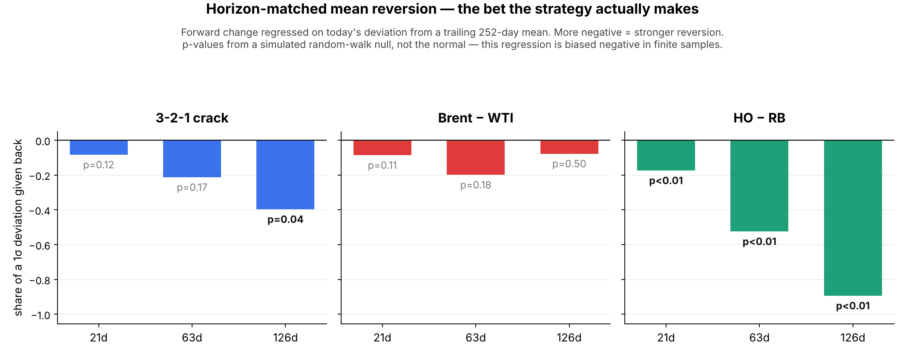

# Summary

**Status: descriptive.** Added after every registered and exploratory result was seen. It changes no registered rule, no gate and no verdict. It reads the futures panel and writes only to `output/exploratory/horizon_tests/`.

**The nine-step plan is correctly executed but horizon-mismatched.** Steps 4–6 select an AR order on *daily differences*, which answers "does yesterday's change predict today's". Neither traded strategy asks that. Mean reversion bets on today's *deviation* reverting over the next few weeks; trend bets on a 252-day move persisting. A simulation shows the daily test cannot see a 30–150 day half-life at all, so its ARIMA(0,1,0) result carries no information about mean reversion in either direction.

**Three findings.**

- **HO − RB is the only spread with robust mean reversion.** Against a simulated random-walk null it gives back 89% of a 1σ deviation over 126 days (p < 0.01 at 21, 63 and 126 days). The 3-2-1 crack reverts only at 126 days (p = 0.04) and Brent − WTI at no horizon tested.
- **ULSD carry is the strongest carry signal in the complex, and it was never tested.** Sharpe 0.53 (t = 2.18) on M1 − M2, against Brent's 0.39 and WTI's 0.38 on the same construction. It is the only carry instrument whose t-statistic exceeds 2. RBOB carry is negative (−0.28), which is a clean reason to keep the sleeve off gasoline.
- **The variance-ratio table on slide 17 of the deck cannot support a conclusion either way.** At a true momentum Sharpe of 0.32, VR(252) rejects in 50% of simulated runs; at 0.16 it rejects in 25%. The deck's non-significant VR p-values are a statement about the test's power, not about the market.

**What reproduces.** Running the stationarity and AR-order tests on this panel reproduces the deck almost exactly — crack ADF p = 0.0591 against the deck's 0.059, WTI 0.0240 against 0.024 — and the variance ratios match to two decimal places. The existing results are sound. The gap is in what was asked, not in how it was computed.

# 1. Why these tests

The test plan runs ADF and KPSS on levels, then selects an AR order on first differences, then checks residuals and fits GARCH. Every step is standard and correctly done. The problem is that the question changes between the tests and the strategies:

| What the pipeline tests | What the book trades |
|---|---|
| Steps 4–6: does yesterday's *change* predict today's? | Mean reversion: does today's *deviation* close over 1–6 months? |
| Steps 2–3, 9: are the levels cointegrated, and which leg corrects? | Trend: does a 252-day move persist another month? |
| — | Carry: does the shape of the forward curve predict the next month's return? |
| Step 8: GARCH | Sizing, in both sleeves. The only step that reaches the final book |

The deck notices this itself. Slide 16's "what's missing" box says the daily lags "cannot judge a 252-day trend signal" and that the tests "never look at the futures curve, so they cannot judge carry", and slide 17 answers it with a direct test. This note extends that answer, puts a power figure on it, and adds the horizon-matched reversion test that neither the pipeline nor the deck runs.

# 2. Power: what the existing tests could have detected

## 2.1 An AR order on differences cannot see mean reversion

Simulate a level that *is* a stationary AR(1) with a known half-life, then select an AR order on its differences exactly as step 5 does. 4,800 observations, 40 runs per setting, `horizon.ar_power_sim`.

| True half-life of the level | Daily AR coefficient | BIC picks AR(0) on the differences |
|---|---|---|
| 30 days | 0.9772 | 97.5% of runs |
| 90 days | 0.9923 | 97.5% of runs |
| 150 days | 0.9954 | 100% of runs |

A spread that fully reverts in 30 trading days still looks like ARIMA(0,1,0) to the test. The VECM on step 9 puts the implied half-lives at 87–157 days, squarely inside the blind spot. So the AR(0) result is consistent with strong mean reversion and with none, and should not be read as evidence against the strategy that was then backtested.

This is not an argument that the differencing was wrong. The MA(1) coefficient on the differenced series — the over-differencing diagnostic, near −1 if d = 1 removed a root that was not there — runs from −0.03 to +0.06 across the seven series. Nothing was over-differenced. The level tests and the AR tests are both fine; they simply do not speak to the horizon the strategy trades.

## 2.2 VR(252) is close to a coin flip at the effect sizes in play

4,700 daily observations at q = 252 is 18.7 non-overlapping windows. Simulating increments with a slow hidden drift, measuring the 252-day momentum Sharpe each series actually delivers, and counting how often VR(252) rejects at 5% (400 runs per setting, `horizon.vr_power_curve`):

| True momentum Sharpe | Interquartile range | VR(252) rejects at 5% |
|---|---|---|
| 0.00 | [−0.18, +0.15] | 7.5% (nominal size, slightly over 5%) |
| 0.06 | [−0.10, +0.22] | 8.0% |
| 0.16 | [+0.00, +0.36] | 25.0% |
| 0.32 | [+0.14, +0.49] | 50.5% |
| 0.67 | [+0.45, +0.90] | 92.3% |

The deck's trend Sharpes run from 0.04 to 0.58. Over most of that range the test is a coin flip. Reporting the VR p-values without this column invites the reader to treat "not significant" as "no trend".

# 3. Horizon-matched mean reversion

Regress the k-day-ahead change on today's deviation from a trailing 252-day mean, in trailing standard deviations: `dS(t → t+k) = a + b·z(t)`. This is the bet the strategy makes. Newey–West at k + 5 lags, because the forward windows overlap.

**The t-statistic here is not standard normal.** Regressing a forward change on a deviation from a trailing mean of the same series is biased negative in finite samples. Simulating a random walk with each spread's own daily volatility (600 replications per spread and horizon) puts the true 5% critical value at −2.24 to −2.54, not −1.645. The p-values below use that simulated null.



| Spread | Horizon | β ($/bbl per 1σ) | Share of 1σ | t | Simulated p |
|---|---|---|---|---|---|
| 3-2-1 crack | 21d | −0.39 | −0.08 | −1.73 | 0.125 |
| | 63d | −1.00 | −0.21 | −1.68 | 0.168 |
| | 126d | −1.87 | −0.40 | −2.71 | **0.040** |
| Brent − WTI | 21d | −0.18 | −0.09 | −1.79 | 0.113 |
| | 63d | −0.41 | −0.20 | −1.60 | 0.180 |
| | 126d | −0.16 | −0.08 | −0.38 | 0.503 |
| HO − RB | 21d | −1.33 | −0.17 | −3.90 | **0.002** |
| | 63d | −4.01 | −0.52 | −5.52 | **<0.001** |
| | 126d | −6.83 | −0.89 | −4.73 | **0.002** |

**HO − RB is the clear result.** It reverts at every horizon, and by six months gives back the best part of a full standard deviation (R² = 0.26). **The crack reverts only over six months.** **Brent − WTI does not revert at any horizon tested** — the 126-day coefficient is essentially zero.

That ordering is worth putting beside the backtest. Brent − WTI mean reversion is also the worst performer there, at a net Sharpe of −0.42. The ARIMA table could not distinguish the three spreads; this test does, and it ranks them in a way consistent with what the backtest found.

# 4. Trend and carry pre-tests

## 4.1 Variance ratios

Lo–MacKinlay on back-adjusted increments, heteroskedasticity-robust z (their equation 18, since the ARCH tests reject constant variance).

| Series | VR(21) | VR(63) | VR(126) | VR(252) | z(252) | p(252) |
|---|---|---|---|---|---|---|
| 3-2-1 crack | 1.00 | 1.04 | 1.00 | 0.98 | −0.05 | 0.96 |
| Brent − WTI | 1.06 | 1.15 | 1.00 | 1.03 | +0.08 | 0.94 |
| HO − RB | 0.87 | 0.75 | 0.68 | 0.66 | −0.76 | 0.45 |
| WTI (CL) | 0.95 | 1.20 | 1.27 | 1.13 | +0.39 | 0.70 |
| Brent (CO) | 0.99 | 1.31 | 1.39 | 1.30 | +0.90 | 0.37 |
| RBOB (XB) | 1.03 | 1.20 | 1.17 | 1.03 | +0.08 | 0.94 |
| ULSD (HO) | 1.04 | 1.28 | 1.36 | 1.33 | +0.80 | 0.43 |

These reproduce the deck's slide 17 column to two decimal places. Nothing is significant, and by §2.2 nothing could reasonably have been.

## 4.2 Trend

252-day sign signal, one unit, gross of costs, from 1 February 2010. The TSMOM regression is next-21-day P&L on the sign of the past 252-day move, Newey–West at 26 lags.

| Series | TSMOM t | Sharpe | t | 2007–13 | 2014–19 | 2020–26 |
|---|---|---|---|---|---|---|
| 3-2-1 crack | +0.27 | +0.42 | 1.71 | +0.60 | −0.50 | +0.72 |
| ULSD (HO) | +1.78 | +0.44 | 1.79 | +0.01 | +0.55 | +0.53 |
| Brent − WTI | −0.04 | +0.38 | 1.54 | +0.17 | +0.20 | +0.60 |
| Brent (CO) | +0.65 | +0.33 | 1.34 | +0.23 | +0.49 | +0.13 |
| RBOB (XB) | +0.02 | +0.27 | 1.09 | −0.07 | +0.33 | +0.35 |
| HO − RB | −0.52 | −0.05 | −0.21 | +0.22 | −0.98 | +0.15 |
| WTI (CL) | −0.37 | −0.10 | −0.42 | −0.56 | +0.45 | −0.05 |

No instrument has a TSMOM t above 2, and every one changes sign across sub-periods. That fragility is the honest headline for the trend sleeve and matches the deck's own lookback sensitivity on slide 27 (0.05 → 0.29 → 0.47 across 126, 252 and 504 days).

Note that HO − RB and WTI, the two instruments that lose money in the registered trend sleeve, are also the two with negative Sharpes here. A pre-test run before the sleeve was built would have flagged them.

## 4.3 Carry — including the two roots the deck does not test

The export carries CL and CO out to twelve delivery months and XB and HO out to six, so all four roots are testable. Signal is the sign of M1 − Mk, long in backwardation.

| Instrument | M1−M2 | t | M1−M3 | M1−M6 | 2007–13 | 2014–19 | 2020–26 | In the deck? |
|---|---|---|---|---|---|---|---|---|
| **ULSD (HO)** | **+0.53** | **2.18** | +0.48 | +0.49 | +0.27 | +0.02 | +0.88 | **No** |
| Brent (CO) | +0.39 | 1.58 | +0.35 | +0.45 | +0.43 | +1.00 | +0.37 | Yes |
| WTI (CL) | +0.38 | 1.56 | +0.43 | +0.33 | +0.62 | +0.49 | +0.37 | Yes |
| RBOB (XB) | −0.28 | −1.14 | −0.16 | +0.11 | −0.31 | −0.54 | +0.05 | No |

**ULSD carry is the strongest carry signal in the complex and the only one with t > 2.** It is stable across all three slope measures, which is the same robustness the deck's G4 grid checks. It has an economic story: distillate inventories drive the diesel curve, and both stress years were distillate events.

Two caveats before anyone acts on it. It is concentrated — 0.88 in 2020–26 against 0.02 in 2014–19 — so it is close to a 2022-and-2026 bet. And adding it to the book *after* seeing this table is exactly the overfitting the pre-registration exists to prevent. It belongs in a new, separately dated registration, if at all.

RBOB carry loses in two of three sub-periods. That is a clean negative result and the reason the carry sleeve should stay off gasoline — worth stating, rather than leaving the instrument choice looking arbitrary.

## 4.4 Roll hygiene: a back-adjusted spread level is mostly roll yield

| Series | Cumulative roll adjustment | Level range | Ratio |
|---|---|---|---|
| Brent − WTI | −$80.9 | $32.3 | 2.51 |
| 3-2-1 crack | −$169.7 | $67.7 | 2.51 |
| RBOB (XB) | −$134.3 | $158.8 | 0.85 |
| ULSD (HO) | −$114.1 | $182.9 | 0.62 |
| Brent (CO) | −$58.2 | $126.8 | 0.46 |
| WTI (CL) | +$42.1 | $133.7 | 0.31 |
| HO − RB | +$23.9 | $96.9 | 0.25 |

For the crack and Brent − WTI the accumulated adjustment is two and a half times the true range of the spread. The increments are clean — the roll gap is removed day by day — but the *drift* in those increments is roll yield, and it changes sign across the sample: WTI was in contango through 2010–17 and backwardated since 2021.

A trend signal on a back-adjusted spread is therefore picking up carry as well as trend. That is the most likely explanation for the 0.42 correlation between the trend and carry sleeves, and it means the two sleeves are less diversifying than the 50/50 split assumes. Worth one diagnostic: rebuild the spreads on a constant delivery month and see how much of the trend Sharpe survives.

# 5. Findings

1. The nine-step pipeline is correctly executed and reproduces on this panel. Its conclusions about *daily* predictability are sound.
2. It cannot speak to mean reversion at the horizon the strategy trades, and the ARIMA(0,1,0) result should not be presented as if it could.
3. HO − RB mean-reverts robustly; the crack weakly at six months; Brent − WTI not at all. This ranking is consistent with the backtest and was available before it.
4. ULSD carry is untested and is the strongest carry signal in the complex. RBOB carry is negative.
5. Trend is fragile on every instrument and the two loss-makers in the registered sleeve were identifiable in advance.
6. Back-adjusted spread levels are dominated by roll yield, which partly conflates the trend and carry sleeves.

# 6. Caveats

- Everything here is in-sample on the same 2007–2026 history the strategy was built on. None of it is evidence that any signal works out of sample.
- The horizon-matched regression overlaps heavily. Newey–West and a simulated null handle the bias, but the effective sample is far smaller than the 4,600 observations suggest.
- The random-walk null assumes homoskedastic Gaussian increments. Real spreads have fat tails and volatility clustering, which would likely push the critical values further negative and make these p-values slightly optimistic. A block bootstrap on the actual series would be the stronger null and is the obvious next step.
- Trend and carry Sharpes here are one unit and gross of costs. They are not comparable to the backtest's net, vol-targeted figures and should not be quoted as if they were.
- Nothing here corrects for multiple testing across the seven series and three slope measures.
- `horizon.py` implements ADF, KPSS, AR selection and the variance ratios directly in numpy and scipy rather than calling statsmodels, so the module runs wherever the panel loads. Each estimator is checked against simulated series with known answers in `tests/test_horizon.py`.

# 7. Possible next steps

Each would need its own registration before it could change anything:

- A block bootstrap null for the reversion regression, replacing the Gaussian random walk.
- A separately registered carry sleeve including ULSD.
- Constant-delivery-month spreads, to separate trend from roll yield.
- GARCH residual diagnostics: Ljung–Box and ARCH-LM on standardised residuals, and an EWMA (λ = 0.94) benchmark beside the frozen window sd in the QLIKE comparison. `run_residual_checks.py` covers the AR(1) innovations but not the GARCH.

# Reproduce

```
.venv/bin/python scripts/run_horizon_tests.py            # full, ~15 min
.venv/bin/python scripts/run_horizon_tests.py --quick    # smoke run
```

Requires the Bloomberg export at the path in `config.yaml` → `futures.export_file`. Outputs go to `output/exploratory/horizon_tests/{tables,figures}/`. The module is `src/oilrv/horizon.py`.
