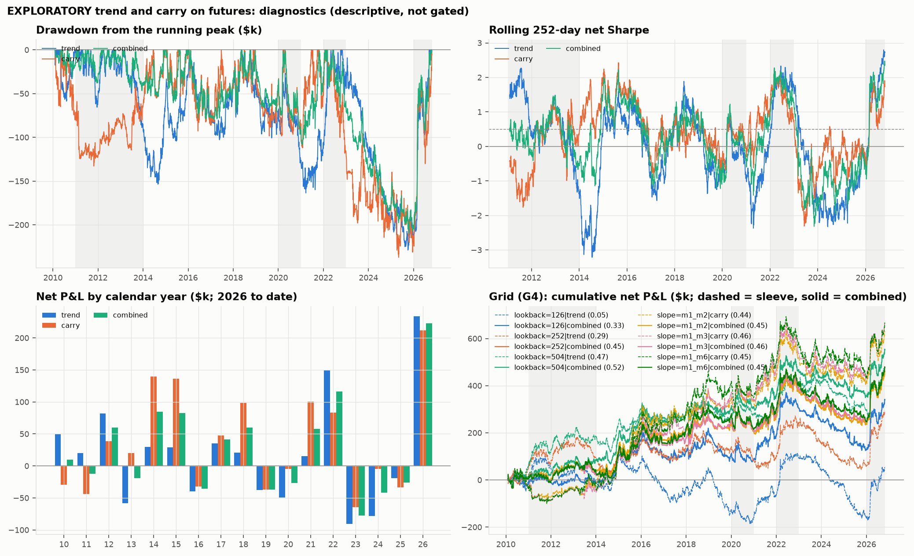
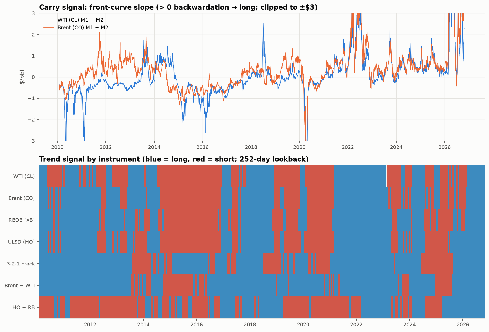
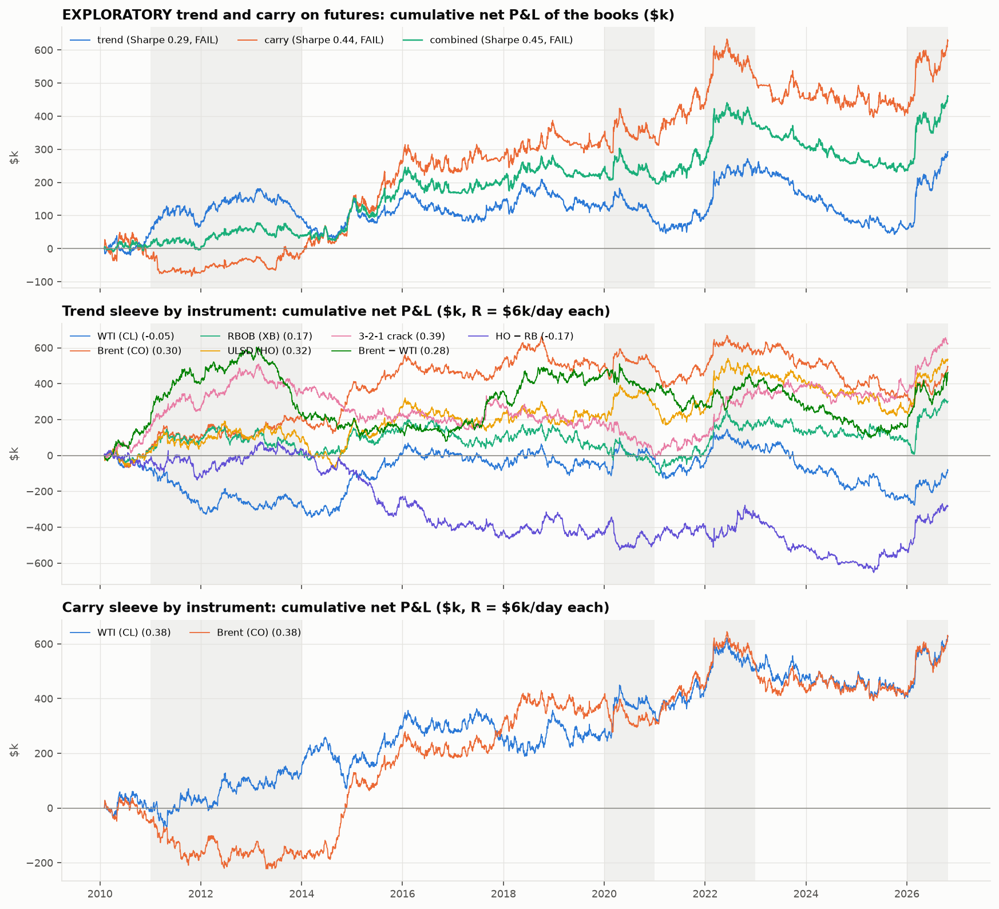

# Summary

**Status: exploratory.** These two strategies were chosen *after* the binding mean-reversion verdict was seen (all three spreads FAIL G1–G5 on futures). They do not change that verdict. Their rules were written down in `PREREGISTRATION_TREND_CARRY.md` and `config.yaml` → `exploratory_trend_carry` before any trend or carry number was computed, and the test was run once.

**Verdict: FAIL, as a near miss.** The 50/50 combined book earned a net Sharpe of **0.45** against the 0.5 bar (G1). It passed the other four gates:
- it made money in all three sub-periods
- every lookback and curve-slope setting stayed positive
- it **made** money in both stress years, 2022 and 2026, where the mean-reversion strategy lost heavily

**What it means.** Trend and carry look like a reasonable complement to the mean-reversion idea: their daily P&L is slightly negatively correlated with it. But with a t-statistic of 1.8 over 16.7 years, the evidence is not strong enough to claim the strategy works.

# 1. What was tested

The full rules are in `PREREGISTRATION_TREND_CARRY.md`. In brief:

| | Strategy 1: trend | Strategy 2: carry |
|---|---|---|
| Instruments | Outrights WTI (CL), Brent (CO), RBOB (XB), ULSD (HO); spreads 3-2-1 crack, Brent–WTI, HO − RB | WTI (CL), Brent (CO) |
| Signal at each close | Sign of the past 252-day change in the back-adjusted price | Long if the held month trades above the next month (backwardation), short if below (contango) |
| Literature | Moskowitz, Ooi & Pedersen (2012) | Koijen, Moskowitz, Pedersen & Vrugt (2018) |

Common to both:
- **Sizing:** each instrument targets \$6,000 a day of risk, using the point-in-time GARCH(1,1)-t volatility forecast. Units are unrounded and resized every day.
- **Timing:** decide at the close, fill at the next close.
- **Costs:** \$0.05/bbl per unit of position change, plus 1 tick per contract leg on each roll.
- **Data:** Bloomberg futures, rolled 5 business days before expiry. Trading runs from 1 Feb 2010 to 26 Oct 2026, the same start rule as the registered backtest.
- **Books:** each sleeve is the equal-risk average of its instruments; the combined book is 50% trend, 50% carry.

RBOB and ULSD were left out of carry because their curves have a seasonal shape (summer and winter grades), so their slope measures the season, not carry.

# 2. Results

## 2.1 Gate verdicts

| Book | G1 Sharpe > 0.5 | G2 ≥ 20 position changes | G3 ≥ 2 of 3 periods positive | G4 grid all > 0 | G5 2022 and 2026 > −\$40k | Verdict |
|---|---|---|---|---|---|---|
| Trend | 0.29 ✗ | 971 ✓ | 3 ✓ | ✓ | ✓ | **FAIL** |
| Carry | 0.44 ✗ | 179 ✓ | 2 ✓ | ✓ | ✓ | **FAIL** |
| **Combined** | **0.45 ✗** | 1,150 ✓ | 3 ✓ | ✓ | ✓ | **FAIL** |

: Table 1. Pre-registered gates, net of costs. Only G1 fails, for every book.

## 2.2 The books

| Book | Net Sharpe | t-stat | Total net P&L | Mean per year | Volatility per year | Max drawdown |
|---|---|---|---|---|---|---|
| Trend | 0.29 | 1.18 | +\$292.7k | \$17.5k | \$60.7k | −\$228.8k |
| Carry | 0.44 | 1.82 | +\$627.4k | \$37.5k | \$84.4k | −\$237.1k |
| Combined | 0.45 | 1.83 | +\$460.0k | \$27.5k | \$61.5k | −\$209.2k |

: Table 2. Feb 2010 – Oct 2026 (16.7 years).

The combined book's Sharpe (0.45) is barely above carry alone (0.44), even though trend and carry are only moderately correlated (0.42). Trend is too weak on its own (0.29) to add much once it takes half the risk.

## 2.3 By instrument

| Sleeve | Instrument | Net Sharpe | Total net P&L | Gross P&L | Trading cost | Roll cost | Max drawdown |
|---|---|---|---|---|---|---|---|
| Trend | WTI (CL) | −0.05 | −\$83.3k | +\$15.9k | \$90.3k | \$8.9k | −\$423.8k |
| Trend | Brent (CO) | 0.30 | +\$494.1k | +\$596.3k | \$93.1k | \$9.1k | −\$401.0k |
| Trend | RBOB (XB) | 0.17 | +\$301.1k | +\$375.0k | \$70.8k | \$3.1k | −\$320.1k |
| Trend | ULSD (HO) | 0.32 | +\$534.7k | +\$601.8k | \$63.8k | \$3.2k | −\$321.7k |
| Trend | 3-2-1 crack | 0.39 | +\$622.4k | +\$819.9k | \$175.3k | \$22.3k | −\$524.1k |
| Trend | Brent − WTI | 0.28 | +\$462.4k | +\$1,048.1k | \$492.4k | \$93.2k | −\$525.6k |
| Trend | HO − RB | −0.17 | −\$282.6k | −\$107.4k | \$164.6k | \$10.6k | −\$729.1k |
| Carry | WTI (CL) | 0.38 | +\$625.8k | +\$692.8k | \$58.1k | \$8.9k | −\$221.3k |
| Carry | Brent (CO) | 0.38 | +\$629.0k | +\$707.4k | \$69.3k | \$9.1k | −\$261.5k |

: Table 3. Each instrument at \$6,000 a day of risk. A sleeve's P&L is the average of its rows, not the sum.

## 2.4 Over time

| Book | 2007–13 (trading from Feb 2010) | 2014–19 | 2020–26 |
|---|---|---|---|
| Trend | +\$92.9k (Sharpe 0.41) | +\$37.3k (0.11) | +\$162.4k (0.36) |
| Carry | −\$14.5k (−0.06) | +\$353.3k (0.70) | +\$288.6k (0.44) |
| Combined | +\$39.2k (0.24) | +\$195.3k (0.53) | +\$225.5k (0.47) |

: Table 4. Net P&L by pre-registered sub-period (G3).

| Window | Trend | Carry | Combined |
|---|---|---|---|
| Brent–WTI break, 2011–13 | +\$43.6k | +\$14.7k | +\$29.2k |
| COVID, 2020 | −\$49.2k | −\$4.4k | −\$26.8k |
| Ukraine, 2022 (G5) | +\$150.2k | +\$83.0k | +\$116.6k |
| Hormuz, 2026 to date (G5) | +\$233.6k | +\$212.0k | +\$222.8k |

: Table 5. Net P&L in the stress windows. For comparison, the registered mean-reversion strategy lost on every spread in 2026 (−\$73k to −\$84k). In 2022, Brent–WTI lost \$151k, the crack had no trades and HO − RB made \$64k.

## 2.5 Sensitivity (G4)

| Setting | Trend Sharpe | Carry Sharpe | Combined Sharpe |
|---|---|---|---|
| Trend lookback 126 days | 0.05 | | 0.33 |
| **Trend lookback 252 days (registered)** | **0.29** | | **0.45** |
| Trend lookback 504 days | 0.47 | | 0.52 |
| **Carry slope M1 − M2 (registered)** | | **0.44** | **0.45** |
| Carry slope M1 − M3 | | 0.46 | 0.46 |
| Carry slope M1 − M6 | | 0.45 | 0.45 |

: Table 6. Every setting is positive, so G4 passes.

Trend gets better with a longer lookback, while carry barely changes with the slope measure. **The 504-day lookback's 0.52 must not be read as a pass.** Picking it after seeing this table is the overfitting the pre-registration is there to prevent.

## 2.6 Diversification

| Daily P&L correlation | Trend | Carry | Combined |
|---|---|---|---|
| with carry | 0.42 | | |
| with the registered mean-reversion strategy (futures, gated research stream) | −0.22 | 0.01 | −0.10 |

: Table 7. Descriptive, as registered.

## 2.7 Year by year, drawdowns and today's book (descriptive, added 29 October 2026)

These were added on 29 October 2026, in a rerun that reproduced every table of the 28 October run byte for byte. They describe the same run. They add no rule and change no gate.

| Year | 2010 | 11 | 12 | 13 | 14 | 15 | 16 | 17 | 18 | 19 | 20 | 21 | 22 | 23 | 24 | 25 | 26 (to date) |
|---|---|---|---|---|---|---|---|---|---|---|---|---|---|---|---|---|---|
| Combined (\$k) | +10 | −12 | +60 | −19 | +85 | +82 | −36 | +41 | +60 | −37 | −27 | +58 | +117 | −77 | −41 | −26 | +223 |

: Table 8. Combined book net P&L by calendar year. Positive in 9 of 17 years. Per-sleeve years are in `tables/annual.csv`.

| Book | Deepest drawdown | Peak | Trough | Recovered |
|---|---|---|---|---|
| Trend | −\$228.8k | 4 Nov 2022 | 2 Oct 2025 | 10 Sep 2026 |
| Carry | −\$237.1k | 8 Jun 2022 | 5 May 2025 | not yet |
| Combined | −\$209.2k | 9 Jun 2022 | 16 Oct 2025 | 12 Oct 2026 |

: Table 9. The five deepest drawdowns of each book are in `tables/drawdowns.csv`.

**2023–25 was a lost stretch.** All three books lost money in each of the three years (combined −\$145k). The combined book spent 1,089 trading days below its June 2022 peak.

**Costs by sleeve.** Trading and roll costs took **39%** of the trend sleeve's gross profit and **10%** of carry's (`tables/cost_breakdown.csv`). The worst case is the Brent–WTI trend position:
- its σ̂ was below \$0.50/bbl on 66% of days, so vol-targeting held a median of 19 contracts a leg
- daily resizing of a position that large is what makes it expensive

**Today's book (close of 26 Oct 2026).** Every instrument is long.
- Trend is long all seven instruments, and both curves are backwardated, so carry is long WTI and Brent.
- The trend Brent–WTI position is 16.2 research units (contracts a leg) at σ̂ = \$0.37/bbl.
- With all nine pointing the same way, the book is in effect one long-oil bet (`tables/current_book.csv`).





# 3. Findings

1. **Close to the bar, but not over it.** The combined book misses G1 by 0.05 and passes everything else. Its t-statistic of 1.83 is short of conventional significance (about 2), so the result may be partly luck.
2. **Carry is the stronger signal.** WTI and Brent carry each earned a Sharpe of 0.38, with almost identical paths, and the result is stable across slope measures. Most of its profit came after 2014. In 2010–13 the two diverged: WTI carry made \$133k, while Brent carry lost \$162k (down \$222k at its worst).
3. **Trend is uneven.** It worked on Brent, ULSD, the crack and Brent–WTI. It lost on WTI and HO − RB, and HO − RB lost money even before costs. A 126-day lookback is barely positive (0.05).
4. **It earns money when the mean-reversion strategy loses.** In 2022 and 2026, spreads and outright prices moved in one direction for months. That ruined mean reversion and paid trend and carry. The slightly negative correlation (−0.10 to −0.22 for trend) makes it a natural partner, not a replacement.
5. **The profit comes in bursts.** Most of the gain came in three episodes: the 2014–15 oil price collapse, 2021–22, and 2026. Between them, the books drifted flat or down for years. The combined book's maximum drawdown, −\$209k, ran from 9 June 2022 to 16 October 2025. A live trader would need to sit through long losing stretches.
6. **Costs matter for the low-volatility spreads.** Positions were resized every day. On Brent–WTI trend, trading and roll costs (\$586k) took more than half of the \$1.05m gross profit, and on the crack about a quarter. Rebalancing less often, or only when the signal flips, would probably cut this. That would have to be a new, separately registered test.

# 4. Caveats

- **Chosen after seeing the data.** The strategies come from the literature, not from this data. But they were picked after the mean-reversion strategy failed, by someone who had already seen the price paths. That is why the result is labelled exploratory.
- **Timestamp.** The pre-registration files were written minutes before the run and were not committed to git first, so there is no independent record that they came first.
- **Few, related instruments.** All nine instruments are oil products, so they move together. Published trend and carry results get much of their Sharpe from many unrelated markets, which this test cannot use.
- **Simplifications.**
  - Unrounded contract sizes.
  - A flat \$0.05/bbl cost and no market impact.
  - Carry measured only at the front of the curve.
  - No funding or margin costs.

# 5. Possible next steps

Each would need its own pre-registration before it is run:
- **Less trading.** Rebalance weekly, or only when a signal changes sign, with a size band. This targets finding 6.
- **Trend and carry as an overlay.** Combine with the registered mean-reversion book, to test whether the negative correlation in finding 4 improves the whole.
- **Out-of-sample check.** Fix today's rules and track them forward on new data (paper trading), which is the only test free of hindsight.

# Reproduce

```
.venv/bin/python scripts/build_data.py                    # futures tables
.venv/bin/python scripts/run_backtest.py --source futures # needed for the correlation in Table 7
.venv/bin/python scripts/run_trend_carry.py               # about 25 s
```

Outputs:
- **Gated results:** `output/exploratory/trend_carry/tables/`. The files are `gate_verdicts`, `summary_books`, `summary_instruments`, `subperiods`, `stress_windows`, `grid`, `correlation_with_mean_reversion`, `daily_books` and `summary.json`.
- **Descriptive additions:** `annual`, `drawdowns`, `cost_breakdown`, `current_book` and `grid_daily_books`, in the same folder.
- **Figures:** `figures/cumulative_pnl.png`, `diagnostics.png` and `signals.png`.
- **Daily paths:** every instrument's daily signal, σ̂, target, position, gross P&L, cost, roll and net P&L, in `data/derived/exploratory/trend_carry_daily.csv`.

Code and checks:
- **Code:** `src/oilrv/trend_carry.py`.
- **Tests:** `tests/test_trend_carry.py` and `tests/test_preregistration.py`.
- **Notebook:** `notebooks/08_trend_carry.ipynb` walks through every table. It also rebuilds the books from the daily paths as a reconciliation.


