<!-- One section per slide, separated by "---". Renders with Marp or pandoc -t revealjs.
     Figures: report/deck_figures/ (scripts/build_deck_figures.py). Numbers: scripts/check_deck.py. -->

# Can the oil complex be traded?

Crude, gasoline and diesel prices are tied together by refining. We tested whether the gaps between them can be traded.

- 3-2-1 crack, Brent − WTI, diesel − gasoline (HO − RB)
- Bloomberg futures, January 2007 to October 2026
- QF603 project, 3 November 2026

**The answer in one line.** The spreads are anchored (the log-ratio is stationary) but the anchor moves, and no mean-reversion rule passes the five gates. Trend and carry comes closest, with a net Sharpe of 0.45.

<!-- Speaker: the result is a near miss, not a winner. The value is in what the tests rule out and why. -->

---

## Crude, gasoline and diesel: one barrel, three spreads, three links

- A refinery splits **3 barrels of crude into 2 of gasoline and 1 of diesel**. The **3-2-1 crack** is what it earns: 2 gasoline + 1 diesel − 3 crude, per barrel of crude.
- **Brent − WTI:** cargoes move between the Atlantic and the US Gulf, so the gap should not exceed shipping cost and quality difference.
- **HO − RB (diesel − gasoline):** refineries can shift yield between the two.
- Each link is a reason a gap should revert. Each can break: outages and hurricanes, pipeline and export limits (the Cushing glut of 2011–13), diesel shortages (2022), a Hormuz closure (2026).

The full economics of each link is in Appendix A.

---

## The hypothesis, and what "worth trading" means

**Hypothesis.** When a spread is unusually wide, it will narrow. Sell it wide, buy it narrow, collect the reversion.

**Worth trading** means passing five questions, **written down before we saw any data** (24 October 2026):

| Gate | The question in plain English |
|---|---|
| G1 | Is the reward big enough? Net Sharpe above 0.5 |
| G2 | Is it enough trades to mean anything? At least 20 |
| G3 | Does it work in every era? Positive in at least 2 of 3 periods (2007–13, 2014–19, 2020–26) |
| G4 | Does it survive changing the settings? Positive at every setting tried |
| G5 | Does it survive a crisis? No loss worse than $40k in 2022 or 2026 |

**Sharpe ratio, plainly:** average profit divided by how bumpy the profit is. Above 0.5 after costs is a modest bar.

<!-- Speaker: trend/carry (28 Oct) and pairs (31 Oct) rules were written after the mean-reversion verdict, so they are labelled exploratory. They are judged on the same five gates. -->

---

## The data: futures expire, so the series are stitched

- A futures contract ends. To follow "the price of oil" for 20 years we hold one contract, then **roll** into the next about 5 business days before expiry.
- **Back-adjusting** shifts old prices so that daily changes are exact. The cost is that the **level** drifts: every roll gap is added to it.
- The 3-2-1 crack on the back-adjusted basis runs from −$163 to +$65 a barrel. At market prices it ranges from $2 to $70.

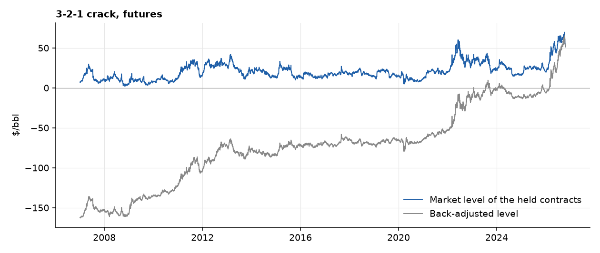

**For a trade:** the registered signal used the adjusted level, so a "wide" spread can partly be accumulated roll gaps, not an economic extreme. This matters in the results. Anything that needs a real price (a ratio, a log, a stationarity test) uses the market level, and P&L always uses the adjusted changes.

---

## Step 1: the dollar spread has no home (ADF, PP, KPSS)

**In plain English.** A rubber band always pulls back to its anchor. A drunk walk has no anchor, and the further he is from the start, the more likely he is to keep going. These tests ask which one a price looks like.

- **ADF and PP** start by assuming there is no home (a unit root). A small p-value means "there is a home".
- **KPSS** starts by assuming there is a home. A small p-value means "there is not".
- We call a series stationary only if all three agree.

| Back-adjusted, 2007–26 | Level: ADF p | PP p | KPSS p | Daily change: ADF p | KPSS p |
|---|---|---|---|---|---|
| 3-2-1 crack | 0.981 | 0.981 | ≤ 0.01 | < 0.001 | ≥ 0.10 |
| Brent − WTI | 0.652 | 0.692 | ≤ 0.01 | < 0.001 | ≥ 0.10 |
| HO − RB | 0.774 | 0.775 | ≤ 0.01 | < 0.001 | 0.078 |

- Taking daily changes (d = 1) makes every series pass all three tests. Taking changes of changes (d = 2) **adds noise**: the first autocorrelation falls to about −0.5, and the spread of the data rises by about 40%. One difference is enough.
- On market prices (not back-adjusted), Brent − WTI and HO − RB already reject a unit root on ADF and PP (p = 0.027 and 0.017), but KPSS also rejects. The tests disagree.

**For a trade:** back-adjusted dollar levels do not return to a fixed home, and they contain 20 years of accumulated roll gaps (the gap alone fails ADF at p = 0.97 for the crack). Before accepting "no anchor", ask what the economics says the spread should do.

---

## Step 2: if the link is proportional, the ratio is the stable object

**A model.** Suppose product A is worth a constant multiple k of product B, up to a stationary error:

- PA,t = k · PB,t · eut, with ut = φ · ut−1 + εt and |φ| < 1
- **Log-ratio:** ℓt = ln PA,t − ln PB,t = ln k + ut. Stationary, with mean ln k.
- **Dollar gap:** St = PA,t − PB,t = PB,t (k eut − 1) ≈ (k − 1) · PB,t + k · PB,t · ut. It inherits the random walk in PB, and its swings scale with PB.

A 6% premium is $1.20 a barrel when the benchmark is $20 and $8.40 when it is $140.

**The economics.** Proportional frictions (quality, financing and storage costs, product value) keep k constant. Fixed frictions (freight, pipeline tariffs, refining cost per barrel) add a dollar part, so S = a + c · PB.

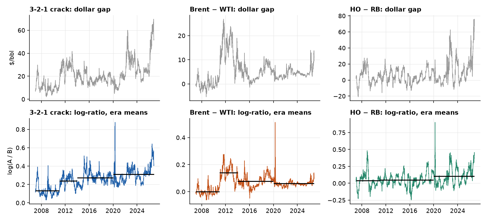

| Prediction | How we test it | Result |
|---|---|---|
| Swings of S grow with PB, swings of ℓ do not | Correlation of the rolling standard deviation with the price level | S: +0.35 to +0.46. ℓ: −0.19 to −0.31 |
| The log slope is 1 | Engle–Granger of ln PA on ln PB | 1.009 and 0.991, against dollar slopes 1.08 and 1.10 |
| Pure substitutes have a ≈ 0 | Regress S on PB | Brent − WTI and HO − RB: a = −$0.71 and −$2.35 (not different from zero). The crack has a ≈ $8 fixed refining cost, plus about 18% of the crude price |
| k is the same number everywhere | Premium from the dollar regression, c + a · E[1/PB], against exp(mean ℓ) − 1 | 29.6% against 28.7%, 7.0% against 6.8%, 7.4% against 6.9% |

**What changes.** Stationarity tests and signals use the **market price of the held contracts**. **P&L still uses back-adjusted daily changes**, which are exact.

---

## Step 3: on the ratio, the home appears

| Daily, 2007–26, futures | Back-adjusted dollar gap, ADF p | Market dollar gap, ADF / PP p | **Log-ratio, ADF / PP p** | Half-life, dollar → log (days) | Zivot–Andrews p, dollar → log |
|---|---|---|---|---|---|
| 3-2-1 crack | 0.981 | 0.059 / 0.055 | **0.014 / 0.000** | 134 → 50 | 0.24 → 0.0009 |
| Brent / WTI | 0.652 | 0.027 / 0.018 | **0.002 / 0.000** | 143 → 49 | 0.22 → 0.001 |
| HO / RB | 0.774 | 0.017 / 0.006 | **0.000 / 0.000** | 55 → 35 | 0.07 → 0.0004 |

- ADF and PP reject a unit root in every log-ratio. Allowing one structural break (Zivot–Andrews), the **dollar gaps still do not reject and the log-ratios do**.
- **The log slope is 1.009 for Brent on WTI and 0.991 for HO on RB**, indistinguishable from 1. In dollars the 1:1 link is rejected (slopes 1.08 and 1.10). That is the constant-k model.
- Half-lives are for the crack and HO/RB with calendar-month effects removed.

**Month-end** (one observation a month, 238 points) shows the same pull without the daily noise:

| Month-end, 2007–26 | ADF / PP p, raw | ADF / PP p, calendar-month effects removed | AR(1) half-life, days | Zivot–Andrews p (effects removed) |
|---|---|---|---|---|
| 3-2-1 crack | 0.000 / 0.000 | 0.378 / 0.001 | 97 | 0.015 |
| Brent / WTI | 0.001 / 0.001 | 0.001 / 0.001 | 99 | 0.059 |
| HO / RB | 0.251 / 0.000 | 0.000 / 0.000 | 43 | 0.045 |

- The month-end half-lives (97, 99 and 43 days) match the slow roots of the daily ARIMA fits (81, 98 and 35). The daily AR(1) gives 50, 49 and 35: fast noise that predicts nothing drags it down.
- **The evidence is not equally strong for the three.** Brent/WTI is stationary at every day of the month by PP and by ADF, except day 25 (ADF p = 0.12). HO/RB is stationary at every day once calendar-month effects are removed, but its raw month-end ADF fails (0.07 to 0.26), so seasonality matters. The crack is the weakest: PP rejects at every day, but ADF depends on the day sampled (0.000 to 0.607 raw) and mostly fails once seasonal effects are removed (0.04 to 0.52).

**For a trade:** the dollar gap wanders, the ratio does not. The strict "all three tests agree" rule still fails, because KPSS rejects everywhere (next slide).

---

## Step 4: but the home moves (why KPSS still disagrees)

- KPSS assumes the series is stationary and rejects if not, so a rejection is real evidence against **one fixed mean for 20 years**.
- But it also **cries wolf on slow series**. On simulated series that are truly stationary at each spread's own persistence, KPSS rejects 52%, 52% and 43% of the log-ratios, and 85%, 87% and 56% of the dollar gaps (should be 5%).
- At month-end the sample is short but not blind: a truly stationary series is rejected by KPSS 22%, 22% and 12% of the time, and ADF fails to reject it only 2%, 2% and 0.3% of the time. So the crack's failed month-end ADF is real evidence against it, not low power.

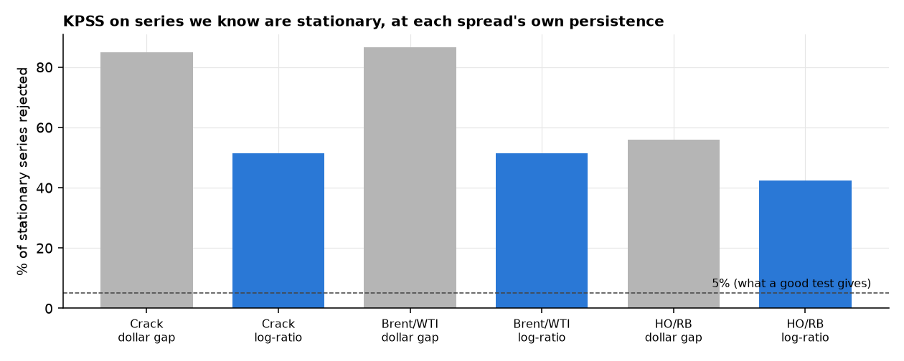

- The mean does move. Implied k = exp(average log-ratio in the era):

| Era | Crack | Brent / WTI | HO / RB |
|---|---|---|---|
| 2007–10 | 1.14 | 1.00 | 1.04 |
| 2011–13 | 1.27 | 1.15 | 1.05 |
| 2014–19 | 1.32 | 1.08 | 1.05 |
| 2020–26 | 1.36 | 1.06 | 1.11 |

- **What moves k?** The 2013 switch of NYMEX heating oil to ULSD shows no break in HO/RB (+2.1% in May 2013, 29th percentile of all month-start jumps). The 9.6% fall in Brent/WTI in 2013 (94th percentile) matches the end of the Cushing glut, but Cushing stock deviation explains almost none of k (t = 0.3 in levels, R² 0.3%; in weekly changes t = 2.4, R² 0.9%). The causes are plausible, not established.

**For a trade:** the anchor is real and it moves. Compare against a rolling average, never a fixed 20-year mean.

---

## Step 4b: a model of the moving anchor

**Allow k to drift.** ℓt = ln kt + ut, with ln kt = ln kt−1 + ηt and ut = φ · ut−1 + εt. A fixed mean is the case η = 0.

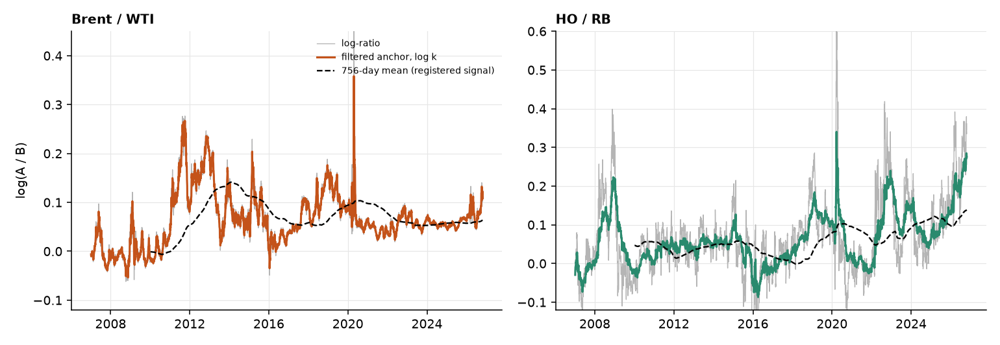

| Spread | Half-life if k is fixed | Half-life of the deviation u | Anchor drift per year | Standard deviation of u |
|---|---|---|---|---|
| 3-2-1 crack | 51 days | 7.2 days | 10.4% | 3.4% |
| Brent / WTI | 51 days | 2.2 days | 9.0% | 1.0% |
| HO / RB | 36 days | 18.4 days | 8.4% | 6.9% |

- The 35–50 day half-life is mostly the anchor drifting. Around a moving anchor, reversion is **fast (2 to 18 days) and small (1 to 7%)**.
- The registered signal measures z against the trailing 756-day mean. That mean is far from the filtered anchor: its error is **5.5, 2.0 and 0.8** standard deviations of u (Brent/WTI, crack, HO/RB). On days when the registered |z| ≥ 2, the filtered deviation is under 1 standard deviation on **86%, 65% and 36%** of days: most "extremes" are the anchor moving.
- That order (Brent/WTI worst, HO/RB best) is the order of the realised Sharpes (−0.49, 0.22, 0.38). Three points are suggestive, not proof.
- **Limits:** parameters are fitted on the full sample, and the model cannot tell a drifting anchor from a slowly reverting series (the fitted anchor follows Brent/WTI almost point by point). The fast half-lives are model statements, not tradeable estimates.

**For a trade:** the problem is not a slow reversion, it is measuring the anchor. We do not test an anchor-tracking rule on this sample (it would be the seventh look).

---

## Step 5: what the daily ARIMA says (almost nothing, and that explains the earlier tests)

| Series (BIC orders throughout) | Dollar gap (on back-adjusted changes) | Log-ratio, d = 0 | Slowest root, half-life | Roll-clean held index |
|---|---|---|---|---|
| 3-2-1 crack | ARIMA(0,1,0) | ARIMA(1,0,3) | 81 days | ARIMA(2,1,3), partly cancelling terms |
| Brent / WTI | ARIMA(2,1,0), coefficients 0.06 and −0.04 | ARIMA(3,0,2) | 98 days | ARIMA(3,1,0), coefficients under 0.14 |
| HO / RB | ARIMA(0,1,0) | ARIMA(1,0,0) | 35 days | ARIMA(0,1,0) |

- **Products:** Brent, RBOB and ULSD are ARIMA(0,1,0) with drift (BIC), and so is WTI once 9 March to 29 May 2020 is excluded (otherwise a cancelling (2,1,2)). ARCH is present in every series (p < 0.001): a random walk with GARCH.
- **Same process, two lenses.** The log-ratio is d = 0 with one root of 1.007 to 1.02 (half-life 35 to 98 days). It closes only 0.7% to 2% of the gap a day, far below the daily noise, so the ARIMA on the dollar gap sees a random walk. Both are true. HO/RB's d = 1 fit has a moving-average term of −0.99, the signature of over-differencing.
- **Brent/WTI ARMA(3,0,2), factored:** AR = (1 − 0.993 L)(1 − 0.447 L + 0.275 L²). One slow root (half-life 98 days: cargo, pipeline and export arbitrage) and a damped oscillation (it decays by 0.52 a day, period about 6 days): short-run noise as one benchmark reacts first. The order counts polynomial terms. It is not five separate economic facts.
- **Out of sample** (756-day window, refit monthly, 1 to 63 days ahead): no AR forecast of the log-ratio beats a random walk (RMSE ratio 0.94 to 1.14, Diebold–Mariano |t| of at most 1.8). The 756-day mean the strategies use as the anchor is worse than no-change at every horizon except HO/RB at 63 days.
- **Roll-clean:** the held-contract index is a random walk with drift, a tradeable series with no daily linear predictability.
- **Why d = 0 and d = 1 both fit.** Δℓ = −(1 − φ)(ℓt−1 − μ) + ε, and with φ ≈ 0.99 the pull is about 1% of the gap, invisible next to daily noise. Forcing d = 1 sets φ = 1 and hides the small pull in a moving-average term, which heads to −1 if the series is really stationary (HO/RB: −0.99). BIC cannot compare the two (they are fitted to different series). ADF, PP, Zivot–Andrews and the arbitrage bound favour d = 0. KPSS favours d = 1 but false-alarms about half the time at these half-lives. The held index is a different series and is d = 1.
- **At month-end** the BIC order is AR(1) for the crack and Brent/WTI and ARMA(1,1) for HO/RB, with slowest-root half-lives of about 97, 101 and 79 days: the slow pull, with the daily noise gone.

**For a trade:** no daily ARIMA edge exists in any form. Whatever pull there is acts over months, which the next slide tests.

---

## Step 6: over months the ratio reverts, and a holder earns part of it

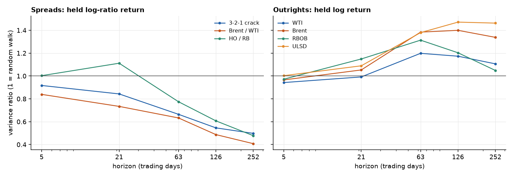

- **Variance ratio at one year:** the ratio's variance is only **50%, 41% and 48%** of the random-walk level (crack, Brent/WTI, HO/RB). Outright prices lean the other way: Brent 1.34 and ULSD 1.46 at one year. None is statistically significant (robust p from 0.15 to 0.98).
- **The roll:** the market ratio jumps when we roll into the next contract month, and a holder does not earn that jump. After removing it, **HO/RB shows reversion a holder clearly earns** (t = −2.78 at 21 days, −3.51 at 63 days). The crack and Brent/WTI have the right sign but |t| of at most 1.72, and 41% to 54% of their apparent reversion is the roll.

**In one line:** the ratio is stationary in the long run and a random walk day to day.

**For a trade:** reversion in the **ratio over months** (mean reversion), persistence in **outright prices over a year** (trend). The detail is in Appendix B.

---

## What the tests allow

| Finding | What it means | Strategy it motivates | Judged on |
|---|---|---|---|
| Changes are close to white noise (BIC: AR(0) for 6 of 7) | No daily forecasting edge | Drop daily AR and SARIMA trades | not carried forward |
| Dollar levels wander, link unstable (rope in 8–11% of windows) | Reversion is possible but only sometimes | Mean reversion and cointegration pairs, with a stability check | G3, G4, G5 |
| **Ratios are stationary** (ADF, PP, Zivot–Andrews), half-life 35–50 days, but k moves between eras | The anchor is proportional, and it drifts | **Mean reversion on the log-ratio**, against a rolling mean | G1 to G5 |
| A moving-anchor model: deviations revert in 2 to 18 days around a drifting k | The slow half-life is mostly the anchor moving | A better anchor than a 3-year mean (not tested, see Appendix D) | not carried forward |
| Variance ratios: log-ratios below 1, outright prices above 1 | Two horizons: reversion in months, persistence over a year | Mean reversion (short horizon) and trend (long horizon) | G1 to G5 |
| Volatility clusters (ARCH p < 0.001) | Risk is forecastable | Volatility-based sizing in every strategy | G5 |
| Daily tests cannot see 12-month moves or the futures curve | A gap in the evidence | Trend and carry, tested directly (appendix) | G1 to G5 |

**The tests rule things out. They cannot pick a winner, so the shortlist goes to the backtest.**

---

## Five candidates, each with an economic reason

| Strategy | Idea | Economic reason | Motivated by |
|---|---|---|---|
| **Mean reversion** (registered, dollar gap) | Fade spreads that are 2 standard deviations from the 3-year average | Arbitrage and substitution pull gaps back | Persistent but possibly anchored levels |
| **Ratio mean reversion** (registered 4 Nov) | The same rules on the log-ratio of market prices | Substitution works in percent, so k is the anchor | Ratios are stationary, half-life 35–50 days |
| **Pairs** | Trade legs tied by a rope (cointegration) | A long-run link between two prices | The rope test, when it passes |
| **Trend** | Follow the sign of the past 12 months | Supply and demand adjust slowly, so big shocks keep going | Levels that wander in one direction |
| **Carry** | Long if the curve is backwardated, short if in contango | Paid for insuring hedgers; scarce prompt barrels sell at a premium | The curve, which no daily test looks at |

---

## Every strategy against the five gates

| Futures, 2010–26, net of costs | G1 net Sharpe > 0.5 | G2 trades ≥ 20 | G3 positive eras (of 3) | G4 every setting > 0 | G5 worst crisis year > −$40k | Integer-book Sharpe |
|---|---|---|---|---|---|---|
| Mean reversion, dollar gap (crack / Brent − WTI / HO − RB) | 0.32 / −0.42 / 0.06 ✗ | 18 / 9 / 18 ✗ | 2 / 0 / 2 | ✓ / ✗ / ✗ | −$73k / −$151k / −$84k ✗ | 0.13 |
| Ratio mean reversion, daily decisions (book of 3) | 0.055 ✗ | 71 ✓ | 2 ✓ | ✓ | −$133k ✗ | 0.23 |
| Ratio mean reversion, monthly decisions | −0.13 ✗ | 22 ✓ | 1 ✗ | ✗ | −$61k ✗ | −0.13 |
| Pairs (book of 6) | −0.19 ✗ | 80 ✓ | 1 ✗ | ✗ | −$40k ✗ | not run |
| **Trend and carry (50/50 book)** | **0.45 ✗** | 1,150 ✓ | 3 ✓ | ✓ | profit in 2022 and 2026 ✓ | not run |

- **No strategy passes all five gates.** Trend and carry passes four and misses G1 by 0.05. Every mean-reversion and pairs variant fails G1 and G5.
- The registered integer book (units capped at 3, $2m, drawdown rules) lifts the daily ratio strategy from 0.055 to 0.23 and cuts the 2026 Brent/WTI loss from $348k to $44k, but does not reach 0.5.
- The bar itself is noisy: a measured Sharpe over 16.7 years has a standard error of about 0.25 (see "Could we have known?").

**For a trade:** the gates separate carry and trend from everything else, and no mean-reversion variant gets close.

---

## Why mean reversion fails: the wrong anchor, the wrong horizon, and crisis breaks

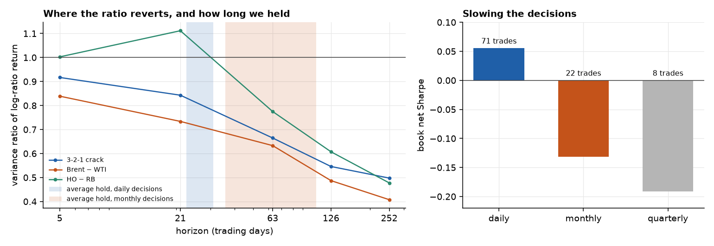

- **The wrong anchor.** The registered z measures against a 756-day mean. It misses the filtered anchor by **5.5, 2.0 and 0.8** standard deviations of the deviation (Brent/WTI, crack, HO/RB), and on days with |z| ≥ 2 the filtered deviation is under 1 standard deviation on **86%, 65% and 36%** of days: most "extremes" are the anchor moving.
- **The wrong horizon.** The ratio reverts over 3 to 12 months, but the daily strategy held for only **31, 23 and 26 days**. Deciding monthly made it worse (Sharpe −0.13), and 14 of 22 trades ended on the time stop.
- **Crisis breaks.** Brent/WTI broke in the 2026 supply shock. Capping size at 3 units cuts that loss from $348k to $44k, which shows how much of the tail was sizing, not signal. The Sharpe is still only 0.23.

**For a trade:** a stationary ratio is not a tradeable one. A size cap helps the tail but not the Sharpe. A better anchor and a longer hold cannot be tested on this sample without a seventh look.

---

## Trend and carry: a near miss

| Net of costs, 2010–26 | G1 Sharpe | G2 changes | G3 eras | G4 settings | G5 crises |
|---|---|---|---|---|---|
| Trend | 0.29 ✗ | 971 ✓ | 3 ✓ | ✓ | ✓ |
| Carry | 0.44 ✗ | 179 ✓ | 2 ✓ | ✓ | ✓ |
| **50/50 book** | **0.45 ✗** | 1,150 ✓ | 3 ✓ | ✓ | ✓ |

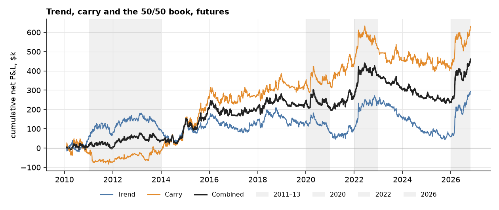

- Passes four of five gates, and made money in 2022 and 2026, the years mean reversion lost most (Brent − WTI −$151k in 2022; all three spreads lost in 2026).
- Daily P&L is slightly negatively correlated with mean reversion (−0.10), so it is a natural partner.
- t-statistic 1.83 over 16.7 years: short of the 2 normally wanted.

---

## Where the money came from

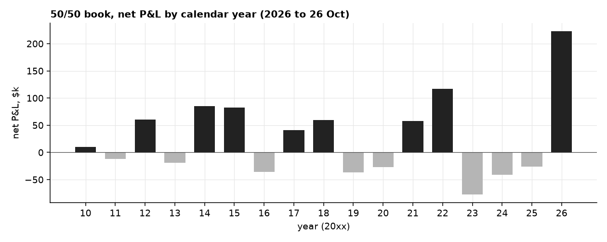

- Gains arrive in bursts: the 2014–15 price collapse, 2021–22 and 2026.
- 2023, 2024 and 2025 all lost money (−$145k in total), and the book spent 1,089 trading days below its June 2022 peak.
- **Costs** take 39% of trend's gross profit and 10% of carry's. Carry is cheaper to hold, because it changes sign rarely.

**For a trade:** this is a strategy that needs patience through multi-year dry spells, and the evidence for it is a few large episodes.

---

## Could we have known? What the statistics predict for the gates

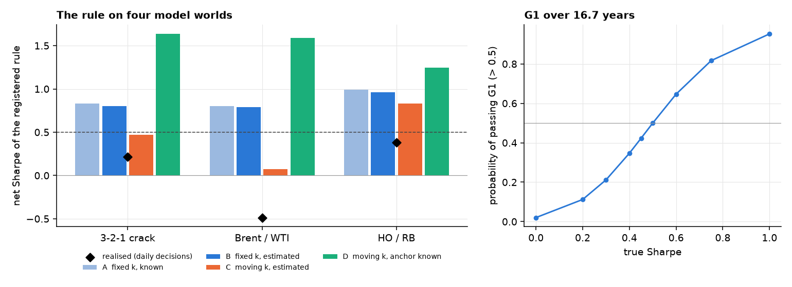

- We simulated the registered rule on four worlds fitted to each spread. **A:** k fixed and known. **B:** k fixed, estimated on 756 days. **C:** k moves (the model of step 4b) and the rule estimates it as registered. **D:** k moves and the rule knows the anchor.
- If k never moved (A, B), the rule earns a Sharpe of **0.8 to 1.0**, well above the 0.5 bar. With a moving k that has to be estimated (C) it earns **0.47, 0.07 and 0.83**. So the failure was predictable from the stationarity results.
- World C reproduces the **number of trades** (26, 16 and 26 simulated against 29, 15 and 27 realised) and the **order of the spreads** (HO/RB, then crack, then Brent/WTI). It does not reproduce the **level**: the realised Sharpes (0.22, −0.49, 0.38) are lower, and below the middle 90% of simulated paths for Brent/WTI and HO/RB. Rolls, fat tails, volatility clustering and crises are outside the model.
- World D, with the anchor known, earns 1.25 to 1.64. That is an upper bound on what better anchor tracking could be worth, not an estimate, because the model cannot tell a drifting anchor from a slowly reverting series.
- **The gate itself is noisy.** Over 16.7 years the measured Sharpe has a standard error of about 0.25. A strategy with a true Sharpe of 0.45 (our trend and carry estimate) passes G1 only **42%** of the time, and one with no skill passes **2%** of the time. Six skill-less variants would produce at least one pass 12% of the time.
- **Deflated Sharpe** of the trend and carry book: **0.70** with six trials and 0.57 with twelve (the probability that its true Sharpe beats what the best of that many skill-less trials would show).

**For a trade:** judge a near miss by its power, not by the bar alone. Trend and carry at 0.45 is as likely a 0.5 strategy that was unlucky as a 0.4 strategy that was lucky.

---

## What would change the answer: more years, more independent bets

- **Out-of-sample years.** Pulling 1990 to 2006 (WTI, Brent, heating oil, unleaded gasoline) takes Brent/WTI from 16.7 to about 37 years. The registered rules, fixed now, would then be run on years they have never seen.
- **Independent spreads.** Gasoil against heating oil and Brent, Dubai or Oman against Brent, Eurobob against RBOB: five or six bets instead of three related ones. This is the real fix for power (about 28 years for t = 2 at the best Sharpe we saw).
- **Drivers of k.** Freight indices and US crude exports test whether the anchor moves with the arbitrage band.
- **Measured costs.** Bid, ask and volume replace the flat $0.05 a barrel.
- **The rules stay fixed.** No parameter is tuned on the new years first, and an anchor-tracking rule would be registered before it is run.

The pull sheet, with the fields to download and the tickers still to be verified, is in `data/raw/bloomberg/README.md`.

---

## Why the work is worth having, even without a passing Sharpe

- **It stopped us trading a failed idea.** Mean reversion on Brent − WTI would have lost $224k, mostly in 2022 and 2026.
- **It explains the failure.** Levels drift, links break in crises, and any reversion is slower than the holding period.
- **It tested the obvious rescue.** Matching the strategy to the horizon where the ratio reverts did not help, and the reasons for not going further are on the record.
- **It found where the failure comes from.** A moving-anchor model reproduces the trade counts and the order of the spreads, and shows that a 3-year mean mistakes anchor drift for dislocation. It does not reproduce the size of the losses.
- **It found what survives.** Carry earns most of the Sharpe at a tenth of the cost drag of trend.
- **It kept us honest.** Trend's 504-day lookback scores 0.52, above the bar. Picking it after seeing the table would be overfitting, so it is not counted.
- **It is reusable.** The data pipeline, pre-registered gates, seven tests and the reporting checks run on any new data.

---

## Recommendation

**Paper trade the 50/50 trend and carry book on fixed rules. Do not commit real capital yet.**

- Net Sharpe 0.45 misses the 0.5 bar, t-statistic 1.83, and 48% of the profit came in 2026.
- All nine positions are long at the 26 October close, so today the book is effectively one long-oil bet.
- Next experiments, each registered before it is run:
  1. Trade less (weekly, or only when the signal flips), to cut trend's 39% cost drag.
  2. Overlay a small HO/RB ratio sleeve (stand-alone Sharpe 0.38, t = 1.55, daily P&L correlation −0.18 with the book), as a registered test of whether it adds to trend and carry. It is fragile: the same spread falls to −0.27 when decisions go monthly.
  3. Track the fixed rules forward on new data, the only test free of hindsight.
  4. Pull 1990 to 2006 and more independent spreads (the Bloomberg sheet is written in `data/raw/bloomberg/README.md`), and treat those years as out-of-sample for any rule fixed beforehand.

---

## Caveats

- **Chosen after seeing results.** Trend and carry came from the literature, but were picked after mean reversion failed, so they are labelled exploratory. The ratio strategy followed the professor's feedback, and its rules were registered after we had seen the forward-return regressions on HO/RB, so even a pass would not be independent.
- **Six looks at one sample.** Mean reversion, pairs, trend, carry, ratio mean reversion and its slower version were all tried on the same 16.7 years, the last three after seeing earlier results. Any single pass would have to be discounted for that.
- **The moving-anchor model.** It is fitted on the full sample and cannot tell a drifting anchor from a slowly reverting series, so its fast half-lives and the known-anchor world are statements about the model.
- **Sizing.** The gates were judged on the unrounded research stream. On the registered integer book (units capped at 3) the daily ratio strategy has a Sharpe of 0.23 and the 2026 Brent/WTI loss is $44k, so the research-stream tail losses overstate what a capped book sees. The G1 failure does not change.
- **Monthly appendix on dollars.** Appendix A1 to A4 use back-adjusted dollar spreads and were not recomputed on the log-ratio. The month-end log-ratio results are in the frequency ladder.
- **KPSS and a moving anchor.** KPSS rejects for every spread, and the era means of the log-ratio shift. We read this as "anchored around a moving k", and the test cannot prove it.
- **Few, related instruments.** All nine instruments are oil products and move together. Published trend and carry results draw on many unrelated markets.
- **Simplifications.** Flat $0.05/bbl costs, no market impact, carry measured at the front of the curve only, unrounded contract sizes.
- **Test power.** About 200 monthly points cannot reliably separate a slow reversion from none.

---

## Summary: test, finding, economics, consequence

| Test | Finding | Economic reading | Consequence |
|---|---|---|---|
| ADF, PP, KPSS, Zivot–Andrews | Dollar gaps need one difference, log-ratios are stationary around a moving mean | The anchor is a ratio k, and k shifts between eras | Trade the ratio against a rolling mean, never a fixed one |
| Local level + AR(1) | Deviations revert in 2 to 18 days around an anchor that drifts 8 to 10% a year. The 756-day mean misses the anchor by 0.8 to 5.5 deviation-sd | The slow half-life is anchor drift | The open question is how to track the anchor (untested) |
| Model worlds, power of G1 | Fixed k would earn 0.8 to 1.0, moving k 0.07 to 0.83. The measured Sharpe has a standard error of 0.25 | The failure was predictable and the gate is noisy | Judge near misses by their power |
| ARIMA on the products and the log-ratios | Products are random walks with drift, the dollar gaps are ARIMA(0,1,0) or (2,1,0), and the log-ratios are d = 0 with a slow root (half-life 35 to 98 days) | The pull is real but too slow to show in daily changes | No daily ARIMA edge; the pull acts over months |
| Integer book | The daily ratio strategy has a Sharpe of 0.23 on capped sizing (0.055 on the research stream) | Sizing discipline changes the tail more than the signal | G1 still fails |
| Variance ratio | Log-ratios 0.4–0.5 at one year, outrights 1.1–1.5 | Two horizons | Mean reversion months, trend a year; but a monthly-decision version fails (−0.13) |
| Cointegration | Link in 8–11% of windows | Arbitrage works, but regimes shift | Reversion needs a stability check |
| ACF, PACF | 0 of 280 lags survive | Markets absorb yesterday's news | No daily forecasting |
| AIC, BIC, Ljung–Box | AR(0) for 6 of 7 | No short-term memory to exploit | Drop AR and SARIMA |
| ARCH, GARCH | Volatility clusters | Shocks arrive in bursts | Size by forecast volatility |
| Gates on strategies | Mean reversion fails (dollar gap and ratio), trend and carry near-miss | Reversion exists but is too slow and breaks in crises; curve and shock persistence pay | Paper trade trend and carry |

---

# Appendix

Everything the main deck summarises is here in full, in five sections.

- **A. Economics and data detail:** the refining link in full, the three spreads, how the deck is organised, what the spreads look like.
- **B. The stationarity argument in detail:** the roll decomposition, the two horizons, the equations in one place.
- **C. The full test battery:** cointegration, ACF and PACF, AIC and BIC, ARIMA in full, Ljung–Box, GARCH, VECM.
- **D. Strategy detail:** the registered mean reversion, pairs, ratio mean reversion, the slower version, the twelve-month question, the integer book.
- **E. Follow-up checks:** monthly horizon, trend and carry tests, alpha against oil beta.

---

# Appendix A. Economics and data detail

---

## One barrel of crude becomes several products

- A refinery splits crude into gasoline, diesel and other fuels. A rule of thumb is **3 barrels of crude give 2 of gasoline and 1 of diesel**.
- The **3-2-1 crack** is what the refiner earns on that split: 2 gasoline + 1 diesel − 3 crude, per barrel of crude.
- Product prices and crude prices must stay linked. If gasoline sells for far more than the crude that makes it, refiners buy more crude and make more gasoline, until the gap narrows.

**Why this matters for trading:** a link that pulls prices back together is the whole reason to expect a spread to snap back.

---

## Three spreads, three economic links

| Spread | What ties it together | What can break the tie |
|---|---|---|
| **3-2-1 crack** (products − crude) | Refiners switch to the more profitable product and add or cut crude runs | Refinery outages, hurricanes, product shortages, a Hormuz closure |
| **Brent − WTI** (two crudes) | Cargoes move between the Atlantic and the US Gulf, so the gap should not exceed shipping cost and quality difference | Pipeline and export limits (Cushing glut 2011–13), export rules, regional supply shocks |
| **HO − RB** (diesel − gasoline) | Refineries can shift yield between diesel and gasoline | Season (summer driving, winter heating), grade changes, diesel shortages as in 2022 |

**For a trade:** each link is a reason the gap should revert. Each break is a reason it might not.

---

## How we got there: tests first, then strategies

1. **Tests** tell us what the prices do: do they wander, do they come back, can yesterday predict today, does risk cluster. Steps 1 to 5 follow one argument from equations to evidence: the dollar spread seems to have no home, a model says the ratio should, the ratio does, its home moves, and what that means for a trade.
2. Each test ends with **"For a trade"**: what it allows or rules out.
3. A **bridge slide** turns the findings into a shortlist of strategies.
4. Each strategy is judged on the **same five gates**.

**Why this order:** testing first stops us from backtesting ideas the data already contradicts.

---

## What the three spreads look like

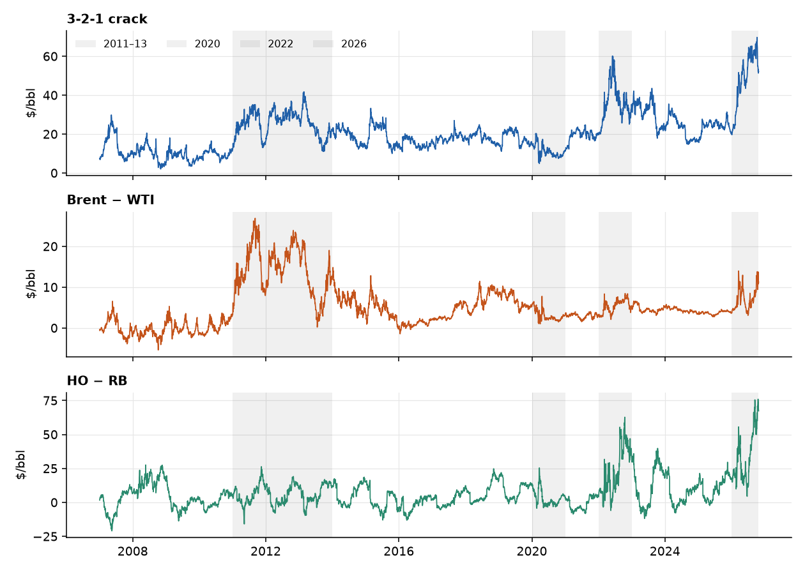

- Levels sit in ranges for years, then move to a new range: Brent − WTI in 2011–13, the crack and HO − RB in 2022 and 2026.
- The shaded windows are the periods gates G3 and G5 look at.

---

# Appendix B. The stationarity argument in detail

---

## Step 6a: can a holder earn the reversion? (the roll)

A market ratio **jumps when we roll** into the next contract month, and a holder does not earn that jump. So we split every change in the market log-ratio into the **held-contract return** (what a position earns) and the **roll jump**.

- The median move on a roll day is about twice a normal day (crack 0.011 against 0.006, Brent/WTI 0.005 against 0.003, HO/RB 0.016 against 0.007).
- Over 20 years roll jumps add up to −2.08, −1.21 and +0.44, against ranges of 0.85, 0.58 and 1.15. Held-contract returns offset them (+2.38, +1.33, −0.05).

Forward held-contract return regressed on today's z-score (756-day window), slope per 1 z:

| Spread | 21 days (t) | 63 days (t) | Share of the market reversion that is roll jump |
|---|---|---|---|
| HO / RB | **−0.016 (−2.78)** | **−0.030 (−3.51)** | 28% / 22% |
| 3-2-1 crack | −0.008 (−1.72) | −0.011 (−1.52) | 42% / 54% |
| Brent / WTI | −0.002 (−1.20) | −0.005 (−0.96) | 43% / 41% |

**For a trade:** only HO/RB shows reversion a holder clearly earns. The crack and Brent/WTI have the right sign but are not significant, and about half of their apparent reversion is the roll.

---

## Step 6b: two horizons, ratios revert and outright prices persist

- **Variance ratio** = variance of the q-day change / (q × variance of the 1-day change). Above 1, moves persist (trend). Below 1, they partly undo themselves.
- On **dollar changes** the crack and Brent/WTI looked like random walks (about 1.0 at one year). On **log-ratio returns** the variance at one year is only **50%, 41% and 48%** of the random-walk level.
- Outright prices lean the other way: Brent 1.34 and ULSD 1.46 at one year.
- **None of the log-ratio variance ratios is statistically significant** (robust p from 0.15 to 0.98), so this supports the picture but cannot confirm it.

**For a trade:** reversion in the **ratio over months** (mean reversion, tested in the strategy slides: it does not pay), persistence in **outright prices over a year** (trend). The trend rule is unchanged: the sign of the 252-day change in the log-ratio differs from the sign of the dollar change on only 6–12% of days.

---

## A0. The equations in one place

| Object | Definition |
|---|---|
| Log-ratio | ℓt = ln PA,t − ln PB,t. The crack uses A = 2 · RB + HO and B = 3 · CL, in $/bbl |
| Constant-k model | PA,t = k · PB,t · eut, ut = φ ut−1 + εt, so ℓt = ln k + ut |
| Dollar gap | St = PA,t − PB,t = a + c · PB,t + noise, with c ≈ k − 1 and a the fixed dollar part |
| Moving anchor | ℓt = ln kt + ut, ln kt = ln kt−1 + ηt |
| Half-life | h = ln 2 / (−ln φ) |
| z-score used by the strategies | zt = (ℓt − mean756) / sd756, month effect removed in the window for the crack and HO/RB |
| Roll decomposition | Δℓt = rheldt + Jt, with rheld = ln(1 + rA) − ln(1 + rB) the held-contract return and J the roll jump |
| Variance ratio | VR(q) = Var(ℓt+q − ℓt) / (q · Var(Δℓt)) |
| Standard error of a Sharpe ratio | SE ≈ √((1 + SR² / 2) / years) |
| Deflated Sharpe ratio | DSR = Φ((SR − SR0) √(T − 1) / √(1 − γ3 SR + (γ4 − 1) SR² / 4)), SR0 the expected best Sharpe of N skill-less trials |

---

# Appendix C. The full test battery

---

## Test 2: are two prices on a leash? (cointegration)

**In plain English.** Two drunks who each wander randomly, but are tied together by a rope. Neither has a home, yet the **distance between them** does. Engle–Granger and Johansen test for the rope.

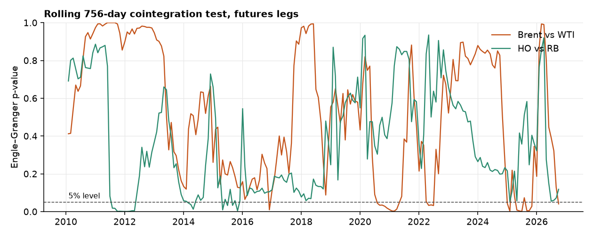

- A rope would show as p below 5% (the dashed line). Brent vs WTI passes in 11% of rolling 3-year windows, HO vs RB in 8%.
- Johansen on the crack legs finds no rope in 65% of windows.
- **In logs, on market prices of the held contracts:** a rope is found in 24% of Brent/WTI windows (18% in dollars) and 14% of HO/RB windows (5% in dollars). Better, but still a minority of three-year windows.

**For a trade:** a link exists in some periods, not others. Entry needs a stability check, which is what the regime filter was for.

---

## Test 3: does yesterday's move echo today's? (ACF and PACF)

**In plain English.** Shout in a valley and listen for the echo. The ACF measures how much of today's change is repeated at each lag. The PACF measures the same after removing echoes already explained by shorter lags.

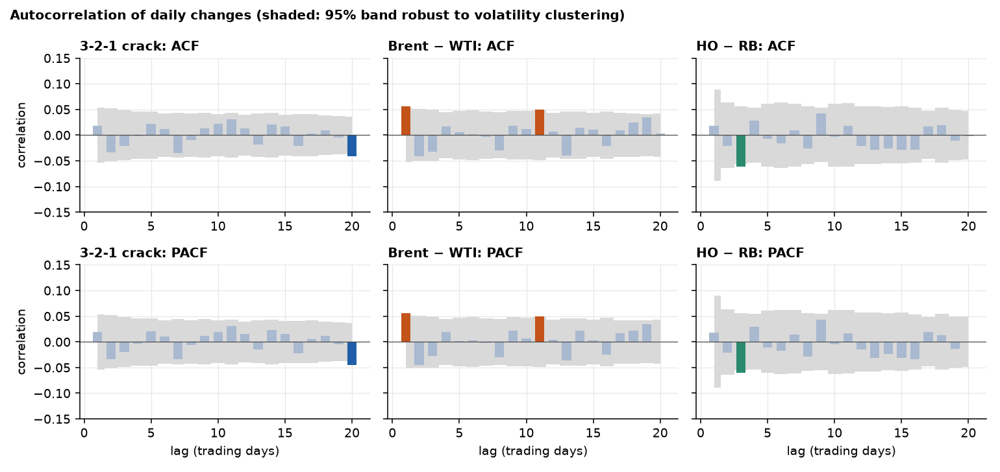

- Bars outside the grey band are "significant". By chance about 1 in 20 will be, and these tests look at 280 lags.
- After correcting for testing many lags, **0 of 280** survive.
- The same holds for daily changes of the log-ratio: no lag survives the correction.

**For a trade:** no daily forecasting edge. Yesterday does not tell us today.

---

## Test 4: how many past days should a model use? (AIC and BIC)

**In plain English.** Adding past days to a model always fits the past a bit better, like adding more squiggles to a curve. AIC and BIC charge a fee per extra day. **BIC charges more**, so it only keeps terms that clearly earn their place.

| Daily changes, 2007–26 | BIC picks | AIC picks | R² of the AIC model |
|---|---|---|---|
| 3-2-1 crack | AR(0) | AR(20) | 0.9% |
| Brent − WTI | AR(2) | AR(19) | 1.4% |
| HO − RB | AR(0) | AR(16) | 1.3% |

- AR(0) means "the best forecast of tomorrow's change is zero".
- AIC's long orders explain about 1% of the variance and vary by period. That is over-fitting, not memory.
- On log-ratio changes BIC picks AR(6), AR(3) and AR(0) (R² of the AIC model 6.8%, 4.1%, 1.8%): a little more memory than in dollars, but nothing significant on the robust ACF.

**For a trade:** an AR(4) or AR(20) forecaster would be fitting noise, and has no economic story. No daily AR strategy.

---

## ARIMA in full (1 of 3): the products and the order of integration

| Series | ADF p, log price | KPSS p, log price | ADF p, returns | KPSS p, returns | BIC order | AIC order | Robust Ljung–Box p (20) | ARCH p |
|---|---|---|---|---|---|---|---|---|
| WTI | 0.31 | 0.01 | 0.000 | 0.10 | ARIMA(2,1,2) | ARIMA(3,1,3) | 0.53 | < 0.001 |
| Brent | 0.25 | 0.01 | 0.000 | 0.10 | ARIMA(0,1,0) | ARIMA(0,1,1) | 0.31 | < 0.001 |
| RBOB | 0.40 | 0.01 | 0.000 | 0.10 | ARIMA(0,1,0) | ARIMA(3,1,3) | 0.60 | < 0.001 |
| ULSD | 0.93 | 0.01 | 0.000 | 0.09 | ARIMA(0,1,0) | ARIMA(0,1,0) | 0.71 | < 0.001 |

- All four log prices fail ADF (p 0.25 to 0.93) and KPSS rejects, while the returns pass both: **d = 1**.
- BIC picks ARIMA(0,1,0) for Brent, RBOB and ULSD: a random walk with a drift of 0.02% to 0.03% a day. AIC picks larger orders (up to (3,1,3)) that explain almost nothing.
- **WTI's (2,1,2) is an artefact of March to May 2020.** Its AR roots (0.24 ± 1.16i) sit on top of its MA roots (0.28 ± 1.20i): they cancel. Excluding 9 March to 29 May 2020, BIC picks (0,1,0). On the full sample the (2,1,2) beats the random walk by only 13 BIC points.
- The robust Ljung–Box test finds no serial correlation left (p of at least 0.31). The plain test rejects because of volatility clustering, and ARCH is present in every series: **ARIMA(0,1,0) plus GARCH**.

---

## ARIMA in full (2 of 3): the three spreads in four forms

| Spread | Form | BIC order | AIC order | Half-life of the slowest AR root (BIC; shown for d = 0 only: elsewhere that root is short-run noise) | Robust Ljung–Box p (20) |
|---|---|---|---|---|---|
| 3-2-1 crack | Dollar gap, d = 1 | ARIMA(0,1,0) | ARIMA(2,1,2) |  | 0.522 |
|  | Log-ratio, d = 0 (market) | ARIMA(1,0,3) | ARIMA(3,0,3) | 81 days | 0.892 |
|  | Log-ratio, d = 1 (market) | ARIMA(0,1,3) | ARIMA(0,1,3) |  | 0.885 |
|  | Held index, d = 1 (roll-clean) | ARIMA(2,1,3) | ARIMA(2,1,3) |  | 0.937 |
| Brent / WTI | Dollar gap, d = 1 | ARIMA(2,1,0) | ARIMA(0,1,3) |  | 0.551 |
|  | Log-ratio, d = 0 (market) | ARIMA(3,0,2) | ARIMA(3,0,2) | 98 days | 0.546 |
|  | Log-ratio, d = 1 (market) | ARIMA(2,1,1) | ARIMA(2,1,1) |  | 0.699 |
|  | Held index, d = 1 (roll-clean) | ARIMA(3,1,0) | ARIMA(2,1,2) |  | 0.502 |
| HO / RB | Dollar gap, d = 1 | ARIMA(0,1,0) | ARIMA(3,1,3) |  | 0.727 |
|  | Log-ratio, d = 0 (market) | ARIMA(1,0,0) | ARIMA(2,0,3) | 35 days | 0.001 |
|  | Log-ratio, d = 1 (market) | ARIMA(1,1,1) | ARIMA(1,1,1) |  | 0.000 |
|  | Held index, d = 1 (roll-clean) | ARIMA(0,1,0) | ARIMA(2,1,2) |  | 0.798 |

- **The dollar gap is d = 1 with almost no short-run structure** (BIC: (0,1,0), (2,1,0), (0,1,0)). Its drift is the roll gaps accumulated in the back-adjusted level.
- **The log-ratio is d = 0** (market): the slowest root is 1.007 to 1.02, a half-life of 35 to 98 days. On Brent/WTI and the crack, the d = 1 fits add moving-average terms; on **HO/RB the d = 1 fit has θ = −0.99**, which means the series was over-differenced.
- **HO/RB's market log-ratio fails the residual test** (robust Ljung–Box p = 0.001 for d = 0). The roll-clean held index passes (p = 0.80): the leftover structure is the roll jumps.
- **The roll-clean held index is close to a random walk with drift** for all three. The market ratio is stationary because the roll jumps offset the drift of the held index: the pull a holder cannot earn.

---

## ARIMA in full (3 of 3): the roots, and whether any forecast beats a random walk

| Spread | Polynomial | Root in L | Modulus | Half-life |
|---|---|---|---|---|
| 3-2-1 crack | AR | 1.009 | 1.009 | 81.2 days |
| 3-2-1 crack | MA | 1.770 | 1.770 |  |
| 3-2-1 crack | MA | -1.393 − 1.610i | 2.129 |  |
| 3-2-1 crack | MA | -1.393 + 1.610i | 2.129 |  |
| Brent / WTI | AR | 1.007 | 1.007 | 98.3 days |
| Brent / WTI | AR | 0.814 − 1.726i | 1.909 | 1.1 days |
| Brent / WTI | AR | 0.814 + 1.726i | 1.909 | 1.1 days |
| Brent / WTI | MA | 2.791 | 2.791 |  |
| Brent / WTI | MA | 16.543 | 16.543 |  |
| HO / RB | AR | 1.020 | 1.020 | 35.3 days |

- Brent/WTI: the real root 1.007 is the slow pull (half-life 98 days). The complex pair 0.814 ± 1.726i has modulus 1.909: a damped oscillation that decays by 0.52 a day with a period of about 5.6 days. The MA roots (2.79 and 16.5) are far from it, so nothing cancels.

**Out of sample.** Monthly refit on the trailing 756 days. Each cell is the RMSE relative to a random walk (below 1 is better), with the Diebold–Mariano t-statistic (HAC) in brackets; a positive t means the model beats the random walk.

| Spread | Horizon (days) | AR(1) | AR(3) | 756-day mean |
|---|---|---|---|---|
| 3-2-1 crack | 1 | 0.995 (0.5) | 1.016 (−1.2) | 4.531 (−12.6) |
|  | 5 | 0.989 (0.3) | 0.984 (0.5) | 2.273 (−10.3) |
|  | 21 | 0.986 (0.2) | 0.970 (0.3) | 1.443 (−3.9) |
|  | 63 | 1.009 (−0.1) | 1.001 (−0.0) | 1.140 (−1.5) |
| Brent / WTI | 1 | 1.005 (−0.6) | 1.055 (−1.5) | 6.082 (−12.5) |
|  | 5 | 1.043 (−1.8) | 1.011 (−0.5) | 3.328 (−9.5) |
|  | 21 | 1.104 (−1.7) | 1.068 (−1.4) | 1.999 (−5.1) |
|  | 63 | 1.137 (−1.6) | 1.136 (−1.8) | 1.416 (−2.6) |
| HO / RB | 1 | 0.997 (0.9) | 0.999 (0.3) | 4.560 (−9.7) |
|  | 5 | 0.982 (1.3) | 0.985 (1.1) | 2.092 (−7.6) |
|  | 21 | 0.952 (0.8) | 0.961 (0.7) | 1.218 (−2.3) |
|  | 63 | 0.935 (0.8) | 0.938 (0.7) | 0.986 (0.1) |

- No AR forecast beats the random walk significantly. HO/RB at 21 and 63 days is the best (0.94 to 0.96), with t of at most 0.8.
- The 756-day mean, the anchor used in the registered z, is worse than no-change at every horizon except HO/RB at 63 days (0.986): the anchor is a poor forecast.

---

## The frequency ladder in full: daily, month-end and other days of the month

| Spread | Form | Frequency | n | ADF p | PP p | KPSS p | AR(1) φ | Half-life, days | Zivot–Andrews p |
|---|---|---|---|---|---|---|---|---|---|
| 3-2-1 crack | raw | daily | 4,987 | 0.014 | 0.000 | 0.010 | 0.988 | 55 | 0.001 |
|  | raw | month-end | 238 | 0.000 | 0.000 | 0.010 | 0.853 | 91 | 0.001 |
|  | calendar-month effects removed | daily | 4,987 | 0.044 | 0.000 | 0.010 | 0.986 | 50 |  |
|  | calendar-month effects removed | month-end | 238 | 0.378 | 0.001 | 0.010 | 0.860 | 97 | 0.015 |
| Brent / WTI | raw | daily | 4,987 | 0.002 | 0.000 | 0.010 | 0.986 | 49 | 0.001 |
|  | raw | month-end | 238 | 0.001 | 0.001 | 0.100 | 0.863 | 99 | 0.059 |
|  | calendar-month effects removed | daily | 4,987 | 0.002 | 0.000 | 0.010 | 0.986 | 49 |  |
|  | calendar-month effects removed | month-end | 238 | 0.001 | 0.001 | 0.100 | 0.863 | 99 | 0.059 |
| HO / RB | raw | daily | 4,987 | 0.000 | 0.000 | 0.010 | 0.989 | 61 | 0.000 |
|  | raw | month-end | 238 | 0.251 | 0.000 | 0.015 | 0.765 | 54 | 0.000 |
|  | calendar-month effects removed | daily | 4,987 | 0.000 | 0.000 | 0.010 | 0.981 | 35 |  |
|  | calendar-month effects removed | month-end | 238 | 0.000 | 0.000 | 0.013 | 0.714 | 43 | 0.045 |

**Does it depend on which day of the month is sampled?** Each cell is ADF p / PP p / AR(1) half-life in days, sampling the last trading day on or before the given day of every month (238 points each).

| Spread | Form | Day 5 | Day 10 | Day 15 | Day 20 | Day 25 | Month-end |
|---|---|---|---|---|---|---|---|
| 3-2-1 crack | raw | 0.046 / 0.001 / 100 | 0.009 / 0.001 / 99 | 0.607 / 0.008 / 126 | 0.004 / 0.004 / 117 | 0.549 / 0.001 / 99 | 0.000 / 0.000 / 91 |
|  | calendar-month effects removed | 0.153 / 0.003 / 104 | 0.040 / 0.003 / 106 | 0.197 / 0.033 / 150 | 0.518 / 0.013 / 132 | 0.055 / 0.002 / 108 | 0.378 / 0.001 / 97 |
| Brent / WTI | raw | 0.001 / 0.001 / 105 | 0.004 / 0.005 / 125 | 0.023 / 0.001 / 104 | 0.000 / 0.000 / 92 | 0.120 / 0.003 / 115 | 0.001 / 0.001 / 99 |
|  | calendar-month effects removed | 0.001 / 0.001 / 105 | 0.004 / 0.005 / 125 | 0.023 / 0.001 / 104 | 0.000 / 0.000 / 92 | 0.120 / 0.003 / 115 | 0.001 / 0.001 / 99 |
| HO / RB | raw | 0.261 / 0.000 / 51 | 0.218 / 0.000 / 62 | 0.147 / 0.000 / 72 | 0.072 / 0.000 / 51 | 0.084 / 0.000 / 50 | 0.251 / 0.000 / 54 |
|  | calendar-month effects removed | 0.000 / 0.000 / 42 | 0.000 / 0.000 / 55 | 0.000 / 0.000 / 64 | 0.000 / 0.000 / 42 | 0.000 / 0.000 / 39 | 0.000 / 0.000 / 43 |

**How much can 238 points detect?** A truly stationary AR(1) at each spread's month-end persistence, simulated 300 times:

| Spread | n | Monthly φ | KPSS rejects it | ADF fails to reject it |
|---|---|---|---|---|
| 3-2-1 crack | 238 | 0.860 | 22% | 2.0% |
| Brent / WTI | 238 | 0.863 | 22% | 2.3% |
| HO / RB | 238 | 0.714 | 12% | 0.3% |

- **The half-life is stable across days of the month** (calendar-month effects removed: Brent/WTI 92 to 125 days, HO/RB 39 to 64, crack 97 to 150), so the slow pull is not an artefact of one point in the roll cycle.
- **The unit-root verdict is not.** The crack's ADF flips with the day sampled, Brent/WTI's fails at day 25 only, and HO/RB needs the seasonal removal. PP rejects at every day for all three.
- **The sample is short, not blind.** ADF would fail to reject a truly stationary series at these persistences only 0.3% to 2% of the time, so the failures above are evidence, not low power. KPSS rejects a stationary series 12% to 22% of the time at 238 points, against 43% to 52% for the log-ratios at daily frequency.
- Month-end ARIMA (BIC): AR(1) for the crack and Brent/WTI, ARMA(1,1) for HO/RB (the half-lives are in the Step 5 slide).

---

## Test 5: is anything left in the leftovers? (Ljung–Box)

**In plain English.** After the model is fitted, the leftover errors should look like pure noise. Ljung–Box tests whether any pattern remains.

- Oil returns have bursts of volatility, which makes the plain test **cry wolf**: on simulated data with a true AR(1), it falsely rejects 32–50% of the time. The robust version rejects 4–7%.
- On the stored fits, the robust test rejects in 0–12% of windows, in line with chance.
- The test is weak against small misses: it catches a real −0.10 effect only 15–30% of the time.

**For a trade:** the simple short-lag model is adequate, but absence of evidence is not proof of no pattern.

---

## Test 6: can't predict direction, can predict size (ARCH and GARCH)

**In plain English.** We cannot say whether tomorrow's move is up or down, but we can say whether it is likely to be big. Calm days follow calm days, and storms follow storms.

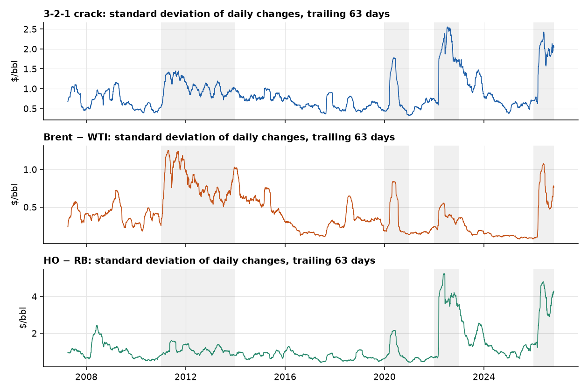

- The ARCH test rejects "no volatility clustering" for all three spreads (p < 0.001).
- In oil this is natural: news, inventory data and supply shocks arrive in clusters.
- The ARCH test also rejects on daily log-ratio returns (p < 0.001), so the same sizing logic applies to the ratio strategies.
- GARCH forecasts beat a constant standard deviation out of sample on all three spreads.

**For a trade:** size each position by forecast volatility, so a calm day and a stormy day risk about the same dollars.

---

## Test 7: when the gap is off, who moves? (VECM)

**In plain English.** If two legs are tied by a rope, one of them must give. A VECM estimates how fast each leg pulls back.

- On futures, only **RBOB** shows a clearly significant adjustment speed (t = −2.9). Crude and diesel adjust slowly or not at all.
- Plausibly because gasoline is the most seasonal leg, so its price has to do the adjusting.
- **In logs**, with the log-ratio as the error-correction term and each leg's held-contract log return as the dependent variable, the answer changes: the leg that adjusts is **crude** (WTI α = +0.017 a day, t = 2.6, in the crack; t = 1.3 in Brent/WTI). The product legs have the wrong sign or are not significant.
- The log-ratio's own pull is −0.010, −0.009 and −0.007 a day (t = −2.3, −1.8 and −1.2), half-lives of 70, 77 and 96 days.
- Who moves depends on the specification (dollars: RBOB, logs: WTI), so we do not build a strategy on it.

**For a trade:** any reversion is slow (median half-lives of 92 to 125 days in the rolling fits), so trades are held for weeks and costs and risk limits matter.

---

# Appendix D. Strategy detail

---

## Mean reversion: all three spreads fail

| Futures, 2010–26, net of costs | G1 Sharpe | G2 trades | G3 eras | G4 settings | G5 crises |
|---|---|---|---|---|---|
| 3-2-1 crack | 0.32 ✗ | 18 ✗ | 2 of 3 ✓ | ✓ | ✗ (−$73k in 2026) |
| Brent − WTI | −0.42 ✗ | 9 ✗ | 0 of 3 ✗ | ✗ | ✗ (−$151k in 2022) |
| HO − RB | 0.06 ✗ | 18 ✗ | 2 of 3 ✓ | ✗ | ✗ (−$84k in 2026) |

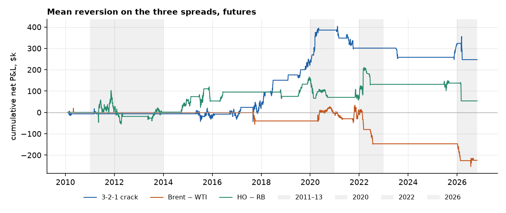

**Why, in terms of the tests.** The levels drift (slide on back-adjusting), so |z| ≥ 2 holds on 40%, 21% and 33% of days, roughly twice as often as on spot prices, which is too often for a true extreme. The ties break in exactly the stress years the gates check. The registered signal also traded the **dollar gap**, which grows with the price level, so it is the wrong object if the anchor is a ratio. The ratio version is tested after the pairs.

---

## Pairs: convergence lost money

- Six cointegrated pairs: net Sharpe **−0.19** on 80 round trips. Only G2 passes.
- Costs are not the cause. At zero cost the Sharpe is −0.14.
- Split the P&L: **convergence lost $294k**, while the pairs' own carry made $129k.
- Without the cointegration gate, the Sharpe is 0.17 (t = 0.70), which still fails G1 and G5.

**What it says economically:** the leash does not hold on a trading horizon. What did pay in the pairs book was the carry between the legs, a hint for the next strategy.

---

## Ratio mean reversion: stationary, but still not tradeable

Pre-registered on 4 November, before any signal or P&L. Same rules and gates as the registered strategy, with one change: z is read from the **log-ratio of market prices** and the legs are dollar-neutral.

| Futures, 2010–26, net of costs | G1 Sharpe | G2 trades | G3 eras | G4 settings | G5 crises |
|---|---|---|---|---|---|
| 3-2-1 crack | 0.22 ✗ | 29 ✓ | 3 ✓ | ✓ | ✓ |
| Brent / WTI | −0.49 ✗ | 15 ✗ | 1 ✗ | ✗ | ✗ (−$348k in 2026) |
| HO / RB | 0.38 ✗ (t = 1.55) | 27 ✓ | 3 ✓ | ✓ | ✓ |
| **Three-spread book** | **0.055 ✗** | 71 ✓ | 2 ✓ | ✓ | ✗ (−$133k in 2026) |

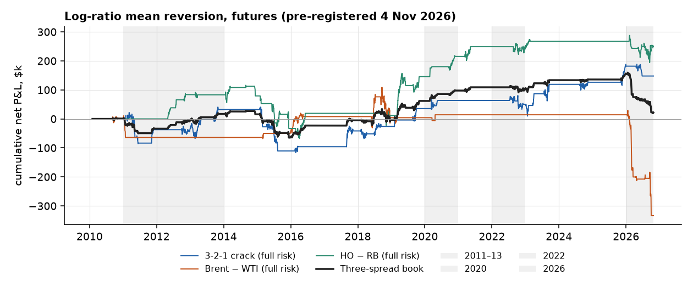

- **Changing the object did not rescue mean reversion.** The same weights with z on the market *dollar* gap give a book Sharpe of −0.05, against +0.06 for the log-ratio. HO/RB is the one spread that improves (0.20 → 0.38).
- Costs are not the cause: at zero cost the book Sharpe is 0.10. It flips sign with the estimation window (−0.06 at 504 days, 0.24 at 1,008).
- Brent/WTI loses in the 2026 supply shock: in the research stream (unrounded size), a short entered in January with 65 units was stopped for −$190k. On the integer book (units capped at 3) Brent/WTI lost $44k in 2026. The half-life gate is open on 90–100% of days, so it does not screen anything out.
- Daily P&L is **−0.18 correlated with the trend and carry book**, and +0.21 with the registered dollar strategy.

**For a trade:** a series can be stationary and still not pay. A 35–50 day half-life, a moving anchor and a few crisis stop-outs leave a Sharpe indistinguishable from zero. HO/RB is the one to watch.

---

## Does the horizon rescue it? A slower version, registered first

- The ratio reverts at **3 to 12 months** (variance ratio 0.66, 0.63 and 0.77 at 63 days, 0.50, 0.41 and 0.48 at one year). The daily strategy held for only **31, 23 and 26 days** on average, where the ratios are close to random walks (0.84, 0.73 and 1.11 at 21 days).
- So we registered one change on 4 November, before any result: decide **monthly** instead of daily. Everything else is as registered, and the daily version re-run in the same code reproduces the earlier result.
- **It made things worse.** Book Sharpe −0.13 against +0.06 daily, on 22 trades instead of 71. It fails G1, G3, G4 and G5. HO/RB, the best spread in the daily version, falls from 0.38 to −0.27.
- **14 of 22 trades ended on the time stop**, and only 3 reached take-profit. The time stops lost $125k in total.
- **A limit:** the time stop is 3 times the half-life fitted at entry (13 to 49 days), so average holds were 52, 106 and 36 days. A full 6 to 12 month hold is still untested.

**For a trade:** slowing the decisions does not help here. Waiting for the gap to close mostly ends in a time stop, not a profit.

---

## Should we test a 12-month hold? Why we stop here

**The case for.** The variance ratios fall with the horizon, the 63-day forward slopes are larger than the 21-day ones, and a slower strategy is cheap to build.

**The case against, which we find stronger:**

- **The evidence is a point estimate.** No log-ratio variance ratio is significant, and we saw it before writing the rules.
- **The sample cannot decide.** There are about 17 non-overlapping years. At the best Sharpe seen anywhere (HO/RB daily, 0.38) it takes about **28 years for t = 2 and 62 years for t = 3**.
- **Forking paths.** This is the **sixth** strategy variant tried on one sample. A seventh, tuned to a horizon we already saw, could not be told apart from luck, and the bar would have to rise (we set t above 3.0 before a pass is called evidence).
- **Longer holds meet more regime breaks.** The two largest losses here are HO/RB in 2026 (−$147k on one trade) and Brent/WTI in 2011 (−$74k).
- **Why we did not do it first.** On back-adjusted dollar changes the variance ratio was about 1 at every horizon, so there was no slow reversion to match. It appeared only in the log-ratio, after the professor's feedback.

**What would change the answer:** more independent bets (more spreads or markets) to raise the power, or tracking the fixed rules forward on new data. More tuning on these three spreads cannot.

---

## The integer book: the ratio strategies with the registered sizing

The gates for the ratio strategies were judged on the **research stream**: units = R / (σ · M), unrounded, so a calm forecast can mean 65 units. The registered sizing also defines an **integer book**: $2m, units = the smaller of the volatility limit and a $40k stop limit, floored and capped at 3, halved after a 10% drawdown, stopped at 20%. It was run for the registered dollar strategy and never for the ratio strategies. Reported here, not gated.

| Integer book, 2010–26 | Sharpe | Total P&L | Max drawdown | Round trips | Mean units | Worst trade | 2026 P&L |
|---|---|---|---|---|---|---|---|
| daily decisions (registered ratio rules) | 0.23 | $121k | 6.0% | 71 | 2.8 | −$41k | −$82k |
| monthly decisions (slow version) | -0.13 | −$63k | 6.7% | 22 | 2.9 | −$83k | −$111k |
| registered dollar-gap strategy (reference) | 0.13 | $67k | 9.4% | 43 |  |  |  |

| Run | Spread | Sharpe | 2026 P&L | Worst trade |
|---|---|---|---|---|
| daily decisions | 3-2-1 crack | 0.14 | −$29k | −$41k |
| daily decisions | Brent / WTI | -0.34 | −$44k | −$20k |
| daily decisions | HO / RB | 0.30 | −$10k | −$25k |
| monthly decisions | 3-2-1 crack | 0.18 | −$8k | −$14k |
| monthly decisions | Brent / WTI | -0.16 | $0 | −$25k |
| monthly decisions | HO / RB | -0.27 | −$103k | −$83k |

- **Same trades, smaller size.** The daily ratio rules take the same 71 round trips, with units of 2.8 on average (cap 3), against up to 65 in the research stream.
- **The tail shrinks.** The worst trade falls from $190k to $41k, and Brent/WTI's 2026 loss from $348k to $44k.
- **The Sharpe rises** from 0.055 to 0.23, above the registered dollar strategy's 0.13, and the maximum drawdown is 6.0% against 9.4%. It is still below the 0.5 bar.
- The slow (monthly) version stays negative (−0.13), and HO/RB's 2026 loss is still $103k.
- Scale differs: the integer book adds the three spreads at up to 3 units each, while the research book averages three spreads at full risk.

---

# Appendix E. Follow-up checks

Two follow-up checks: whether the conclusions change at a monthly horizon, and direct tests of the trend and carry signals.

---

## A1. Horizon check: do monthly changes tell a different story?

**Why.** The daily tests look at lags of up to 40 days. A 12-month trend signal acts at a longer horizon, so we repeat the ACF and PACF on monthly changes.

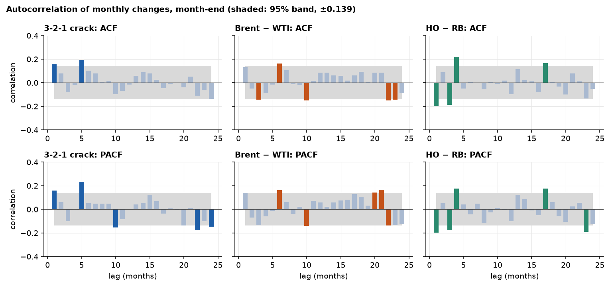

- Month-end back-adjusted values, January 2010 to September 2026 (200 changes, band ±0.139).
- Lag 1: crack +0.15, Brent − WTI +0.13, HO − RB −0.20. Others scatter across lags 5 to 24.
- About 5% of 144 bars (about 7) would fall outside the band by chance.

---

## A2. Is it AR(1), AR(4), or neither?

| Monthly changes, month-end | Lag-1 ACF | AR(1) φ p-value | BIC picks | AIC picks |
|---|---|---|---|---|
| 3-2-1 crack | +0.15 | 0.087 | AR(0) | AR(5) |
| Brent − WTI | +0.13 | 0.196 | AR(0) | AR(6) |
| HO − RB | −0.20 | 0.103 | AR(1) | AR(4) |

- **AR(4)** comes from AIC and only lag 1 is ever significant in those fits. It has no economic story: why would a spread depend on the move four months ago?
- **AR(1)** is not significant for any spread at 5%.
- **Averaging creates echoes.** If you average daily prices into a monthly mean, a pure random walk gets a lag-1 autocorrelation of about +0.25 (simulated: 0.24). Monthly means here give +0.20, +0.31 and +0.23. Month-end sampling avoids this.
- HO − RB's negative lag 1 is short-term reversal of changes, not a stable mean for the level.

---

## A3. Are the three spreads random walks?

| Month-end levels, 2010–26 | ADF p | KPSS p | Half-life (months) |
|---|---|---|---|
| 3-2-1 crack | 0.989 | 0.010 | none |
| Brent − WTI | 0.029 | 0.010 | 26 |
| HO − RB | 0.844 | 0.065 | 25 |

- **Economics says anchored in the long run**: refiners, shippers and storage hold gaps in range.
- **The data say the pull is too slow to trade**: half-lives of 25 months or more, and none for the crack. Over 2007–26 the half-lives are 97 months for Brent − WTI and 34 for HO − RB.
- Brent − WTI rejects a unit root on ADF but KPSS also rejects stationarity, so the tests disagree.
- **Reading:** close to a random walk at trading horizons. This supports the failed mean-reversion gates, but does not prove them: about 200 monthly points is low power, and the backtest uses daily data.
- **Month-end log-ratios of market prices (2007–26):** ADF p is 0.000 for the crack, 0.001 for Brent/WTI and 0.251 for HO/RB (0.000 once calendar-month effects are removed). For the crack the same removal gives ADF p = 0.378 (PP 0.001), and its ADF verdict depends on which day of the month is sampled (see the frequency ladder in full). Brent/WTI passes all three tests (KPSS p ≥ 0.10), the other two fail KPSS.
- **Why this table and the log-ratio disagree on half-lives.** The dollar rows above are the back-adjusted level, which carries 20 years of accumulated roll gaps (the gap alone fails ADF at p = 0.97 for the crack), so half-lives of 25 months or more are partly that drift. The market log-ratio at month-end has half-lives of about 97, 99 and 43 days. Different object, different half-life. Appendix A1 to A4 were run on back-adjusted dollars and were not recomputed on the log-ratio.

---

## A4. Direct test of trend: do moves persist?

**In plain English.** The variance ratio asks whether a 12-month move is bigger than 12 times a 1-month move. Above 1 the moves feed on themselves (trend). Below 1 they partly undo themselves.

| Month-end, 2007–26 | Variance ratio (12 m) | p-value | Trend Sharpe, before costs |
|---|---|---|---|
| WTI | 1.17 | 0.56 | 0.03 |
| Brent | 1.32 | 0.32 | 0.27 |
| RBOB | 0.99 | 0.96 | 0.04 |
| ULSD | 1.37 | 0.27 | 0.37 |
| 3-2-1 crack | 1.11 | 0.69 | 0.42 |
| Brent − WTI | 0.94 | 0.85 | 0.37 |
| HO − RB | 0.71 | 0.47 | −0.08 |

- Brent and ULSD lean toward persistence, HO − RB leans toward reversal. **None is significant.**
- These are on back-adjusted dollar changes. On held log returns the outrights at one year are Brent 1.34, ULSD 1.46, WTI 1.11 and RBOB 1.05, also not significant.
- That matches the strategy result: trend is positive but statistically thin.

---

## A5. Direct test of carry: does the curve slope predict returns?

Change in the held contract over the next 21 trading days, regressed on the curve slope (M1 − M2).

| Instrument | Sign of slope: coefficient ($/bbl) | t | Size of slope: coefficient (per 1%) | t |
|---|---|---|---|---|
| WTI | +0.46 | 1.14 | −0.22 | −1.27 |
| Brent | +0.62 | 1.53 | +0.19 | 0.61 |

- **Sign** has the right direction on both (backwardation, then higher returns), but neither clears t = 2.
- **Size** adds nothing, and for WTI it points the wrong way. Only the sign of the slope carries information.
- The strategy uses the sign only, so this is consistent with the rules.
- RBOB and ULSD are outside the registered carry sleeve (seasonal curves). Their results are mixed (RBOB t = −2.7, wrong sign; ULSD t = 2.1).

---

## A6. Is carry timing, or a disguised long?

**Idea.** Split each position into its average (a constant long or short, "passive") and its deviation from that average ("dynamic", the timing). If the dynamic part earns the P&L, the signal is timing.

| Carry sleeve, 2010–26 | Average position (units) | Dynamic share of gross P&L | t of dynamic part |
|---|---|---|---|
| WTI | −0.52 | 101% | 1.7 |
| Brent | +1.35 | 77% | 1.4 |

- WTI's average position is slightly short, yet it earned money, so the P&L is timing and not a long bias.
- Brent has a long bias, but timing still explains about three-quarters of its P&L.
- In an unregistered extension, ULSD carry's dynamic share is 125% (t = 1.95).

<!-- Speaker: an independent run reported 105% / 101% / 76% for ULSD / WTI / Brent with ULSD t = 2.20. WTI and Brent reproduce; ULSD does not exactly. -->

---

## A7. Is it alpha, or oil beta?

Daily sleeve P&L regressed on daily WTI and Brent price changes. The intercept is alpha, what remains after the exposure to oil.

| Book | Raw Sharpe | Alpha t-statistic | Sharpe from alpha |
|---|---|---|---|
| Trend | 0.27 | 0.26 | 0.06 |
| Carry | 0.45 | 1.53 | 0.38 |
| 50/50 book | 0.44 | 1.17 | 0.29 |

- Trend's return is **mostly oil exposure**: its alpha is indistinguishable from zero.
- Carry keeps most of its return after removing oil exposure, though its t-statistic falls from 1.8 to 1.5.
- This weakens the case for trend and strengthens carry's.

<!-- Speaker: rebuilt here, the GARCH refit differs slightly from the committed run, so trend Sharpe is 0.27 against 0.29 committed. The independent run reported 0.29 / 0.33 / 0.09 for trend. Carry matches. -->

---

## A8. What these checks do not show

- **Low power.** Roughly 200 monthly points: a slow reversion or a small trend would not be detected.
- **Different horizons.** Tests on monthly changes and a backtest on daily data answer related, not identical, questions.
- **Several tests, few corrections.** Daily lags are corrected for multiple testing. The monthly lags are not.
- **Unregistered extras.** RBOB and ULSD carry and the beta regressions were run after seeing the results, so they describe, and do not change any verdict.
- **Ratio studies.** The variance ratios, the roll decomposition and the forward-return regressions on log-ratios are descriptive and were run after the other results. No variance ratio on a log-ratio is significant (robust p from 0.15 to 0.98).
