# Abstract

We test whether three spreads inside the oil complex can be traded as mean-reverting relative-value pairs, as our research plan proposed. Each spread is held together by a physical arbitrage:

- the **3-2-1 crack**: crude against gasoline and diesel
- **Brent–WTI**
- **diesel minus gasoline** (HO − RB)

We use daily FRED and EIA spot prices from 2007 to 20 October 2026 and follow a ten-step pipeline:

- summary moments and seasonality
- unit-root, Engle–Granger and Johansen tests
- a seasonally adjusted AR(1) fair value with a half-life entry gate
- a GARCH(1,1)-t volatility forecast for sizing
- a pooled logit regime filter
- a walk-forward backtest

**Five pass/fail gates, the trading rules, the spread definitions and the filter features were fixed on 24 October 2026, before any data was downloaded.** Every estimate uses only information available at the time.

The evidence is weak:

- **Fat tails.** Spread changes are extremely fat-tailed: a fitted Student-t has ν ≈ 2–2.6. Each spread is stationary over the full sample, but a rolling three-year ADF test confirms stationarity in only 35–46% of months, with breaks in 2011–13, 2022 and 2026.
- **The regime filter has no out-of-sample skill.** Its AUC is 0.51, and its Brier score is worse than the base rate. In practice it is an off switch: P(revert) clears the 0.6 entry threshold on 3–16% of days.
- **No spread passes.** The 3-2-1 crack makes 6 trades (Sharpe −0.02), Brent–WTI 2 trades (0.13) and HO − RB 19 trades (0.25). HO − RB comes closest, but it passes only the threshold-stability gate. It fails the Sharpe, trade-count, sub-period and stress gates; on the last, the filter kept it out of a profitable 2026.
- **The one durable signal** is HO − RB without the filter (Sharpe 0.27, t = 1.1). It is too weak to survive a multiple-testing correction, and acting on it now would be exploratory.

On the latest data, no spread meets the plan's switch-on triggers. GARCH sizing would give the crack and HO − RB zero contracts.

**These are spot-proxy results.** The pre-registered binding test needs Bloomberg futures curves, which are not yet exported.

# 1. Introduction

Flat-price oil is close to a random walk and, in 2026, moves on war headlines. Our plan (`oil-rv-plan.md`) proposed trading the *gaps* inside the complex instead. It is the same logic as our Project 2 2s10s trade, moved from the Treasury curve to the barrel:

- **Crude vs products (the crack).** If refining margins get too wide, refiners run harder. If margins go negative, they cut runs.
- **Brent vs WTI.** The gap is held near the cost of shipping US crude abroad.
- **Diesel vs gasoline.** Refiners can shift yields between products only so far, so the premium of one over the other should mean-revert, after seasonality is removed.

Each of these spreads should therefore be cointegrated. An unusually wide gap would be a bet with positive expected value, taken with barrel-neutral futures legs.

**The 2026 backdrop is extreme.**

- **The shock.** The US and Israel struck Iran on 28 February 2026, and Iran closed the Strait of Hormuz.
- **Prices.** Brent passed \$100 in March. The 3-2-1 crack averaged about \$65/bbl in early October, against a long-run median near \$19. NY Harbor diesel traded about \$113/bbl over WTI.
- **Policy response:** the IEA's largest-ever stock release on 11 March, and a further diesel-heavy G7 release from 2 October.

This is exactly the setup in which naive mean reversion loses money. The plan therefore puts heavy weight on a regime filter that should keep the book out of war regimes.

**We put the strategy in the best position to answer honestly:**

1. **Pre-registration.** Gates, rules, spread definitions, filter features and the binding-data rule were written into `config.yaml` and `PREREGISTRATION.md`, committed and tagged in git before any download. Automated tests fail if any registered value changes.
2. **No look-ahead.**
   - Every parameter used on day *t* is estimated on the 756 trading days strictly before the month start.
   - Trades fill at the next close.
   - Weekly inventories, positioning data and the geopolitical-risk index are stamped on the day they became public.
   - Tests perturb all data after a date and confirm that nothing before it changes.
3. **Reproducibility.** Everything runs from six scripts, with 82 automated tests (Appendix D).

# 2. Data

| Data | Source | Identifier | Use |
|---|---|---|---|
| WTI and Brent spot, $/bbl | FRED (from EIA) | `DCOILWTICO`, `DCOILBRENTEU` | Crude legs |
| NY Harbor conventional gasoline, $/gal | FRED | `DGASNYH` | Gasoline leg (RB proxy) |
| NY Harbor ULSD, $/gal | EIA daily spot sheet | `EER_EPD2DXL0_PF4_Y35NY_DPG` | Diesel leg (HO proxy) |
| Crude oil implied volatility | FRED | `OVXCLS` | Filter: OVX percentile |
| US weekly stocks and refinery runs | EIA Weekly Petroleum Status Report | `WCESTUS1`, Cushing, `WGTSTUS1`, `WDISTUS1`, `WPULEUS3` | Filter: inventories against their 5-year average |
| Daily geopolitical risk | Caldara–Iacoviello | GPRD | Filter |
| Managed-money positions | CFTC disaggregated COT | NYMEX WTI, RBOB, ULSD | Robustness feature |
| Hurricane landfalls | NHC HURDAT2 (+ 2026 by hand) | — | Entry blackout |
| OPEC/OPEC+ meetings, stock releases, Hormuz events | Built by hand, with a `verified` column | — | Blackout and readout |
| Futures curves (CL, CO, XB, HO) | Bloomberg at SMU | pending export | **Binding test** (not yet run) |

: Table 1. Data sources. All but Bloomberg are free and public.

**Sample and units.**

- **4,848** days from 3 January 2007 to 20 October 2026, keeping only days on which all four legs price. Gasoline and diesel are converted to \$/bbl (× 42).
- **Levels, not logs.** We work in price levels because WTI spot printed −\$36.98 on 20 April 2020. That week is flagged and kept in the core run, and a pre-registered robustness run drops it.

**Point-in-time stamping.**

- Weekly EIA stocks count as known from the Thursday after the week ends.
- COT positions count as known from the Friday release.
- GPR is lagged one day.

**The event calendar** has 98 OPEC/OPEC+ events, 19 hurricane-strength Gulf Coast landfalls (Humberto 2007 to Isaias 2026), 10 Hormuz events and 6 stock releases.

- **Verification:** opec.org blocks automated access, so 75 of the 98 OPEC dates were compiled from memory and are flagged `verified = no` for checking.
- **Effect:** the blackout covers 4.5% of days.

The spot crack on 20 October 2026 is \$46.94/bbl, against a 2007–26 median of \$19.42 (Figure 1).

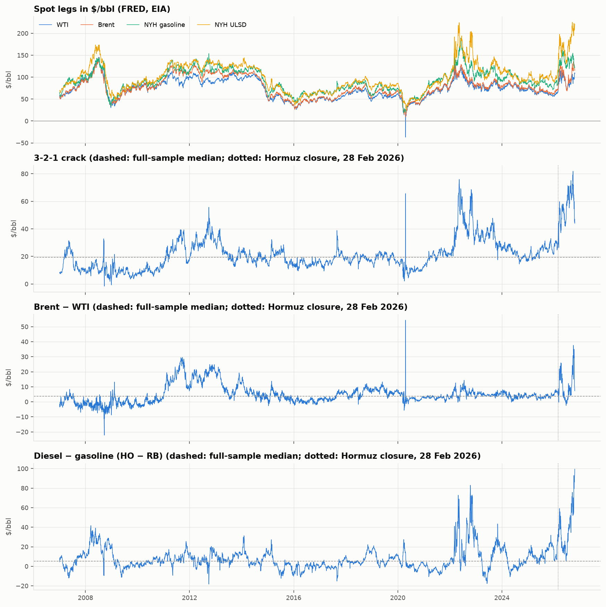

# 3. Research design

## 3.1 The strategy in one card

| Spread | Definition (\$/bbl) | Legs per unit | \$ per \$1/bbl per unit (M) | Seasonally adjusted |
|---|---|---|---|---|
| 3-2-1 crack | (2·42·RB + 42·HO − 3·CL)/3 | short 3 CL, long 2 RB, long 1 HO | 3,000 | yes |
| Brent–WTI | Brent − WTI | long 1 Brent, short 1 CL | 1,000 | no |
| HO − RB | 42·(HO − RB) | long 1 HO, short 1 RB | 1,000 | yes |

: Table 2. Traded spreads. Every contract is 1,000 barrels, so the legs are barrel-neutral.

**Fair value and signal.** At each month start, on the 756 trading days before it, we remove in-window month-of-year means $\text{seas}_m$ from the spread *S*, then compute

$$z_t = \frac{S_t - \text{seas}_{m(t)} - \mu}{\sigma}, \qquad h = \frac{\ln 2}{-\ln b},$$

where μ and σ are the window mean and standard deviation of the deseasonalised spread and *b* is its AR(1) coefficient.

**Rules.**

- **Entry:** 2 ≤ |z| < 4, provided the half-life *h* is in [5, 120] days, |z| has been below 2 since the last exit, the fill would not fall within one trading day before an OPEC meeting or landfall, and the filter's P(revert) ≥ 0.6.
- **Take profit:** at |z| ≤ 0.5.
- **Stops:** |z| ≥ 4, more than 3 × *h* days held, P < 0.4, or the half-life leaves the band at a monthly re-test.

**Sizing.**

- **Research stream (gated):** units = R/(σ̂·M), with R = \$6,000 a day and σ̂ the GARCH forecast.
- **Integer book (reported):** the plan's
$$N = \min\left(\left\lfloor \frac{R}{\hat\sigma\, M}\right\rfloor, \left\lfloor \frac{L}{(4 - |z|)\,\sigma\, M}\right\rfloor, 3\right),$$
with L = \$40,000 per trade, sizes halved after a 10% book drawdown and trading stopped after 20%.

**Costs:** \$0.05/bbl of spread per unit per side.

## 3.2 Pre-registered gates

| # | Gate | Threshold |
|---|---|---|
| G1 | Net annualised Sharpe | > 0.5 |
| G2 | Round trips | ≥ 20 |
| G3 | Sub-periods with positive net P&L (2007–13, 2014–19, 2020–26) | ≥ 2 of 3 |
| G4 | Net Sharpe at every entry \|z\| ∈ {1.5, 2.0, 2.5} | > 0 |
| G5 | In 2022 **and** 2026: filtered net P&L ≥ unfiltered, and > −\$40,000 | both years |

: Table 3. Success gates, registered 24 October 2026 before any data. They are judged per spread on the `fixed` variant with all rules on.

**G5 is new relative to Project 2.** It turns the plan's key question, *did the filter keep the strategy out of 2022 and 2026?*, into a pass/fail rule.

**Variants and ladder.**

- **`johansen` variant** (crack only, not gated): replaces 3:2:1 with the first Johansen vector, refit monthly.
- **Ladder:** every run is reported step by step. *Core* sizes on the window sd; then GARCH sizing is added, then the blackout, then the logit filter. The last step is the gated configuration.

## 3.3 Spot proxy versus the binding test

**The pre-registration makes the verdict binding on futures:**

- Bloomberg CL, CO, XB and HO curves
- legs matched by delivery month
- rolled five business days before the earliest leg's expiry
- additive back-adjustment

The futures loader is built and tested on synthetic curves, but the export is pending. The model, filter and backtest still need to be wired to per-spread futures legs and roll flags (each spread holds its own delivery month) before the binding run can be made. Every number in this report is therefore a **spot proxy**: run with the identical frozen configuration and labelled as such. Nothing was changed after any result was seen.

Spot and futures spreads differ, most of all during physical dislocations. Two examples show up in this sample:

- **Gasoline grade switches.** NY Harbor spot gasoline switches grade (RVP) every February and March, which shows up as reversing spikes.
- **April 2020.** The −\$36.98 WTI print would not appear in a held futures contract, because the roll rule holds the June contract on that day.

# 4. Stylised facts (Step 3)

| Daily change (\$/bbl) | SD | Excess kurtosis | Excess kurtosis excl. Apr 2020 | Student-t ν | Share beyond 4 SD |
|---|---|---|---|---|---|
| 3-2-1 crack | 1.96 | 210.5 | 18.3 | 2.2 | 0.66% |
| Brent–WTI | 1.78 | 346.0 | 22.9 | 2.6 | 0.35% |
| HO − RB | 2.40 | 32.5 | 32.5 | 2.0 | 1.11% |

: Table 4. Moments of daily spread changes, 2007–2026 (a normal distribution puts 0.006% beyond 4 SD). Jarque–Bera and ARCH-LM reject normality and "no volatility clustering" for every spread (p ≈ 0).

**Fat tails, and one day dominates them.** On 20 April 2020 the crack jumped \$53 and reversed the next day. Even without that week, excess kurtosis is 18–33 and a fitted Student-t has about two degrees of freedom (Figure 2). This motivates Student-t GARCH and a hard stop.

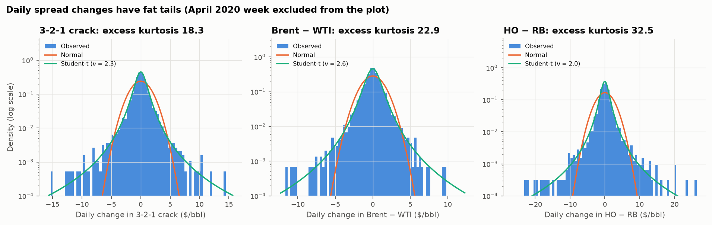

**Volatility clusters, and 2026 is far outside history** (Figure 3). The sd of daily crack changes was \$1.06 in 2014–19 and \$3.65 in 2026. HO − RB rose from \$1.30 to \$6.53 in 2022 and \$5.13 in 2026.

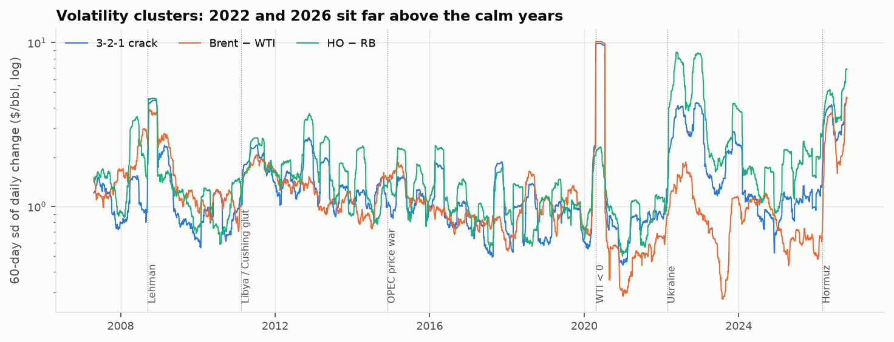

**Seasonality is real and matches the economics** (Figure 4). Month effects are measured by Kruskal–Wallis on monthly averages, detrended with a centred 13-month mean:

| Spread | Seasonal pattern | Peak-to-trough | Kruskal–Wallis p |
|---|---|---|---|
| 3-2-1 crack | strongest Apr–Aug (driving season), weakest Dec–Jan | about \$7/bbl | 0.004 |
| HO − RB | diesel premium peaks Oct–Feb (heating season), lowest May–Jul | about \$15/bbl | < 0.001 |
| Brent–WTI | no significant month effect | — | 0.18 |

This matches the pre-registered choice to seasonally adjust only the crack and HO − RB. STL seasonal strength is low (about 0.1), though: the swings within each year dwarf the seasonal pattern.

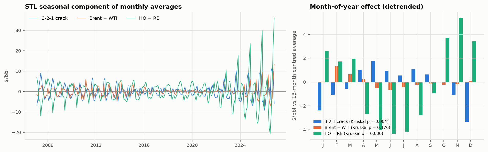

# 5. Stationarity, forecasting and the long-run link (Steps 4–5)

## 5.1 Unit roots

- **Price levels: the tests disagree.**
  - ADF rejects a unit root at 5% for WTI, Brent and gasoline over 2007–26 (p ≈ 0.025), because the sample swings between \$30 and \$140 several times. ULSD keeps its unit root (p = 0.44).
  - KPSS rejects stationarity for all four.
- **Spreads.** Over the full sample, ADF says the crack (p = 0.001) and Brent–WTI (p = 0.003) are stationary; HO − RB is borderline (p = 0.07). KPSS rejects all three. This is the signature of a mean that shifts: structural breaks.

## 5.2 Rolling stationarity: the breaks

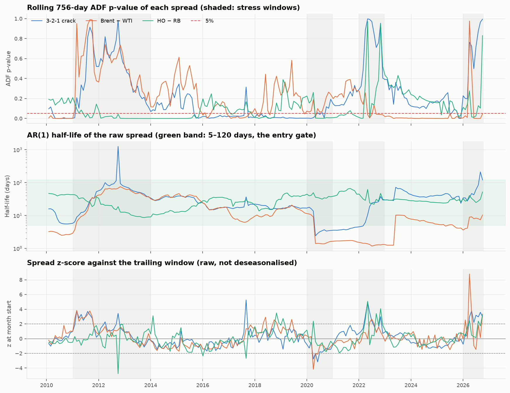

**Rolling ADF** (three-year windows, refit monthly) confirms stationarity in only **35%** (crack), **41%** (Brent–WTI) and **46%** (HO − RB) of months (Figure 5).

- **Where it fails is where the plan expected:**
  - 2011–13, the Cushing glut, for the crack and Brent–WTI
  - 2022 and 2026 for all three
- **Implication:** a hard ADF entry gate would leave few tradeable months, the same lesson as Project 2. ADF therefore enters only as a filter feature.

**April 2020 distorts the half-life for three years.** The half-life entry gate is open in 87%, 71% and 100% of months. But the single April 2020 print pulls Brent–WTI's raw-spread half-life to about 1.4 days in every window that contains it (June 2020 to April 2023).

- **Effect on the gate:** without that week, the median half-life over those months is 9.7 days and the gate is open in 90% of months.
- **Treatment:** the core run keeps the week, as pre-registered. Section 8.4 reports the pre-registered run without it.

## 5.3 Seasonal ARIMA does not beat a random walk

**Setup:** a SARIMA(1,0,0)(1,0,0)₁₂, refit on a rolling 60-month window, forecasting the monthly crack and HO − RB one month ahead (178 forecasts, 2012–26).

**Results:**

- **Against the seasonal naive forecast** ("same month last year"), SARIMA wins easily: RMSE ratios 0.37 and 0.46.
- **Against a random walk** ("next month = this month"), it does not win: RMSE ratios 1.02 and 1.03, Diebold–Mariano p = 0.25 and 0.37.
- **The seasonal AR coefficient is about 0.** At monthly frequency the spreads are dominated by persistence. That supports a simple in-window month-mean adjustment rather than a SARIMA fair value.

## 5.4 Engle–Granger: Brent–WTI and HO − RB

| Regression | Slope | Engle–Granger p | Fixed 1:1 spread ADF p | Rolling EG pass rate | Rolling slope range |
|---|---|---|---|---|---|
| Brent on WTI | 1.08 | 0.005 | 0.003 | 44% | 0.38 – 1.54 |
| HO on RB | 1.18 | 0.006 | 0.067 | 36% | 0.53 – 1.34 |

: Table 5. Full-sample Engle–Granger tests (\$/bbl levels) and their rolling 756-day versions.

- **Both pairs are cointegrated over the full sample.** For Brent–WTI the fixed 1:1 spread is itself stationary.
- **The estimated slopes are unstable** (0.38–1.54 for Brent–WTI). That supports trading the barrel-neutral 1:1 weights rather than an estimated hedge ratio.

## 5.5 Johansen: the crack's three legs

The plan expected **rank 2** for (CL, RB, HO): one cointegrating vector per product crack.

- **Full sample: rank 3.** That is consistent with the price levels themselves looking stationary over 2007–26 (Section 5.1).
- **Rolling three-year windows: the rank is unstable** (Figure 6). It is 0 in 19% of months, 1 in 51%, 2 in only 8% and 3 in 21%.
- **3:2:1 often lies outside the estimated cointegration space.** The median distance is 0.26, and it is 1.0 whenever the rank is 0.

So 3:2:1 is a trading convention rather than an estimated relationship. It is traded because the fixed-weight crack is itself stationary over the full sample.

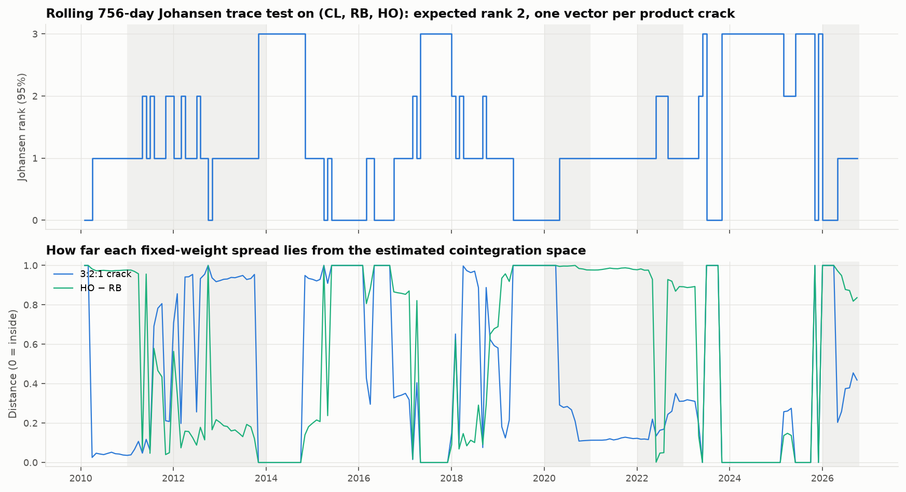

# 6. Model formation (Step 6)

## 6.1 Fair value, half-life and signal frequency

**Median parameters.** The deseasonalised spreads have half-lives of 15–38 days and GARCH persistence α + β of 0.83–0.98. The exception is Brent–WTI in 2020–26, where the median half-life is 4 days because of the April 2020 window effect.

**The raw signal fires often; trades are much rarer.** |z| ≥ 2 holds on 19% (crack), 9% (Brent–WTI) and 17% (HO − RB) of days. Re-arming, the gate and the filter turn these into the few trades of Section 8.

**2026 in the z-paths** (Figure 7):

- The crack's z went above 4 in March 2026 and stayed between 2 and 5 through September: the "extreme all year" pattern the plan warned about.
- HO − RB's z has stayed between 2.8 and 6.2 since August, and at or beyond 4 on 64% of those days.

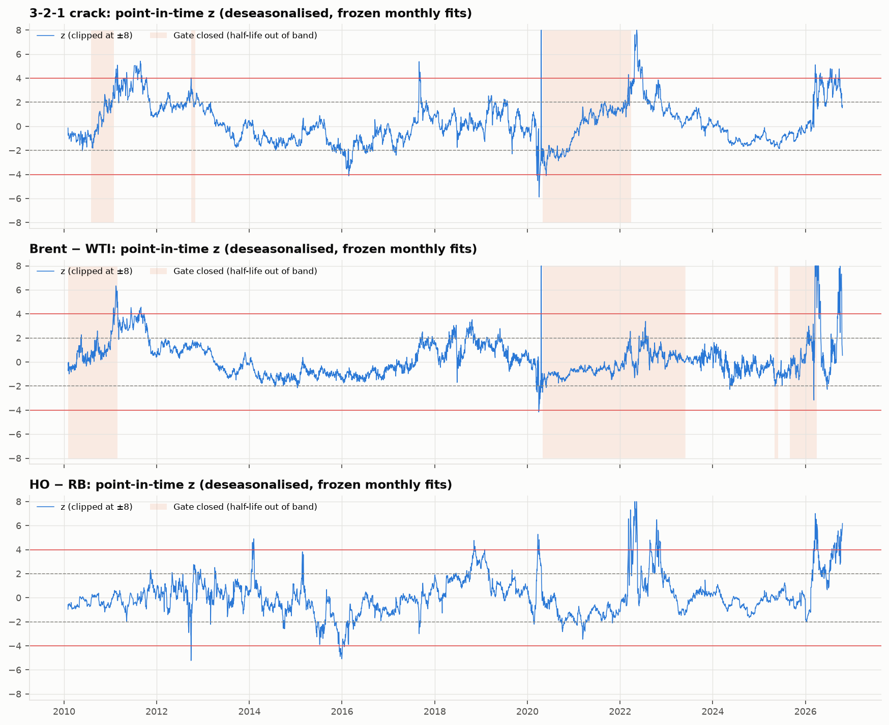

## 6.2 Which leg corrects?

**Method.** With the cointegrating vector fixed at the traded weights, equation-by-equation OLS of each leg's daily change on the lagged spread is the VECM estimator.

**Results** (Figure 8):

- **Crack:** RB corrects it in 35% of three-year windows (t < −2) and HO in 21%. CL corrects in 24%, concentrated in 2020–22.
- **Brent–WTI:** Brent does the correcting in 53% of windows, against 33% for WTI.
- **HO − RB:** HO corrects in 45% of windows, RB in 24%.

This only partly supports the plan's prior that *products adjust and crude does not*. RB does the most correcting, but crude corrects in about a quarter of windows, about as often as HO.


## 6.3 Volatility

**The GARCH(1,1)-t forecast helps.** Out of sample it beats the constant window sd on QLIKE loss for every spread. The gain is significant for HO − RB (t = −3.56) and directional for the crack (t = −1.61) and Brent–WTI (t = −1.29).

**When it falls back.** GARCH falls back to the window sd when a fit fails or is non-stationary:

| Spread | Months on the fallback |
|---|---|
| 3-2-1 crack | 9% |
| Brent–WTI | 27% (mostly windows containing April 2020) |
| HO − RB | 10% |

## 6.4 The Johansen variant

The first Johansen vector, scaled to −3 CL, gives usable weights in only **58%** of months. It is unusable when the rank is 0 or when the CL loading is near zero (a weight above 10). When usable, the HO weight swings between −5 and +6 (Figure 8). With the half-life gate, the variant can trade in only 35% of months.

# 7. Regime filter (Step 7)

**Episode and label.** An episode is a crossing into 2 ≤ |z| < 4 after |z| has been below 2, labelled with the parameters frozen on the signal day. It succeeds if |z| ≤ 1 within 20 trading days before touching 4.

**Model.** A single logit, pooled over the three spreads with spread dummies, is refit monthly on episodes already resolved. It uses five pre-registered features:

- OVX percentile
- GARCH volatility percentile
- rolling ADF p-value
- log GPR
- inventories against their 5-year average

**Results.**

| Spread | Episodes | Reverted | Out-of-sample AUC |
|---|---|---|---|
| 3-2-1 crack | 42 | 24% | 0.47 |
| Brent–WTI | 32 | 47% | 0.46 |
| HO − RB | 41 | 46% | 0.44 |
| **Pooled** | **115** | **37%** (out of sample) | **0.51** |

: Table 6. Episodes and out-of-sample discrimination. The filter's first fit is September 2014.

- **The filter has no skill.** Its Brier score (0.279) is worse than a point-in-time base rate (0.237). Calibration shows no relationship: 25–50% of episodes revert in each probability bin, with no upward trend.
- **No feature matters.** None is significant even in a full-sample (look-ahead) fit.
- **The conclusion is robust.** Probit, the robustness features (positioning, hurricane season, event proximity) and 10- or 40-day labels all give AUC 0.47–0.54.
- **Why base rates are low.** The 20-day label is short next to half-lives of 25–35 days: getting from |z| = 2 to 1 takes about one half-life. With the 40-day label the base rate rises to 55%, but AUC is still 0.48.

**In practice the filter is an off switch.** The 0.6 entry threshold sits far above the base rate. P(revert) clears it on only 4% of days for the crack and Brent–WTI (3% for Brent–WTI alone) and 16% for HO − RB, and only 9 of 92 episodes passed.

- **Stress years:** it blocked every crack and Brent–WTI episode in 2020, 2022 and 2026.
- **It is not discriminating.** In 2026, 8 of the 17 blocked episodes would have reverted.

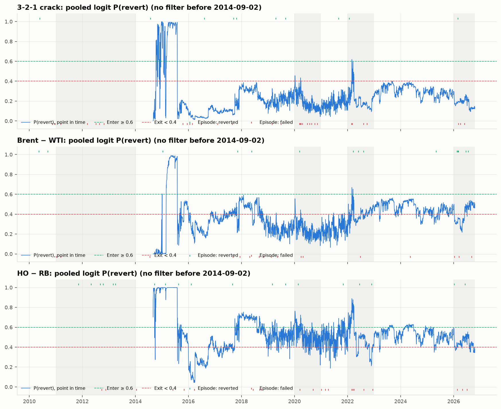

# 8. Backtest results (Steps 8–9)

## 8.1 Gate verdicts

| | G1 Sharpe > 0.5 | G2 ≥ 20 trades | G3 ≥ 2 positive sub-periods | G4 Sharpe > 0 at entry 1.5 / 2.0 / 2.5 | G5 2022 & 2026 | **Verdict** |
|---|---|---|---|---|---|---|
| 3-2-1 crack | −0.02 ✗ | 6 ✗ | 1 ✗ | 0.30 / −0.02 / −0.08 ✗ | ✓ | **FAIL** |
| Brent–WTI | 0.13 ✗ | 2 ✗ | 2 ✓ | 0.19 / 0.13 / −0.08 ✗ | ✓ | **FAIL** |
| HO − RB | 0.25 ✗ | 19 ✗ | 1 ✗ | 0.63 / 0.25 / 0.22 ✓ | ✗ | **FAIL** |

: Table 7. Pre-registered gates on the spot proxy (research stream, R = \$6,000 a day, \$0.05/bbl per side). Not binding: the binding test needs futures.

**All three spreads fail.**

- **Crack:** fails four gates. Without the filter it loses money, and the filter leaves only 6 trades.
- **Brent–WTI:** the filter leaves only 2 trades in 16.7 years.
- **HO − RB comes closest, but passes only G4:** its Sharpe is positive at every entry threshold. It has 19 trades (one short of G2), only one positive sub-period, and a Sharpe of 0.25. It also fails G5: in 2026 the filter kept it flat while the unfiltered book made \$46.9k.
- **None is statistically significant.** No Sharpe ratio has a t-statistic above about 1.3. Three spreads and two variants were tested, so even the best figure would not survive a multiple-testing correction.

## 8.2 What each layer adds

| Spread | Core | + GARCH sizing | + blackout | + logit (gated) | Trades: core → gated |
|---|---|---|---|---|---|
| 3-2-1 crack | −0.16 | −0.07 | −0.07 | −0.02 | 26 → 6 |
| Brent–WTI | 0.04 | 0.04 | 0.04 | 0.13 | 18 → 2 |
| HO − RB | 0.30 | 0.32 | 0.27 | 0.25 | 33 → 19 |
| Crack, `johansen` (not gated) | 0.04 | 0.14 | 0.13 | 0.07 | 20 → 6 |

: Table 8. Net Sharpe ratio as each layer is added (research stream).

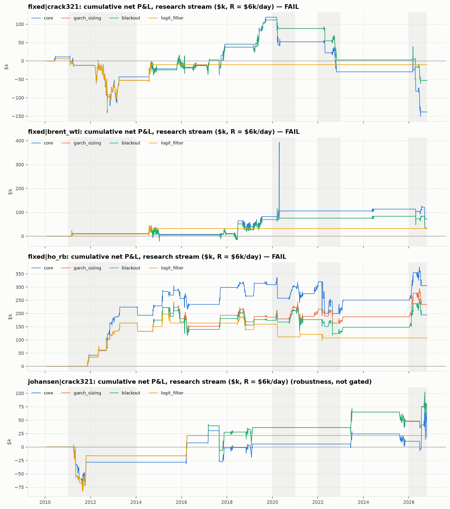

Reading the ladder (Figure 10):

1. **GARCH sizing helps every spread.**
   - The crack's maximum drawdown falls from \$270k to \$172k, and Brent–WTI's from \$322k to \$127k.
   - Most of the core step's damage comes from sizing on a window sd inflated by April 2020. The Brent–WTI core book gained \$284k on 20 April 2020 and gave back \$291k the next day.
2. **The blackout binds rarely, and here it hurts.** It moves two HO − RB entries off the eve of OPEC meetings (June 2015 and November 2021). The second was a \$27.7k winner, so HO − RB's Sharpe falls from 0.32 to 0.27. (Before the code-review correction in Appendix C, the blackout was applied one day too early and never bound.)
3. **The filter mainly removes trades.** It improves the crack's and Brent–WTI's Sharpe only by cutting exposure, and it lowers HO − RB's.
4. **Without the filter, fading the crack loses.**
   - It loses in 2010–13 and in 2020–26.
   - Stop-losses are its most common exit: 11 of 26 trades.
   - This is the plan's warning ("fading the 2026 crack would have hurt") seen in the data.
5. **HO − RB without the filter is the one consistent edge.**
   - Sharpe 0.27 (t = 1.1), 59% winning trades, \$195k over 16.7 years at R = \$6,000 a day.
   - Positive in all three sub-periods, but 84% of the profit was made in 2010–13.

## 8.3 The stress years

| Window | Crack: unfiltered → gated | Brent–WTI: unfiltered → gated | HO − RB: unfiltered → gated |
|---|---|---|---|
| 2020 | −\$23.3k → \$0 | +\$6.3k → \$0 | +\$37.1k → −\$48.2k |
| 2022 | −\$85.5k → \$0 | \$0 → \$0 | −\$44.1k → −\$13.5k |
| 2026 to date | −\$55.8k → \$0 | −\$49.6k → \$0 | +\$46.9k → \$0 |

: Table 9. Net P&L in the stress windows without and with the logit filter.

**The filter does what G5 asks for the crack and Brent–WTI:** it kept them out of losing 2022 and 2026 trades. But it does so by being off almost all the time, and it cost HO − RB a profitable 2026.

## 8.4 Robustness (pre-registered, never gated)

| Run | Crack | Brent–WTI | HO − RB |
|---|---|---|---|
| Base (gated) | −0.02 | 0.13 | 0.25 |
| 504-day window | 0.01 | −0.00 | 0.09 |
| 1,008-day window | 0.02 | 0.32 | 0.21 |
| 10-day label | −0.02 | 0.02 | 0.27 |
| 40-day label | −0.02 | 0.01 | 0.24 |
| Drop April 2020 week (gated) | −0.04 | 0.24 | 0.25 |
| Drop April 2020 week (no logit) | −0.11 | 0.15 | 0.32 |

: Table 10. Net Sharpe ratio under the pre-registered robustness runs.

- **Nothing reaches 0.5** except HO − RB at entry |z| = 1.5. That row of the entry × exit grid gives 0.56–0.63 with 34–36 trades (Figure 11), but choosing it after the fact would be exploratory.
- **Costs matter little because trades are rare.** At \$0.20/bbl per side, HO − RB's Sharpe falls from 0.27 (zero cost) to 0.21, and the others move by 0.02 or less.

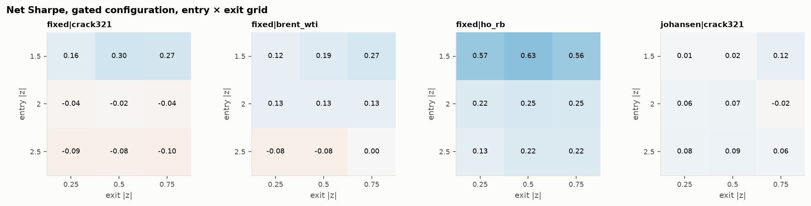

## 8.5 The integer book

**Setup:** a \$2m book with whole contracts, the stop-distance limit and the drawdown rules (Figure 12).

**Whole contracts shrink the book.** The worked example B in our plan shows up repeatedly: volatile regimes size to zero contracts. The size rule blocked an otherwise valid entry on 200 signal-days without the logit, and 29 with it.

| Book | Result | Sharpe | Max drawdown | Trades | Notes |
|---|---|---|---|---|---|
| Gated | +\$36.8k | 0.07 | 3.9% | 24 | No trade since March 2022 |
| Without the logit | +\$127.4k | 0.09 | 12.5% | 62 | Drawdown triggered the halving rule: half size from April 2022 to date |

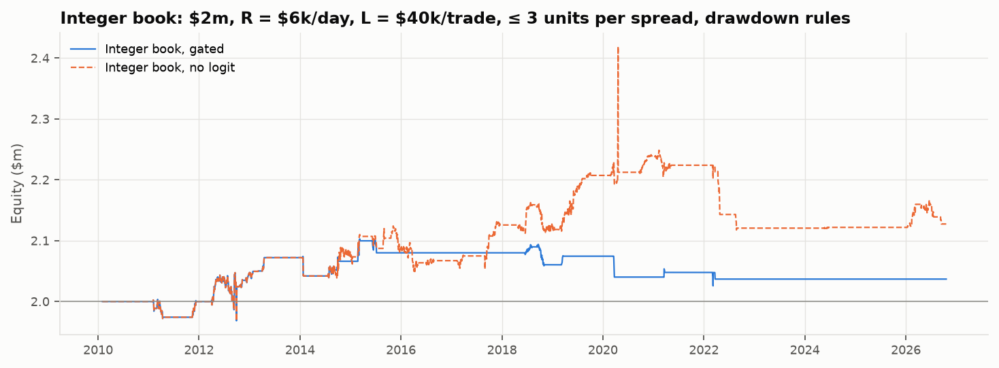

# 9. The oil complex now (Part 7 readout)

**State on 20 October 2026, under the gated rules** (Figure 13):

| Spread | z | P(revert) | GARCH σ̂ (\$/bbl a day) | σ̂ percentile in its history | Status |
|---|---|---|---|---|---|
| 3-2-1 crack | 1.8 | 0.14 | 5.2 | 99th | No signal. A 2σ entry would size to **0 contracts** (volatility limit 0.38) |
| Brent–WTI | 0.6 | 0.50 | 1.5 | 78th | No signal. Its trigger needs futures data in any case |
| HO − RB | 6.2 | 0.38 | 7.7 | 99th | Beyond the stop; no entry allowed |

: Table 11. Current state on spot data to 20 October 2026.

- **The crack is the plan's worked example B in real data,** with σ̂ about twice the \$2.50 the example assumed.
- **The dislocation is now all in diesel.** The diesel crack is \$113/bbl, with its volatility in the 99th percentile, while the gasoline crack has collapsed to about \$14.
- **No spread meets the plan's switch-on triggers:**
  - P(revert) ≥ 0.6
  - the relevant volatility back under its 80th percentile
  - no Hormuz closure for four weeks (the last logged closure was 27 September)

**The plan's "diesel first" candidate trade** (sell HO, buy RB in Q1–Q2 2027 months) is therefore not supported under the registered rules. z is past the stop, volatility is extreme, and the rules failed the spot-proxy gates.

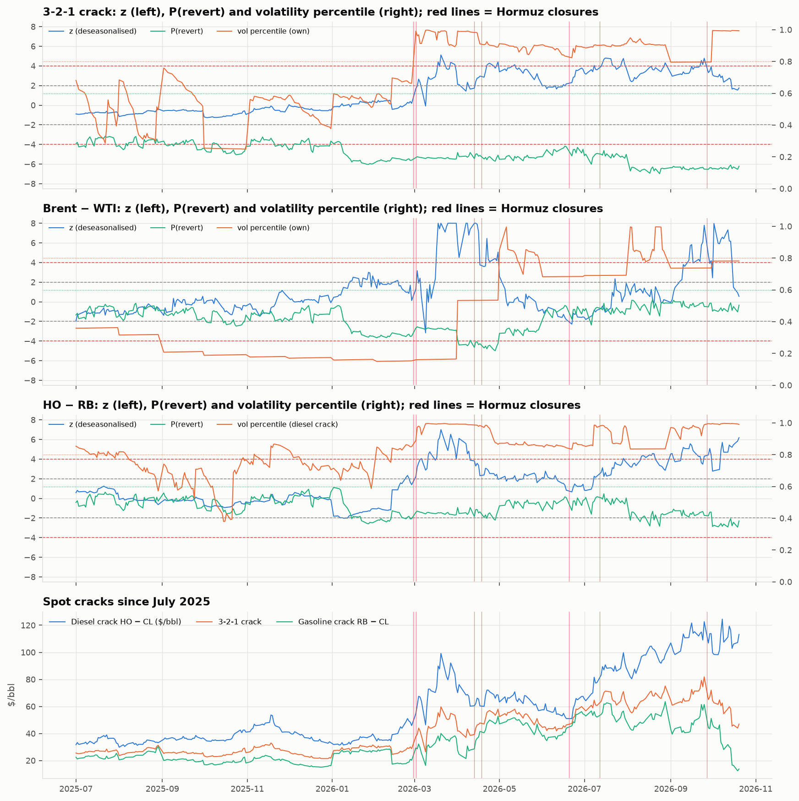

# 10. Discussion

**Why the strategy fails on the spot proxy.**

1. **The physical anchors are real but slow and breakable.** Half-lives of 15–38 days mean a 2σ gap takes about a month to halve. In 2011–13, 2022 and 2026, the anchor itself moved: Cushing congestion, Russian diesel exports, Hormuz. Stationarity holds in fewer than half of the three-year windows.
2. **Fat tails meet a hard stop.** With ν ≈ 2, moves from 2σ to 4σ are common. The crack's stop-losses outnumber its take-profits.
3. **The regime filter cannot tell good regimes from bad.** Its features are proxies for "stress", and stress is when most signals fire. With only 115 episodes and the stress years overlapping, a logit has little to learn. The 0.6 threshold then makes it a near-permanent off switch.
4. **Volatility-scaled sizing is the strongest risk control.** In every stress year it shrank positions to almost nothing, which the plan anticipated.

**Diesel–gasoline is the most promising spread.** It has the clearest economics (refiners' yield flexibility). Gated, it passes only the threshold-stability gate, but without the filter it is positive across sub-periods and entry thresholds. A pre-registered follow-up could test it on futures with a filter designed for it. That would be a new study, not a rescue of this one.

# 11. Limitations

- **Spot proxy.** NY Harbor spot gasoline is not RBOB, Dated Brent is not ICE Brent futures, and spot has no roll costs. The binding futures run may differ in either direction.
- **The event calendar.** 75 of 98 OPEC dates are compiled from memory and need checking against opec.org. They affect only the entry blackout, which moved two HO − RB entries in this sample.
- **GPR timing.** The pre-registered spec lags daily GPR by one day, but the published file is updated only periodically, so a trader would not always have had yesterday's value. The filter has no skill either way.
- **Few episodes and trades.** 115 filter episodes and 2–33 trades per spread give wide confidence intervals. With three spreads and two variants, multiple testing matters.
- **Simplifications.**
  - Hurricane blackouts use actual landfall dates rather than forecasts.
  - EIA posts spot prices weekly; we treat them as known at each day's close, as a price-reporting-agency subscriber would.
  - 3:2:1 is a convention; real refinery yields differ.
- **The sample ends mid-crisis** (20 October 2026). The 2026 window is incomplete.

# 12. Conclusion

**The test.** We pre-registered a relative-value strategy on three oil spreads, the crack, Brent–WTI and diesel–gasoline, and tested it walk-forward on 2007–2026 spot data with no look-ahead.

**The verdict.** **None of the three spreads passes the pre-registered gates on the spot proxy.**

- The spreads are anchored only part of the time.
- Their changes are extremely fat-tailed.
- The regime filter has no out-of-sample skill and mostly keeps the book flat.

**What does work.** GARCH volatility sizing is the most useful component, and it keeps the book almost flat in the current war regime. The only durable edge is HO − RB without the filter, which is weak (t ≈ 1.1) and exploratory.

**What comes next.** Under the pre-registration, the verdict becomes binding only when the same frozen configuration is rerun on Bloomberg futures. That run, and verifying the OPEC calendar, are the next steps. We will report the futures result whichever way it falls.

# Appendix A. Course methods used

| Method | Course area | Role in this project | Section |
|---|---|---|---|
| Summary moments, Jarque–Bera, ARCH-LM, Student-t fit | Probability & statistics | Fat tails and volatility clustering | 4 |
| STL decomposition, Kruskal–Wallis | Time series | Seasonality of the crack and HO − RB | 4 |
| ADF and KPSS tests, rolling ADF | Time series | Stationarity and structural breaks | 5.1–5.2 |
| SARIMA, Diebold–Mariano test | Time series | Forecasting baseline; persistence dominates | 5.3 |
| OLS, Engle–Granger with HAC slope test | Time series / regression | Brent–WTI and HO − RB long-run links | 5.4 |
| Johansen trace test and VECM | Time series | Three-leg crack; which leg corrects | 5.5, 6.2 |
| AR(1) half-life and z-score | Time series (ARMA) | Fair value, entry gate | 6.1 |
| GARCH(1,1) with Student-t errors, QLIKE | Time series (volatility) | Volatility forecast and sizing | 6.3 |
| Logit and probit (expanding refits), AUC, Brier, calibration | Discrete choice | Regime filter | 7 |
| Walk-forward backtest, Sharpe, drawdown | Applied | Strategy evaluation | 8 |

# Appendix B. Implementation choices not fixed by the pre-registration

All were decided before the first backtest run and are logged in `README.md`.

1. **Spot sample.** It keeps only days with all four legs. Weekly stocks are stamped on week-end + 6 days and COT on as-of + 3 days.
2. **Seasonal effects** are in-window month means; a month missing from the window gets 0. AR(1), half-life and ADF are computed on the deseasonalised spread. GARCH is fitted on raw daily spread changes, with a window-sd fallback.
3. **The `johansen` variant** has no usable vector in a month if the rank is 0, the vector is not finite, or any scaled weight exceeds 10. The gate is closed in those months.
4. **Filter episodes** are counted whether or not the half-life gate is open. GPR enters as log(1 + GPR), because one day has GPR = 0. Only `fixed` episodes train the pooled logit.
5. **Refits after an exit** use rows strictly before the fill day. While in a trade, the month-start refit is used only for the model-break test.
6. **G4 and G5 details.** In the G4 grid, the re-arm level equals the grid's entry |z|. G5's "unfiltered" run is every rule except the logit.
7. **Integer book.** The drawdown multiplier applies to new entries only. Reaching the 20% stop closes all positions and ends trading.
8. **The readout's 80th percentile** is measured against the full point-in-time volatility history since 2010.

# Appendix C. Corrections after code review (24 October 2026)

A line-by-line review of the code, with independent re-computations, found three timing errors. They were fixed after the results above had first been produced. Each fix makes the code match the **registered** rule or principle; no registered value changed, and `tests/test_preregistration.py` still passes. Every number in this report is from the corrected code.

**What changed**

1. **Entry blackout.** It was applied to the *decision* day, so it blocked fills that fell after an event and let positions be filled the day before one. It now blocks any decision whose fill (one day later) would fall within one trading day before an OPEC meeting or Gulf landfall. The blackout covers 4.5% of days instead of 2.3%.
2. **OVX** closes at 4:15 pm ET, after the 2:30 pm NYMEX settle. It is now lagged one day: every feature must be known at the decision close.
3. **COT positions** are released on Friday at 3:30 pm ET, after the settle. They are now stamped on the following Monday. This is a robustness feature only.

**Effect on the verdicts**

| Gated run | Before | After |
|---|---|---|
| 3-2-1 crack | Sharpe −0.02, 6 trades, FAIL | unchanged |
| Brent–WTI | Sharpe 0.13, 2 trades, FAIL | unchanged |
| HO − RB | Sharpe 0.28, 20 trades, passed G2–G4, FAIL | Sharpe 0.25, 19 trades, passes G4 only, FAIL |
| Pooled filter AUC | 0.50 | 0.51 |

: Table 12. Spot-proxy results before and after the code-review corrections.

**Everything else checked out.** The review also re-checked the rest of the code against the data:

- **Fits:** the fitted mean, sd, half-life, ADF p, z and GARCH forecast were recomputed from scratch, and match the `arch` package's own forecast.
- **Filter:** episode labels and the filter's training-set sizes match in all 201 months.
- **Trades:** every real trade's entry and exit conditions hold, and an independent replay of the entry logic matches the engine's decisions in all eight runs.
- **P&L** reconciles exactly between the daily and per-trade views.

# Appendix D. Reproducibility

```
python3 -m venv .venv
.venv/bin/pip install -r requirements.txt && .venv/bin/pip install -e .
.venv/bin/python scripts/build_data.py     # Part 1: data, features, events
.venv/bin/python scripts/run_analysis.py   # Parts 2-3: moments to Johansen
.venv/bin/python scripts/run_model.py      # Part 4: model formation
.venv/bin/python scripts/run_regime.py     # Part 5: regime filter
.venv/bin/python scripts/run_backtest.py   # Part 6: backtests and gate verdicts
.venv/bin/python scripts/run_readout.py    # Part 7: current regime
.venv/bin/python -m pytest -q              # 82 tests incl. look-ahead checks
scripts/build_report.sh                    # this report (Word and PDF)
.venv/bin/python scripts/check_report.py   # numbers in this report match output/
```

**Where the results live:**

- Figures and tables: `output/`
- Notebooks: `notebooks/01_data.ipynb` to `07_current_regime.ipynb`
- Pre-registration: `config.yaml` and `PREREGISTRATION.md` (git tag `prereg-2026-10-24`), guarded by `tests/test_preregistration.py`
- Bloomberg export specification: `data/raw/bloomberg/README.md`
