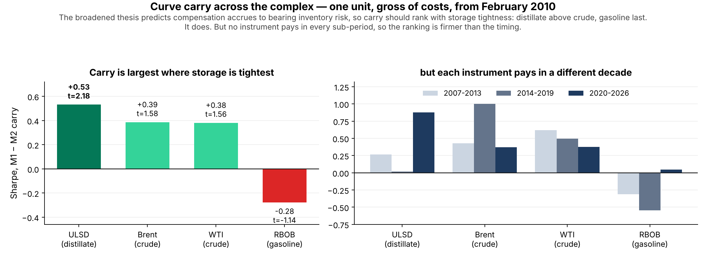

# The one-page version

We asked whether three oil spreads can be traded as mean-reverting pairs. The answer is no, and the tests say why with some precision. But "mean reversion failed" is the wrong conclusion to draw from them, for two reasons.

**First, the anchor is real; the harvesting rule was wrong.** HO − RB gives back 89% of a 1σ deviation over 126 days (p < 0.01). ULSD is the leg that corrects (VECM t = −3.18). The economics work. What fails is a 2σ-entry / 4σ-stop rule applied to a 90-day half-life that holds in only 1 rolling window in 7: the spread travels past the stop before it reverts, and stop-losses are the most common exit.

**Second, we tested one observable out of four.** A futures complex offers four things to bet on — the level of a spread, the shape of the curve, the persistence of moves, and the second moment. The project tested the level. The level turns out to be the one where the economics give you the weakest guarantee of being paid.

That is the broadening this note proposes. Not "reversion failed, try trend" — which is a rescue — but a restatement of where in the complex the compensation actually sits:

> **Original.** Physical arbitrage anchors the *level* of oil spreads, so deviations revert.
>
> **Restated.** In the oil complex, compensation accrues to bearing *inventory and capacity risk*. It is observable in the slope of the forward curve, it is largest in the product with the tightest storage, and the level of a spread is the weakest place to look for it.

The restated version makes predictions. One is already confirmed on data we have: carry ranks distillate (0.53, t = 2.18) above crude (0.39, 0.38) above gasoline (−0.28), exactly the order of storage tightness. Another — that carry concentrates in low-inventory regimes — is directly testable with the EIA inventory series already built in `data/clean/`, and has not been run.

# 1. What the tests support and rule out

Every row is from this repository. "Confirmed null" means the statistic and the economics agree, so the negative result is informative. "No power" means the test could not have detected the effect either way and the result carries no information.

## 1.1 Ruled out, and safely so

| Strategy | Evidence | Economic reading |
|---|---|---|
| **Daily directional forecasting** (AR/ARIMA on changes) | BIC selects AR(0) for six of seven series; best AIC model explains 2.2%; 0 of 280 lag tests survive multiple-testing correction | **Confirmed null.** These are among the most liquid futures in the world. A one-day pattern in a crack spread would be arbitraged intraday. We should *expect* this result, and getting it is a check that the pipeline works |
| **Seasonal / calendar-only trades** | SARIMA RMSE is 1.04× a random walk on the crack and 1.03× on HO − RB; significantly *worse* (DM p = 0.002) | **Confirmed null, and the most instructive one.** The seasonality is real and large — a $15/bbl peak-to-trough in HO − RB, Kruskal p < 0.001. It is also public, dated and in everyone's model, so the forward curve already prices it. A calendar is not an edge; it is a published schedule. Note SARIMA beats a *seasonal* naive easily (ratio 0.23–0.27) — it is beating the wrong benchmark that flatters it |
| **Cointegration-gated pairs** | Book Sharpe −0.19; five of seven pairs negative; Johansen rank 0 in 72% of rolling windows; hedge ratios range 0.33 to 1.49 | **Confirmed null.** A hedge ratio is only stable if the physical conversion is stable. Refinery yields, crude slates and export rules all moved over the sample, so there is no structural constant to estimate |
| **Brent − WTI mean reversion** | Net Sharpe −0.42, 9 trades, 0 of 3 sub-periods positive; no reversion at any horizon tested (p = 0.11 / 0.18 / 0.50) | **Confirmed null, with a clear cause.** Before 2015 this was a bounded arbitrage against a US export ban. After liberalisation it became a freight-and-pipeline cost variable, which trends with infrastructure rather than reverting to a mean. The 2007–13 rolling ADF passes in 0% of windows |

## 1.2 Rejected as implemented, but the property is there

| Strategy | Evidence | Reading |
|---|---|---|
| **HO − RB mean reversion** | Fails all five gates (Sharpe 0.065, 18 trades) — but reverts at every horizon (p < 0.01) and ULSD is the correcting leg (t = −3.18) | The statistical property is the strongest in the project. The *rule* cannot harvest it: median rolling half-life 89 days against a 3-half-life time stop and a 4σ hard stop, in a spread that reached z ≈ 6 in 2026. This is a design failure, not a hypothesis failure |
| **3-2-1 crack mean reversion** | Fails all gates (Sharpe 0.317, 18 trades, 2 of 3 sub-periods); reverts only at 126 days (p = 0.04) | Weaker version of the same story. A refiner's correction mechanism is cutting runs, which is slow and lumpy — turnarounds are scheduled months ahead and capacity is fixed in the short run. So the band is wide and the correction is slow by construction |

## 1.3 Supported

| Strategy | Evidence | Economic reading |
|---|---|---|
| **Volatility modelling for sizing** | ARCH-LM p < 0.001 on all seven series; α + β ≈ 0.99; Student-t ν 7–10; GARCH beats a constant window sd on QLIKE | **The strongest result in the project, by a distance.** Inventory and capacity constraints make shocks persist: a refinery outage or a closed strait takes weeks to resolve, so large moves follow large moves. This is not an edge — it is the risk layer, and it is the one finding that transfers to *any* strategy the book runs |
| **Curve carry** | ULSD 0.53 (t = 2.18), Brent 0.39, WTI 0.38, RBOB −0.28; stable across M1−M2, M1−M3, M1−M6; sleeve Sharpe 0.44 and passes four of five gates | **Best evidence of a premium.** See §2 for why the economics are stronger here than for reversion |
| **Time-series trend** | Sleeve Sharpe 0.29; no instrument has a TSMOM t above 2; every instrument changes sign across sub-periods; lookback sensitivity 0.05 → 0.29 → 0.47 | **Weak, and partly contaminated.** The back-adjusted crack and Brent − WTI levels carry a cumulative roll adjustment 2.5× the true range of the spread, so a "trend" signal on them is partly a carry bet. That is the likely source of the 0.42 correlation between the two sleeves |

## 1.4 Results that carry no information either way

These should be reported, but not used as evidence:

- **Variance ratios at q = 252.** 4,700 observations is 18.7 non-overlapping windows. Against a series with a true momentum Sharpe of 0.32, VR(252) rejects in 50% of simulated runs; at 0.16, in 25%. The non-significant VR p-values say nothing about whether trend exists.
- **The AR order on daily differences, as evidence about mean reversion.** BIC picks AR(0) in 97–100% of simulations where the level genuinely reverts with a 30–150 day half-life. The ARIMA(0,1,0) result is consistent with strong reversion and with none.
- **The logit regime filter.** AUC 0.51, Brier worse than the base rate, no feature significant. It is an off switch, not a forecast.

# 2. Why the premium is in the curve, not the level

This is the economic argument the restated thesis rests on, and it is the part the original hypothesis skipped.

**Mean reversion needs a bound. Carry needs a bearer.**

A mean-reversion trade is a bet that a *technological constraint* holds — that refining economics will not let the crack stay at $50 for long. Two things can go wrong, and both did:

- the constraint is slow (run cuts take months; the rolling half-lives are 71–108 days), and
- the constraint can move. In 2022 and 2026 the fair value itself shifted, so the deviation was not a deviation. The rolling ADF passes in only 5.5–16% of three-year windows; the level is not reliably anchored at all.

Crucially, nothing in that story says **anyone has a reason to pay you** for closing the gap. You are betting on a physical relationship, not collecting a transfer.

A carry trade is different. Backwardation means the front contract trades above the deferred: the market is paying for immediacy because inventories are tight and someone needs the barrel now. That is a transfer with a named counterparty — a refiner or consumer hedging supply risk — and it is the classical theory of storage (Kaldor 1939, Working 1949) and normal backwardation (Keynes, Hicks). The long futures position earns the roll because it is bearing the risk the hedger wants to shed.

This predicts something testable: **a premium paid *because of* scarcity should survive scarcity.** It does. Carry earned +$83k in 2022 and +$212k in 2026, the two years mean reversion lost most heavily. Mean reversion fails in exactly the regimes carry is paid for, which is not a coincidence — it is the same physical event seen from two sides.

And the cross-section agrees with the mechanism. If the premium compensates inventory risk, it should rank with storage tightness:

| Instrument | Storage economics | Carry Sharpe |
|---|---|---|
| ULSD (distillate) | Tightest. Heating and freight demand, thin stocks, the binding constraint in both 2022 and 2026 | **+0.53 (t = 2.18)** |
| Brent (crude) | Seaborne, floating storage available | +0.39 |
| WTI (crude) | Cushing tankage, historically ample | +0.38 |
| RBOB (gasoline) | Most abundant and most seasonal; blending grades change twice a year | **−0.28** |

That ordering was not fitted. It falls out of the data and matches what the mechanism predicts, which is the thing worth having before believing a backtest. Note also that ULSD carry is the *only* instrument in the entire project with a t-statistic above 2.

# 3. The restated thesis

> **In the oil complex, compensation accrues to bearing inventory and capacity risk, not to betting on the level of a spread. It is observable in the slope of the forward curve, it is largest in the product with the tightest storage, and it is paid most when physical stress is greatest.**

Three falsifiable predictions, with their current status:

| # | Prediction | Status |
|---|---|---|
| 1 | Carry outperforms spread reversion out of sample | Consistent so far (0.44 vs negative), but in-sample. **The 12-month paper trade is the real test** |
| 2 | Carry ranks with storage tightness: distillate > crude > gasoline | **Confirmed** on data not used to form the prediction's ordering: 0.53 / 0.39 / 0.38 / −0.28 |
| 3 | Carry returns concentrate when inventories are low relative to the 5-year band | **Not yet tested.** `inventory_dev_5y` is already built in `data/clean/`. This is the single most informative next run |

Prediction 3 is the one that would turn a statistical regularity into an economic claim. If carry pays when stocks are tight and not otherwise, the premium has a mechanism and a conditioning variable. If it pays uniformly regardless of inventory, it is just a trend signal with a different name, and the thesis is wrong.

## 3.1 Should the thesis be broadened? Yes, with one discipline

**For.** The original hypothesis was under-specified in a way that is now visible: it named three instruments and one observable. The economics of a storable commodity do not say "the level reverts"; they say "physical constraints create compensated risk transfer". Concluding "no edge in oil spreads" from a test of the level alone over-generalises from a narrow experiment.

**Against.** Broadening after a failure is precisely how multiple testing enters a project. Seven strategy streams have already been through the gates, across an entry grid, a cost sweep, three window lengths and three label horizons. A best-of-seven Sharpe of 0.45 is close to what chance delivers.

**The discipline that resolves it.** Broaden the *hypothesis* now, in writing, and pre-register the *test* before looking at any more results. State the stream count in the report so a reader can discount accordingly. And set a stopping rule in advance — this is the honest alternative to testing families until one passes:

> No further strategy family will be added to this project. The restated thesis is judged on predictions 1 and 3, on data not used to form it.

# 4. What we would and would not trade

| | Verdict | Why |
|---|---|---|
| Curve carry, crude and distillate | **Paper trade** | Best evidence, a named economic bearer, cross-section matches the mechanism. Still only t = 1.8 on the sleeve |
| Volatility-scaled sizing | **Use everywhere** | Strongest statistical result; it is risk management, not an edge |
| Time-series trend | **Paper trade at half weight, or drop** | Fragile across lookbacks and sub-periods, 39% of gross lost to costs, and partly a carry bet in disguise through the roll yield |
| HO − RB reversion | **Do not trade the current rule. Worth one re-specification** | The property is real but the horizon is wrong. A rule matched to a 90-day half-life — longer holds, wider stops, or trading the diesel crack's curve instead of the spread level — is a legitimate separate registration |
| Crack and Brent − WTI reversion | **Drop** | Crack is weak and slow; Brent − WTI shows no reversion at any horizon and lost in every sub-period |
| Daily AR, SARIMA, calendar trades | **Drop permanently** | Confirmed nulls with economic reasons. No re-specification will help |
| Cointegration pairs | **Drop** | The hedge ratio is not a structural constant |

# 5. How to present this

The current deck runs nine tests, shortlists, backtests, then recommends. The reader waits thirteen slides for a result and then meets trend and carry with no motivation. Reordering around the argument above fixes both.

| Section | Content | Why here |
|---|---|---|
| 1. Question and answer | The complex, the question, the recommendation, and the fact that this is a two-phase study: a registered hypothesis that was rejected, then a registered follow-up | Say the real sequence out loud on slide 3. Buried in a footnote it reads as something you hoped nobody would notice; stated up front it is a documented audit of a rejected hypothesis, which is a strength |
| 2. The hypothesis and how we tested it | Physical arbitrage anchors the level. Compress the nine steps to five slides: data and rolls; stationarity and cointegration; near-white-noise with its power caveat; GARCH; VECM and half-lives. Full tables to an appendix | The tests are plumbing for one hypothesis. Thirteen slides implies they are the contribution |
| 3. Verdict: rejected, and exactly why | Gates, then the per-spread diagnosis from §1.2 and §1.3 — slow anchor, moving band, rule mismatched to the half-life | A specific cause of death is worth far more than "it failed" |
| 4. What the rejection taught us | The four observables; why the level is the weakest; mean reversion needs a bound, carry needs a bearer | **The pivot slide.** Without it the rest looks like a rescue |
| 5. The restated thesis and its predictions | §3, including the three predictions and their status | Turns a post-hoc search into a hypothesis with consequences |
| 6. Evidence | Carry cross-section figure, trend fragility, GARCH; each with its economic bearer | Evidence now arrives in service of a stated claim |
| 7. Decision | Paper trade, go-live criteria, the stopping rule, the stream count | |

Two principles worth holding to throughout:

**Pair every statistic with its mechanism, or drop it.** The tables in §1 have an "economic reading" column for a reason: a number with no mechanism is a data-mining result, and a mechanism with no number is a story. The slides that land are the ones where both agree — the carry cross-section is the example.

**Distinguish a confirmed null from no power.** Both appear as "not significant" and they mean opposite things. The deck currently presents the variance ratios as weak evidence when they are no evidence, and the AR(0) result as a finding about mean reversion when it cannot be one. One extra column — what the test could have detected — fixes it and shows the examiner you know the difference.

# 6. Caveats

- Everything in §1 and §2 is in-sample on 2007–2026. The cross-sectional carry ordering in §2 is suggestive, not confirmatory: it uses the same sample as everything else, and four instruments is a very small cross-section.
- The restated thesis was formed after seeing these results. It is a hypothesis, not a finding. Only predictions 1 and 3, tested on new data, can give it standing.
- ULSD carry's full-sample Sharpe is concentrated in 2020–26 (0.88, against 0.02 in 2014–19). The sub-period chart shows no carry instrument pays in every decade, so the *ranking* is firmer than the *timing*.
- Nothing here corrects for multiple testing across the seven streams or the four instruments.
- Adding ULSD to the carry sleeve on the strength of this note would be exactly the overfitting the pre-registration exists to prevent. It needs its own dated registration.

# Related

- `report/report.md` — the registered mean-reversion study
- `report/exploratory_trend_carry.md` — the registered trend and carry follow-up
- `report/exploratory_horizon_tests.md` — the horizon-matched tests and power audits behind §1
- `scripts/run_horizon_tests.py`, `src/oilrv/horizon.py` — code
